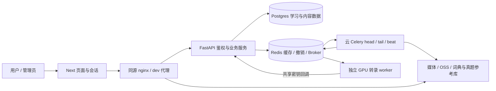

# SeeWord 全面审计与持续优化方案

审计日期：2026-10-29（America/Los_Angeles）。基线：`redesign`，`c7db49d3d3d0c32250bc65b6b82019365812aafc`，开始时工作树干净。用户已明确首要目标为**学习体验与用户留存**。

本次交付是审计与优化规划，应用实现、依赖锁、迁移、检查器和基线均未修改；没有提交、部署或访问生产。执行检查产生的报告与复现脚本保存在本目录。一次性本机数据库尝试及清理单独记录在验证清单中。

## 1. 决策结论

项目已具备视频学习、词汇积累与复习、听写、真题练习、内容运营的完整基础。当前最值得投入的是**减少学习中断、保证学习记录可信、建立可解释的留存验证**。现有代码没有支持“用户留存已经低”“页面已经慢”“某功能无人使用”的实测证据，不能据此直接删功能或重写架构。

应先修复交付阻塞和高影响可靠性缺口，再分批改善核心闭环。已复现的问题包括：短句循环可能不计学习时间、翻页失败重试漏页、个人本周时长混入历史累计、转录回调在落库后入队失败会丢失后半段、试卷并发提交重复答案、refresh token 并发轮换可同时成功。依赖扫描命中高危公告，CI 测试密钥与当前配置校验冲突，默认Turbopack构建也失败。这些问题使后续体验优化难以可靠交付或评估。

本轮没有证实当前部署存在可直接利用的 RCE、用户越权、生产数据泄漏或生产停机。依赖公告级别、源码可达性与真实线上状态在报告中分别标注。

详细证据按职责保留一份：[前端/产品/体验](frontend.md)、[后端/API/数据/安全](backend.md)、[运维/依赖/交付](ops.md)、[指标专项](metrics.md)。执行入口是[优化任务表与验收](execution-plan.md)，命令结果集中在[验证记录](verification.md)。历史审计用于定位，未把历史已修项重复认定为缺陷。

本轮验证摘要：后端全量1406通过/14项PG集成跳过；前端312项单测与静态门禁通过；Ruff/格式及mypy现有基线门通过；cloud依赖解析审计通过。默认Turbopack构建和npm运行依赖审计失败，Webpack对照构建通过；完整视觉、实库并发、真实GPU与生产验收未执行。详细环境与失败证据见验证记录，不能用正常路径测试通过来否定已复现的故障边界。

## 2. 已核对的项目现状

| 层 | 当前代码与配置确认的内容 | 验证边界 |
| --- | --- | --- |
| 产品 | SeeWord：真实视频逐词学习；词汇训练/间隔复习、原句收藏/笔记、逐句听写、阅读真题、续学与记录；管理员负责内容供给 | 功能存在由路由、组件、服务和测试确认；真实使用率未取生产数据 |
| 前端 | Next 16.3.7 App Router、React 19.2.7、Tailwind 4、Zustand；用户/后台双壳、独立会话；自建 API 客户端处理刷新、去重、GET 重试/缓存 | 锁文件版本；门禁/单测本轮运行，视觉与整链路结果见验证记录 |
| 后端 | FastAPI、SQLAlchemy async、Alembic、Celery；统一错误 envelope；鉴权依赖服务 Bearer/媒体/PDF/WS；首页编辑内容有草稿/不可变版本/发布边界 | 路由、服务、配置、模型与隔离测试 |
| 数据 | Postgres 16；46 个带 `__tablename__` 的模型定义、84 个迁移文件；词典/真题参考库与媒体/OSS独立于主库 | 数量为静态规模，不能代替实际 schema 与索引执行计划 |
| 异步管线 | 云端 head → Redis GPU 队列 → 独立 GPU worker → 内部回调 → 云端 tail；有质量门、超时巡检和重试工具 | 云端与 GPU 不应按单进程理解；真实 GPU 质量/吞吐本轮未运行 |
| 测试 | 119 个后端 test 文件、28 个前端 unit 文件、45 个 E2E spec、5 个 GPU test 文件 | 文件数不是覆盖率；测试状态只认本轮命令 |
| 部署 | 单机 Compose + nginx；DB、Redis、API、云 worker/beat、前端；GPU 另机，通过 broker/回调连接 | 仓库配置不代表线上所有额外覆盖配置 |
| 协作 | 根/前后端 `CLAUDE.md` 为规则源，根 `AGENTS.md` 只作入口；有设计/会话静态门、mypy baseline、依赖审计、schema drift、CI与生产 smoke脚本 | 不新增另一套规则源；不扩大基线或豁免 |

静态盘点还包含 48 个前端 `page.tsx`、31 个 v1 API 模块、229 个路由装饰器（包括兼容入口与媒体路由，不能理解成229项用户功能）。盘点脚本和口径见 [inventory.json](evidence/inventory.json)。

## 3. 十个审计方向的判断

| 方向 | 已有基础 | 现存问题或证据缺口 | 优化重点 |
| --- | --- | --- | --- |
| 1 产品与需求 | 视频学习、词汇与专项练习可独立使用；已有续学与来源回看 | 未建立基于真实用户的激活/回访基线；免费访问与会员文案不一致 | 优先减少核心任务失败；开展任务型用户研究，再决定入口调整 |
| 2 UI/UX与视觉 | 语义 token、用户作用域样式、PageHeader、公共状态组件、焦点处理与主导航 | 翻页重试漏页；临时刷新故障可登出；本轮视觉/触控/读屏未完整验证 | 验证390/1440、暗色、短视口、缩放、键盘及错误恢复；不凭历史图再做全站改版 |
| 3 架构/API/模型 | 模块化单体 + 独立GPU边界清楚；统一错误、响应契约和可见性过滤 | DB提交与队列投递跨系统缺少可靠衔接；学习聚合口径分裂；GPU broker授权边界不足 | 事务 outbox/可恢复投递、统一学习读模型、服务端权限隔离 |
| 4 代码与技术债 | 分层服务、现有不变量与静态门有效 | watch页面/播放器、管线和编排服务职责集中；少量契约重复 | 在修真实缺陷时提取计时/播放状态/保存职责；保留对外契约，按变更风险拆分 |
| 5 正确性/测试 | 单测、集成测试、E2E和生产smoke均有基础 | 已复现状态机、刷新/试卷并发与统计错误；CI自身配置失配；默认构建失败而Webpack对照通过；跨浏览器/生产路径未自动完整执行 | 增加边界与故障注入回归；测试失败与环境未执行分开记 |
| 6 性能与资源 | 请求去重、缓存、索引、DB连接池与异步任务已存在 | 无可信生产 RUM/包体积/接口与查询分位数基线；部分读模型全量读历史；事件量增长无容量证据 | 先测量客户端体验、慢查询和队列年龄，再按瓶颈优化，不预先引入分布式改造 |
| 7 认证/权限/安全 | 统一token校验、封禁/改密失效、管理员权限与媒体所有权校验 | 依赖硬门失败；refresh轮换非原子；撤销状态恢复与GPU权限隔离有缺口；导出清理不完整 | 受控升级、原子轮换、最小权限、完整数据生命周期清单 |
| 8 部署/监控/恢复 | Compose、迁移单一所有者、健康接口、日志、备份步骤与回滚镜像 | 迁移失败返回成功；标准Compose未透传站外告警配置；Redis与备份恢复契约不足 | 发布阻断、独立告警、恢复演练与破坏性迁移处理，区分应用回滚和数据恢复 |
| 9 业务指标 | BehaviorEvent、LearningEvent、管理统计、学习档案已经存在 | 计时失真、历史DAU可被回写、所谓漏斗非同一cohort；缺少闭环版本化事件与留存分析 | 先修数据定义、再建激活/D1/D7与学习效果观察；不拿有效Pro人数当付费转化 |
| 10 流程/文档/AI | 规则事实源清楚、门禁入CI、历史审计可追踪 | CI短密钥、mypy工具故障可假通过、GPU依赖治理缺口、发布假设与破坏性迁移不符 | 修执行机制；每任务记录证据/负责人/复核日；规则仍只在现有CLAUDE文件维护 |

## 4. 产品定位与功能取舍

建议继续使用当前定位：**帮助用户把真实英语内容转成能够理解、保存和再次练习的学习材料**。直接体验目标是：能找到合适内容，顺利完成一次短学习；离开后有可信记录；回来能接着学或复习留下的词句。

核心路径应分别验收：

1. 首次学习：进入内容 → 播放原句 → 点词理解 → 保存词/句 → 看见明确结果。
2. 回访续学：首页/历史 → 定位上次内容或原句 → 恢复播放 → 记录本次有效学习。
3. 复习：找到到期词 → 完成一轮 → 看结果/来源 → 需要时回到原声。
4. 专项：听写或真题 → 草稿恢复 → 提交 → 解析/错题 → 再练。用户不必先看视频。

“跟读、成就、热力图、周报、复杂每日计划”已有明确退役决策；410接口和重定向是兼容契约，不作为应恢复的功能。当前没有使用证据支持删除听写或真题，也没有证据支持添加社区、积分、竞争榜或新推荐算法。重复入口是否有害，需通过找到任务的成功率、点击路径和用户访谈判断。

会员页面的真实性应修正，但新增付费墙、收费增长、价格实验不进入本轮主目标。先对齐实际免费期、购买增量与存量权益，不用改变免费访问门来让文案成立。

## 5. 优先级与投入原则

- **P0**：已证实正在发生、需立即控制的不可接受损害；本轮没有此级结论。若后续验证发现可达严重漏洞或生产数据持续损坏，应升级处理。
- **P1**：阻碍安全交付、破坏学习记录/会话/任务完整性，或关键恢复能力缺失；应进入近期排期，是否作为发布阻断按该发布触及范围决定。
- **P2**：体验中断、数据洞察与可维护性改进；按影响和依赖进入后续迭代。不能因人数少就忽略已复现的核心故障。

排序首先看学习任务损害与交付风险，再看可达性、覆盖用户范围、复现置信度、修复代价和依赖。没有采用缺乏样本的精确打分，也不承诺尚未测量的留存提升百分比。

## 6. 建议执行节奏

按 **1 名主工程师 + 兼职设计/测试/运维评审**估算，核心A01–A13约24–44工程日，另留20%–30%联调交付余量；分批约需6–12个工程周。首轮只承诺约12–14工程日容量。数据基线至少观察2周、D7需等待cohort成熟，不能用增加工程人手消除日历等待。这是范围估算，不是交付承诺；任务表给出逐项投入，进入迭代前再结合实际负责人和环境条件拆分。

| 阶段 | 目标与主要任务 | 出口条件 |
| --- | --- | --- |
| 0：先恢复交付 | 修CI短密钥、mypy执行失败识别、迁移失败退出；受控升级依赖，诊断默认构建，建立隔离验收环境 | 现有门禁能真实执行；依赖无未处理公告；失败迁移阻断切换 |
| 1：首轮核心体验 | 学习计时与个人聚合、翻页/会话恢复、关键恢复闭环；涉及管线/试卷的版本同时修其并发与派发问题 | 核心学习数据和恢复行为符合任务表验收；不能用单测数量替代闭环验收 |
| 2：分批补可靠性 | Redis恢复、GPU服务端权限、告警、完整备份恢复与导出清理；补发布/移动关键回归 | 能恢复、能发现失败、权限负测通过；关键用户数据清单与实现相符 |
| 3：测量与研究 | 建立事件版本、激活/D1/D7 cohort、性能基线；完成核心任务的桌面/手机与可访问性走查 | 连续两周数据质量可用；有真实用户任务记录与可重复性能数据 |
| 4：以效果选优化 | 每次只验证一项体验假设；按证据优化续学入口、首次引导或复习发现；择需拆分高耦合模块 | 预先定义的体验/留存指标与护栏得到评估，记录继续/修改/撤回决定 |

安全与数据损害修复不等待留存实验；展示调整与增长假设必须经过效果验证。生产操作、账号访问、数据修复和不可逆清理需在后续实施任务中明确目标与退路，本次仅形成可评审方案。

## 7. 保留的不确定性

未核验生产实际部署版本、额外Compose覆盖、告警订阅、定时备份、SSH受限key、CDN缓存和日志落地；未读取真实用户cohort、收入、留存、设备分布或用户访谈；未获得真实GPU识别质量与处理成本、生产查询执行计划、生产页面性能。它们是下一轮的取证任务，不是“均已缺失/均已失败”的结论。

本轮本机DB/Redis未运行、浏览器二进制缺失及ego加载无响应限制了完整视觉与真实端到端验收；Chromium单次补装因DNS失败，未继续重试。最终状态见[验证记录](verification.md)。已有历史截图和过去的通过记录不替代本次结果。
