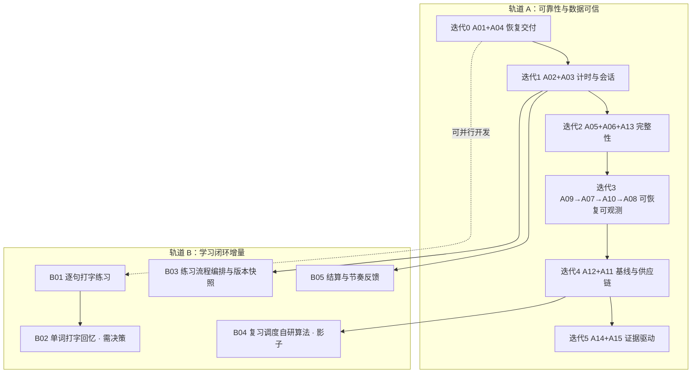

# SeeWord 开发计划（2026-10-29 起）

这份文件把「审计发现的修复任务」与「学习闭环的产品增量」排成一条可执行的路线。它是唯一排期入口；
任务定义、证据和关闭条件仍以 [`comprehensive-audit-2026-10-29/execution-plan.md`](comprehensive-audit-2026-10-29/execution-plan.md) 为家，
本文件不复制发现细节，只回答「先后顺序、每批交付什么、什么条件下才能往下走」。

- 输入：审计目录的 `README.md`（优先级原则）、`execution-plan.md`（A01–A15 任务表）、`frontend.md` / `backend.md` / `ops.md` / `metrics.md`（证据），以及参考产品 [TypeWords](https://github.com/zyronon/TypeWords)。
- 时间口径：**工程日**（1 主工程师 ≈ 5 工程日/周），另有兼职设计／测试／运维评审。日历周是粗略换算，不是承诺。
- 状态（2026-10-29 晚）：迭代 0–2 已实施并合入 `redesign`，逐项证据见 §3 的状态列；迭代 3 起未开始。审计已复现不等于已修复——以各任务的验收用例和真实执行记录为准，不以本文件的「已完成」代替。

## 1 三条排序原则

1. **先让交付可信，再谈体验。** 门禁假绿、迁移假成功、依赖硬门失败时，后面所有体验改动都无法判断是否真的上线成功。这是迭代 0 的全部内容。
2. **数据不可信时不做展示类优化。** 学习时长与周统计（FE-02 / BE-06 / MET-01）修好之前，任何「本周学了 X 分钟」「连续 X 天」的新展示都是在放大错误。轨道 B 中依赖这些数字的项因此被排在其后。
3. **体验改动可以早写，不能早放量。** 代码可以并行开发，但进入默认入口、对用户可见，要等 A12 的两周基线建立。没有基线就没有「有没有变好」的判断能力。

## 2 两条轨道与依赖

轨道 B 的每一项都必须写明「依赖哪个 A 项才能宣称有效」，不允许用「感觉更好」作为关闭证据。

## 3 迭代排期

容量按 WIP≤2、每迭代留 20%–30% 联调余量估算。人日区间直接取审计任务表，未重新估算。

| 迭代 | 时间 | 范围 | 工程日 | 出口条件（简版，完整见任务表） | 状态 |
| --- | --- | --- | --- | --- | --- |
| 0 恢复交付 | 第 1 周 | A01、A04 | 2.5–5 | 门禁在 CI 原样环境真实执行；迁移失败非零；`npm audit --omit=dev` 无未处理公告；默认 build 有确定结论；列表失败后重试同一页 | 已完成（2026-10-29，`6f3da310`/`186d9738`/`08ddc186`） |
| 1 计时与会话 | 第 2–3 周 | A02、A03 | 5–9 | 拖动不加时、短会话保留尾段、循环/倍速按定义计时；同一旧 refresh 最多铸一条后继 | 已完成（2026-10-29，`76e5a7dd`） |
| 2 完整性 | 第 4–5 周 | A05、A06、A13 | 3.5–8 | 管线派发最终收敛且不重复；两次并发提交只产生一套答案一次事件；72/73 字节密码行为一致 | A06 已完成（`47dd51d6`）；A05、A13 已完成（2026-10-29） |
| 3 可恢复 | 第 6–8 周 | A09 → A07 → A10 → A08 | 8–14 | 站外告警可达；Redis 有命名卷与允许损失窗口；GPU 身份越权操作被服务端拒绝；导出含全部活跃数据、注销清理旧媒体 | 未开始 |
| 4 测量 | 第 9–11 周 | A12、A11 | 5–8 | 事件带版本且有去重与缺失率；激活/D1/D7 分母固定；生产构建与移动闭环进 CI；GPU 有独立依赖审计 | 未开始 |
| 5 按证据优化 | 第 12 周起 | A14、A15、轨道 B 放量 | 每轮 2–4 | 每轮只验证一项假设，预先写主指标/护栏/撤回条件 | 未开始 |

**为什么 A04 放进迭代 0**：它 0.5–1 日、与 A01 无文件冲突、修的是用户可见的「漏页」，且不依赖任何其他任务。这是唯一允许插进「恢复交付」的前端体验修复。

**为什么 A05 / A06 不在迭代 0**：它们是确定的数据完整性问题，但审计的约束是「若当前发版触及转录管线或试卷提交，必须进入该版本范围」。是否阻断发布由下表的决策项决定，不是固定排期能替代的。

### 迭代 2 的实施记录（2026-10-29）

- **A05**：新增 `pipeline_dispatches` outbox（迁移 `d5e6f7a8b9c0`）与 beat `dispatch_pipeline_tasks`（60 秒）。回调、head 续跑、GPU 转写三处派发改为「意图与状态同事务落库 → 提交 → 立即派发」，失败留在 pending 由扫描补发；看门狗不再把「有意待在派发中的视频」判死，积压超阈值/超时长时告警。确定性故障注入已覆盖：broker 抛错、提交后未派发、重复回调、重复扫描、视频状态已推进、看门狗豁免；本地 PostgreSQL 上迁移 `upgrade`/`downgrade` 往返通过。**未执行**：真实 Redis/broker 停机演练、积压告警的站外投递（依赖 A09 的告警链路）。
- **A13**：密码契约统一为「最多 72 个 UTF-8 字节」（schema 422、`hash_password` 不截断、历史 hash 按前 72 字节仍可验证）；`plan_expires_at` 为空的语义定为无效并统一前后端与后台 KPI；购买页按 D1/D7 改写为「内测期全站免费 + 购买是支持开发」。**未执行**：浏览器走查免费/付费/过期三类账号的文案对照（本机 Playwright 浏览器仍不可用），以及生产 `JINSHUJU_ENABLED` 实际状态核对。

## 4 轨道 B：学习闭环产品增量（TypeWords 参考）

### B00 借鉴边界（先于一切）

**对 TypeWords 只取设计思路；算法与代码全部重新设计、自行实现。**

TypeWords 是 **GPL-3.0**，本仓库 `LICENSE` 是**专有、保留所有权利**，许可证不兼容——这是「不能复制」的硬约束。但即使不考虑许可证，移植也不是好选择：它的状态管理、缓存协议与同步冲突处理都是为「纯本地、可离线、多变体」设计的，与本项目的服务端权威模型不同构，改造成本高于重写。

- **可以借鉴**：练习模式的产品结构、流程编排的抽象方式、交互与信息层级、统计口径的思路——即「对外可观察的行为」。
- **不可以复制**：源码、算法实现、数据结构、词表与内置教材、课程内容、i18n 文案、图标与素材。
- **算法同理**：不逐条翻译 FSRS 的公式，也不引入该实现，见 B04。
- 每一项借鉴都要能回答：在 SeeWord 现有的数据模型与契约里，我们自己的做法是什么、为什么这样拆。

TypeWords 值得参考的核心是：**它把「背单词」做成有明确步骤、可编排、可续上的流程，而不是一个答题页面。** 它的 `BUILTIN_FLOWS` 把一次学习拆成 `followWrite → listen → dictation` 这样的步骤序列，带 `CURRENT_FLOW_VERSION` 和会话快照；单词练习分 10 种模式（System / Free / IdentifyOnly / DictationOnly / ListenOnly / Shuffle / Review / Custom 等），由 5 个步骤模板（跟写 / 拼写 / 听写 / 默写 / 自测）组合而成；文章侧则是逐句跟打、自动发音、边听边默写。调度用 `ts-fsrs`，评分由「本轮错次」映射到 Easy/Good/Hard/Again。

### B01 逐句打字练习（听写升级）

| 项 | 内容 |
| --- | --- |
| 现状 | 已有逐句听写（`/practice/listening`，服务端冻结题面、服务端判分、逐词 diff）。`lib/drillQuestions.ts` 明确写明**拼写型题在 S5 设计中已退役**，单词侧只剩选择题。 |
| TypeWords 做法 | 文章练习以句子为单位跟打，逐句自动发音，可切换「看原文跟打 / 听音默写」 |
| SeeWord 落点 | 复用 listening 的会话冻结与判分链路，把「选择题」扩展为「输入题」；句子来源仍是 12–220 字符的合格字幕句，天然与视频内容绑定，不需要新语料 |
| 为什么先做这个 | 它是现有链路的能力扩展，不是新模块：题面冻结、草稿保存、提交幂等、逐词 diff 都已存在，新增面主要是输入组件与移动端键盘 |
| 前置 | 无（可与迭代 0–1 并行开发）；但**不得**在 A12 基线建立前把它设为主线入口 |
| 主要风险 | 手机输入法 / 中文 IME 干扰、拼写差异的判分容错（大小写、标点、连字符、美英拼写）必须在服务端定义，不能前端「差不多就行」 |
| 验收 | 同一句在桌面与 390 宽度可完成输入；草稿可恢复；提交后结果不可改；判分归一化规则有单测；离页与重试不重复计数 |

### B02 单词打字回忆 —— 需先决策，不默认排期

| 项 | 内容 |
| --- | --- |
| 现状 | 单词训练是「认词 / 巩固 / 听音选词」三型选择题 + 连对两次毕业（DEC-053），复习按错误次数分档（DEC-057）。拼写型被显式标注为退役。 |
| TypeWords 做法 | 以输入为唯一作答方式（跟写 / 拼写 / 听写 / 默写），选择题只作为 `identify` 一种自测步骤 |
| 关键冲突 | 引入打字回忆等于**逆转一条已生效的产品决策**（拼写型退役）。本计划不替产品做这个决定，只把条件和代价摆出来 |
| 若要做的最小路径 | 先做「一个词单、一个模式」的受限实验：同一批词，一半选择题一半打字，比较正确率与失访，不改变默认入口；用 A12 的事件底座衡量 |
| 前置 | 决策通过 + A12 基线 + 移动端输入可用性验证 |
| 验收 | 预先定义主指标与护栏；实验组与对照组分母固定；无论结果如何都记录「继续 / 调整 / 撤回」 |

### B03 练习流程编排与版本快照

| 项 | 内容 |
| --- | --- |
| 现状 | 训练流程硬编码在页面里（`drill/page.tsx` 注释明确写了「新词反复出题、连对两次毕业、复习词追加队尾」），流程变化只能改代码 |
| TypeWords 做法 | `BUILTIN_FLOWS` + 步骤模板 + `CURRENT_FLOW_VERSION`，会话里存 `flowId` 与快照，流程升级不影响进行中的会话 |
| SeeWord 落点 | 不是造一套 DSL，而是把「本轮怎么出题」抽成带版本号的配置对象，服务端随 `study_sessions` 落一份快照。这与 A02 要求的事件版本、A12 要求的事件契约是同一套语言，一起设计成本最低 |
| 前置 | A02（版本化定义与生效日） |
| 验收 | 改流程不使已开轮的会话失效；旧版本快照可读；同一用户跨版本事件能区分 |

### B04 重新设计复习调度算法（自研，不移植）

| 项 | 内容 |
| --- | --- |
| 现状 | `sr_service.calculate_review_interval` 是自研分档（答错→次日；模糊→2 天；全对 3→7→16→35，有错 2→5→12→25，错 3 次封顶 7 天），另有冻结的 SM-2 供旧路径使用。分档只吃「累计错次 + 当前间隔」，不看「隔了多久后答对」——相隔 2 天和相隔 30 天后答对，对记忆的含义完全不同，现在记成同一件事 |
| TypeWords 做法 | 用 `ts-fsrs`，评分由本轮错次映射到 Easy/Good/Hard/Again，参数可配 |
| 只借哪部分思路 | 借**评分粒度与它在流程里的位置**（每次作答 → 一个离散评分 → 更新调度状态），不借公式、参数与代码 |
| 我们的重新设计 | 先定状态量再定更新规则。每个词维护三个量：**稳定度**（预计还能记住的天数）、**难度**（这个词对该用户的固有难度）、**可提取性**（距上次复习的实际间隔）。作答时按对错、作答用时、是否在提示下才答对给出评分；按公开的间隔重复原理设计更新规则——间隔越长回忆越难、难度越高稳定度增长越慢、答错时稳定度回落但不归零。参数用本项目自己的作答序列拟合，公式和常量由我们定义并留版本号 |
| 迁移策略 | **不切换，只影子计算。** 新算法在相同作答序列上并行运行，落库比对「建议间隔」与「每日到期词量」，满 4 周再决策。现有 `wrong_count` 是单调累计，直接换算法会让历史词跳到无依据的位置 |
| 前置 | A02 修好计时与事件去重（否则对照的输入本身是脏的）；B03 的评分字段先落地 |
| 验收 | 影子结果不影响线上调度；对照有可复跑脚本与固定的作答序列样本；**评价口径事先写死**（到期复习完成率、同一词延迟复测正确率、每日复习量护栏），不能事后挑指标；决策记录写明切换或不切换的依据 |

> 自研算法的风险要说在前面：它的正确性不来自「看起来更科学」，只来自影子期的实测对照。写不出固定的样本与口径，就等于没有对照组，那就继续用 DEC-057 分档。

### B05 结算反馈与本周节奏

| 项 | 内容 |
| --- | --- |
| 现状 | 已有训练结算（`TrainSummary`）与学习记录，但个人周统计口径与后台不一致（BE-06 / MET-01），此刻做「本周节奏」展示会展示错数字 |
| TypeWords 做法 | 结算弹窗展示本轮结果，另有本周打卡日历与总进度 |
| SeeWord 落点 | 复用已有结算弹窗，补「本轮/本周」的**同口径**说明；不做新的打卡体系，避免与现有 streak 重复计数 |
| 前置 | A02 + BE-06 修好，且展示口径与后台接口一致 |
| 验收 | 同一用户同一天，个人页与后台统计数字一致；跨日/跨周重复观看不移动旧日期 |

## 5 必须由负责人拍板的决策

这些是审计明确标为「待决定」的事，排期前必须有结论，否则会在实施中途反复。

| # | 决策 | 影响的任务 | 结论（2026-10-29） |
| --- | --- | --- | --- |
| D1 | 内测免费期的边界与购买页承诺（FE-03）；是否暂停购买 | A13 | **已决**：内测期全站免费、购买定位为「支持开发」。购买页明确写出「现在免费用什么」与「付款买到什么（会员身份 + 到期日）」，不新增付费墙、不暂停购买（`JINSHUJU_ENABLED` 未改）。 |
| D2 | refresh 并发风险预算：A03 按 P1 立即修，还是显式接受为近期 P2 | A03 | **已决并实施**：按 P1 修（原子认领旧 refresh，见迭代 1）。 |
| D3 | 拼写型题目是否解除退役（B02） | B02 | 未决；B02 不排期。 |
| D4 | 复习调度是否切换为自研算法（B04） | B04 | 未决；B04 保持影子期前提。 |
| D5 | 当前发版是否触及转录管线 / 试卷提交 | A05、A06 | **已决并实施**：两项都作为 P1 修复（A06 先行，A05 见迭代 2），不依赖发版窗口判断。 |
| D6 | 是否接受 A07/A10 这类基础设施改造先做隔离环境验证再放量 | A07、A10 | 未决；迭代 3 开工前定。 |
| D7 | `plan='pro'` 但 `plan_expires_at` 为空算不算有效会员（FE-04） | A13 | **已决**：视为无效/缺失数据。前端 `isProUser`、`GET /payments/status`、`unlock_service.is_active_pro` 与后台 KPI 统一为「`plan == pro` 且到期时间晚于当前时间」；空到期计入后台的已失效计数。 |

## 6 明确不做

- 不恢复跟读、成就、热力图、周报、每日计划——410 与重定向是兼容契约，不是待补功能。
- 不因本轮审计新增社区、积分、排行榜、新推荐算法：没有证据支持。
- 不新增付费墙、不做价格实验；先让现有文案与现实一致（D1）。
- 不在正确性未稳时做架构重写、换框架、拆目录以「减少行数」为目标。A15 的拆分只在 A02/A05 建立行为回归之后按业务边界逐片进行。
- 不为让门禁变绿而放宽 `.mypy-baseline`、`.pip-audit-ignore`、`check-design-system.mjs`，也不新增豁免。
- 不复制 TypeWords 的源码、算法实现、词表与课程内容；借鉴只到设计思路为止（见 B00）。

## 7 度量、日历等待与风险

**不能靠加人消除的等待：**

- 行为基线至少 2 周；D7 回访要等 cohort 成熟。指标定义见 [`metrics.md`](comprehensive-audit-2026-10-29/metrics.md)，本文件不重定义。
- A09 的恢复演练需要一次真实演练窗口，不能只在代码里「看起来能恢复」。

**本轮审计未执行、实施前必须补上的环境：**

- 隔离 PostgreSQL（当前 14 个 PG 集成用例被跳过）——A06、A05 的验收依赖它。
- 可用浏览器（Playwright Chromium 未安装成功）——A11 与所有视觉/移动验收依赖它。
- 独立 GPU 测试环境（`gpu-worker/.venv` 在本机不存在）——A11 的 GPU 供应链验收依赖它。
- 生产实际覆盖配置、备份、告警订阅——A09 之前必须取得，不能假设。

**已知估算不确定项：** 默认 Turbopack 构建失败的根因未明（FE-08），A01 可能重估；生产依赖集合与构建根因都可能改变工期。

## 8 执行节奏

- 每个任务开工前用 `execution-plan.md` §3 的工作卡起单，关闭证据是行为、持久副作用、恢复与观测，不是 HTTP 200 或截图。
- 回归矩阵按 `execution-plan.md` §4 执行；环境跑不了的检查写「未执行 + 原因 + 补验证人」，不写通过。
- 每周 30 分钟：只看新增证据、当前 WIP、P1 接受项复核、下周容量。
- 每两周一次体验评估：对比激活/回访与护栏，标事件版本与样本量。
- 每完成一个迭代，更新本文件的迭代表状态，而不是在别处再开一份进度表。
- 审计目录是有日期的快照；下一轮先重验再更新结论，不把旧结论当永久事实。
