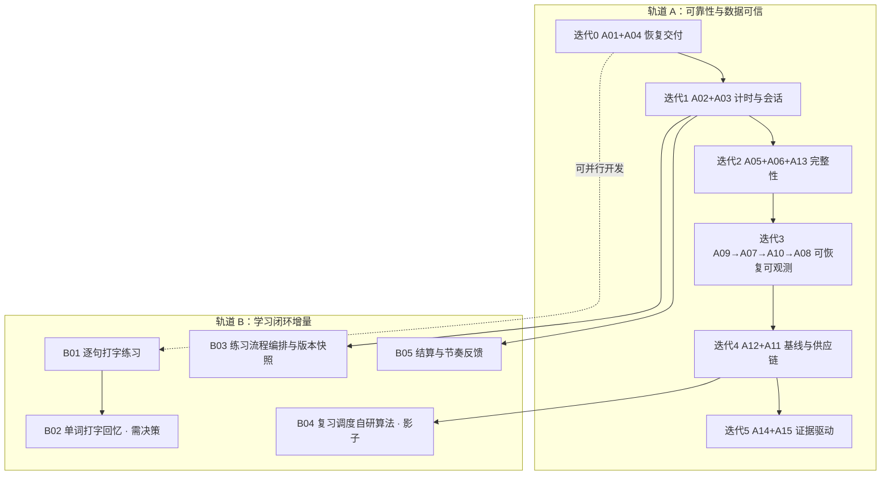

# SeeWord 开发计划（2026-10-29 起）

这份文件把「审计发现的修复任务」与「学习闭环的产品增量」排成一条可执行的路线。它是唯一排期入口；
任务定义、证据和关闭条件仍以 [`comprehensive-audit-2026-10-29/execution-plan.md`](comprehensive-audit-2026-10-29/execution-plan.md) 为家，
本文件不复制发现细节，只回答「先后顺序、每批交付什么、什么条件下才能往下走」。

- 输入：审计目录的 `README.md`（优先级原则）、`execution-plan.md`（A01–A15 任务表）、`frontend.md` / `backend.md` / `ops.md` / `metrics.md`（证据），以及参考产品 [TypeWords](https://github.com/zyronon/TypeWords)。
- 时间口径：**工程日**（1 主工程师 ≈ 5 工程日/周），另有兼职设计／测试／运维评审。日历周是粗略换算，不是承诺。
- 状态（2026-10-30 晚）：迭代 0–3 已在 `redesign` 上实施，迭代 4 的代码与 CI 门已落地并逐项取证（见 §3 与 `docs/evidence/iteration-4/`）；放量与观察窗口（A12 两周基线、A11 生产 smoke 实跑）仍待窗口。审计已复现不等于已修复——以各任务的验收用例和真实执行记录为准，不以本文件的「已完成」代替。

## 1 三条排序原则

1. **先让交付可信，再谈体验。** 门禁假绿、迁移假成功、依赖硬门失败时，后面所有体验改动都无法判断是否真的上线成功。这是迭代 0 的全部内容。
2. **数据不可信时不做展示类优化。** 学习时长与周统计（FE-02 / BE-06 / MET-01）修好之前，任何「本周学了 X 分钟」「连续 X 天」的新展示都是在放大错误。轨道 B 中依赖这些数字的项因此被排在其后。
3. **体验改动可以早写，不能早放量。** 代码可以并行开发，但进入默认入口、对用户可见，要等 A12 的两周基线建立。没有基线就没有「有没有变好」的判断能力。

## 2 两条轨道与依赖

轨道 B 的每一项都必须写明「依赖哪个 A 项才能宣称有效」，不允许用「感觉更好」作为关闭证据。

## 3 迭代排期

容量按 WIP≤2、每迭代留 20%–30% 联调余量估算。人日区间直接取审计任务表，未重新估算。

| 迭代 | 时间 | 范围 | 工程日 | 出口条件（简版，完整见任务表） | 状态 |
| --- | --- | --- | --- | --- | --- |
| 0 恢复交付 | 第 1 周 | A01、A04 | 2.5–5 | 门禁在 CI 原样环境真实执行；迁移失败非零；`npm audit --omit=dev` 无未处理公告；默认 build 有确定结论；列表失败后重试同一页 | 已完成（2026-10-29，`6f3da310`/`186d9738`/`08ddc186`） |
| 1 计时与会话 | 第 2–3 周 | A02、A03 | 5–9 | 拖动不加时、短会话保留尾段、循环/倍速按定义计时；同一旧 refresh 最多铸一条后继 | 已完成（2026-10-29，`76e5a7dd`） |
| 2 完整性 | 第 4–5 周 | A05、A06、A13 | 3.5–8 | 管线派发最终收敛且不重复；两次并发提交只产生一套答案一次事件；72/73 字节密码行为一致 | A06 已完成（`47dd51d6`）；A05、A13 已完成（2026-10-29）；三项出口条件 2026-10-30 复核通过，证据见 [`docs/evidence/iteration-2/verification-2026-10-30.md`](../evidence/iteration-2/verification-2026-10-30.md) |
| 3 可恢复 | 第 6–8 周 | A09 → A07 → A10 → A08 | 8–14 | 站外告警可达；Redis 有命名卷与允许损失窗口；GPU 身份越权操作被服务端拒绝；导出含全部活跃数据、注销清理旧媒体 | 已完成（2026-10-30）：A09（告警/备份）、A07（8/8）、A10（9 PASS / 1 SKIP）、A08（28/28）均通过隔离验收；A07/A10 的生产放量与 A10-T9 宿主 sshd 配置仍待窗口，见 [`docs/evidence/iteration-3/`](../evidence/iteration-3/README.md) |
| 4 测量 | 第 9–11 周 | A12、A11 | 5–8 | 事件带版本且有去重与缺失率；激活/D1/D7 分母固定；生产构建与移动闭环进 CI；GPU 有独立依赖审计 | 代码与门已落地（2026-10-30），证据见 [`docs/evidence/iteration-4/`](../evidence/iteration-4/README.md)。**未完成**：两周真实基线（需放量等待）、GPU 独立环境回归。生产 smoke 实跑与四条「故意破坏」负控已于 2026-10-31 在 Docker Desktop 上完成并抓到一个生产包 TDZ 崩溃，见 [`docs/evidence/iteration-4/production-smoke-2026-10-31.md`](../evidence/iteration-4/production-smoke-2026-10-31.md)。 |
| 5 按证据优化 | 第 12 周起 | A14、A15、轨道 B 放量 | 每轮 2–4 | 每轮只验证一项假设，预先写主指标/护栏/撤回条件 | 未开始 |

**为什么 A04 放进迭代 0**：它 0.5–1 日、与 A01 无文件冲突、修的是用户可见的「漏页」，且不依赖任何其他任务。这是唯一允许插进「恢复交付」的前端体验修复。

**为什么 A05 / A06 不在迭代 0**：它们是确定的数据完整性问题，但审计的约束是「若当前发版触及转录管线或试卷提交，必须进入该版本范围」。是否阻断发布由下表的决策项决定，不是固定排期能替代的。

### 迭代 2 的实施记录（2026-10-29）

- **A05**：新增 `pipeline_dispatches` outbox（迁移 `d5e6f7a8b9c0`）与 beat `dispatch_pipeline_tasks`（60 秒）。回调、head 续跑、GPU 转写三处派发改为「意图与状态同事务落库 → 提交 → 立即派发」，失败留在 pending 由扫描补发；看门狗不再把「有意待在派发中的视频」判死，积压超阈值/超时长时告警。确定性故障注入已覆盖：broker 抛错、提交后未派发、重复回调、重复扫描、视频状态已推进、看门狗豁免；本地 PostgreSQL 上迁移 `upgrade`/`downgrade` 往返通过。2026-10-30 用一次性 Redis + 一次性 PG 跑通真实 broker 停机演练：broker 不可达时意图留 pending（attempts=1、10s 退避、记录错误），broker 恢复后 beat 扫描恰好派发一次，消息落在 `transcription_gpu` 队列（`llen=1`），证据见 [`docs/evidence/iteration-2/`](../evidence/iteration-2/README.md)。**未执行**：积压告警的站外投递（依赖 A09 的告警链路）。
- **A13**：密码契约统一为「最多 72 个 UTF-8 字节」（schema 422、`hash_password` 不截断、历史 hash 按前 72 字节仍可验证）；`plan_expires_at` 为空的语义定为无效并统一前后端与后台 KPI；购买页按 D1/D7 改写为「内测期全站免费 + 购买是支持开发」。2026-10-30 已用 `ego-browser` 起本机 dev 栈走查四类账号（免费／付费／已过期／空到期）的购买页与个人页文案，证据见 [`docs/evidence/iteration-2/`](../evidence/iteration-2/README.md)（截图因本机 CDP 截图超时未产出，以 DOM 文本为证）。**未执行**：真实微信客户端付款链路，以及生产 `JINSHUJU_ENABLED` 实际状态核对。
- **2026-10-30 收尾复核**：A06 的并发用例此前在本机因没有 `PG_TEST_URL` 被跳过，本轮在一次性 PG 库上真实执行（`asyncio.Barrier` 强制「两边先读未提交再同时写」+ HTTP 双提交，3 passed）；全量后端测试在 PG 集成真实参与下 **1465 passed / 0 skipped**，ruff、format、mypy 基线门与前端 `npm run check` / 单测均通过。复核同时修掉两个遗留问题：`pipeline_dispatch_tasks` 顶层 import 与 `celery_app` 形成循环（直接 import 服务模块即 ImportError，改为函数内惰性 import 并加子进程回归用例）；`celery_app.py` 中一条失效的 `noqa: F401` 让 ruff 门实际为红（已删除，未放宽任何检查器）。逐项证据见 [`docs/evidence/iteration-2/verification-2026-10-30.md`](../evidence/iteration-2/verification-2026-10-30.md)。

### 迭代 3 的实施记录（2026-10-30 起）

- **A09**：站外告警与备份恢复。生产 compose 的白名单补上 `SENTRY_DSN` / `ALERT_WEBHOOK_URL` / `ALERT_WEBHOOK_SECRET`（此前宿主 `.env` 写了也进不了容器）；worker/beat 由 daemon 线程写心跳（任务写心跳会被长任务拖成假死），web 进程内新增健康监控（worker/beat 心跳、云端队列、GPU 离线积压、磁盘、DB 可达性、管线失败率），每类问题 Redis 节流；`GET /health/heartbeats` 给站外 uptime，worker/beat 过期即 503。Sentry 覆盖 web/worker/beat 三进程并在 `before_send` 去除凭据头；新增统一脱敏（`?token=`、`Bearer`、`user:pass@`）供告警与 Sentry 共用。管线失败记录走 Redis 列表（`videos` 无失败时间列，不为此加迁移），告警带 `video_id`。备份侧新增 `scripts/backup/backup.sh` / `restore.sh`（`pg_dump -Fc` + TOC/SHA256 校验、revision 与行数比对、媒体归档、`SUCCESS`/`FAILED` 标记、站外与 GPG 旋钮），部署技能里的 `pg_dump | gzip` 换成带校验的 `-Fc`。演练：真实 worker/beat/uvicorn + 一次性 Redis/PG + 本机 webhook，验证健康静默、停 worker、停 beat、队列积压、DB 停机五类告警与脱敏；备份恢复在独立容器完成恢复且行数/revision 一致（小数据集 RTO 5s），故障注入不写 `SUCCESS`。**未执行**：生产真实 webhook/Sentry 投递、站外定时备份的 cron 安装与异地恢复演练（需生产凭据与窗口）。证据见 [`docs/evidence/iteration-3/`](../evidence/iteration-3/README.md)。
- **A07**：Redis 恢复契约。按 D6 在隔离环境完成验收（compose 项目 `seeword-isolation`、Redis `127.0.0.1:16379`、命名卷、一次性 PG），**8/8 用例通过**。新增 `deploy/redis/redis.conf`（AOF `appendfsync everysec`、关闭 RDB、`noeviction`、`aof-load-truncated`）与 `docker-compose.isolation.yml`（Redis + `pg` profile，只差项目名/端口/密码），演练脚本 `scripts/isolation/test_a07_redis_recovery.py` 逐条记录命令与原始输出。实测：容器重启与替换（同卷）后键与 TTL 全在、启动日志显示从 AOF 加载；3 轮 SIGKILL 进程级丢失 0.000s 且 `redis-check-aof` 全绿；空卷后 dbsize 842→0 并逐类核对丢失面；broker 全丢后 DB outbox 恰好补发 1 条到 `transcription_gpu`、重复扫描不重复；撤销状态丢失后 token 重新可用（既有 fail-open）、封禁与改密仍拒绝。两条口径修正：SIGKILL 测的是进程级持久化，everysec 的宿主掉电窗口未实测（按配置语义 ≤1s + 抖动，契约取 2s）；**AOF 开启且无 manifest 时 Redis 7 不回退加载 RDB**，直接拷旧卷再切 AOF 配置会得到空库，迁移须先 `appendonly no` 加载 RDB、`CONFIG SET appendonly yes` 生成 AOF 再切配置（D6 §5.1 已按此修正，T8 验证通过）。**未执行**：生产 Redis 配置与命名卷的放量（需负责人确认窗口，走备份/回滚），以及宿主掉电窗口实测。证据见 [`docs/evidence/iteration-3/`](../evidence/iteration-3/README.md)。
- **A10**：GPU 服务端权限边界。按 D6 在隔离环境完成验收（**9 PASS / 0 FAIL / 1 SKIP**）。Redis 改为从渲染的 ACL 文件启动（`default`/`cloud`/`gpu` 三个身份），新增 `deploy/redis/users.acl.template` 与 `scripts/isolation/render_redis_acl.py`（模板无密码；Redis ACL 文件不接受注释，渲染时剥掉）；GPU 侧新增 `broker_settings.py`（三把私有键 `gpu_unacked`/`gpu_unacked_index`/`gpu_unacked_mutex`）、`celery_app.py` 接上私有键并设 `task_ignore_result=True`、`worker_enable_remote_control=False`、`broker_recovery.py` 启动时恢复孤儿未确认消息。实测：cloud 身份全路径不受影响；桩 worker 以 gpu 身份消费并回调、心跳 TTL 87s、正常路径 ACL LOG 0 条拒绝；杀掉后重启恢复在途任务且云侧 `unacked` 未被触碰；读黑名单、写云队列、FLUSHALL/CONFIG/SHUTDOWN/DEBUG/KEYS/SCAN/ACL 等 12 条危险命令、其它键、pubsub 全部被拒；无结果键、无 pidbox 订阅；回调密钥缺失/错误 401、正确 200、非 ASCII 401、轮换后旧 401 新 200。ACL 收敛实测补进了 `LLEN`、`SADD`、`EVAL/EVALSHA`、`ZRANGE` 与 `transcription_gpu*` 优先级后缀。**发现并修正**：Celery 的 async hub 循环不调用 kombu 的 `maybe_restore_messages`，`visibility_timeout` 恢复在真实 worker 上不运行，硬杀后消息会永远留在 `gpu_unacked`；已改为启动时主动恢复（部署假设一个 GPU worker，横向扩容需改）。**未执行**：生产 ACL/GPU `.env` 切换（D6 §5.2）、T9 宿主 sshd 的 `authorized_keys`/`PermitOpen`（隔离栈无 sshd 且不引入新镜像，清单已写入证据）、真实 GPU worker（本机无 `gpu-worker/.venv`，桩 worker 只验证 broker/ACL 面）。证据见 [`docs/evidence/iteration-3/`](../evidence/iteration-3/README.md)。
- **A08**：数据导出与注销清理。新增 `app/services/account_data.py` 作为唯一数据清单：导出覆盖账号资料、偏好、词库、学习记录/事件/档案、词汇集、训练轮次、听力/试卷/词汇练习、收藏/笔记/句子收藏/订阅/点赞/解锁、订单、收款流水（不含第三方原始表单）、通知、反馈、掌握度/成就、行为事件、上传视频元数据，以及头像、上传视频与历史跟读音频；每条查询按 `user.id` 过滤，子行只经该用户的父 id 读取。注销侧新增 `media_cleanup_tasks`（迁移 `f1a2b3c4d5e6`）：在删除用户的同一事务里记录待删路径，提交后 drain，失败按指数退避由 beat `retry_media_cleanup` 每 15 分钟重试。修掉三个真实缺陷：通用删除误删 `ondelete=SET NULL` 的收款流水、管理员注销会删掉官方视频（含其媒体）、媒体 unlink 失败后无法重试。新增只读孤儿盘点脚本 `backend/scripts/inventory_orphan_media.py`（盘点孤儿/悬空引用/已排队删除，不删除任何文件）。隐私页补齐导出内容、30 天注销、媒体重试、行为事件匿名化与财务流水保留口径。演练：隔离 PG 上两账号 A/B，导出包 28/28 检查通过（含跨用户隔离与媒体原件），注销后 A 数据/媒体清空、B 不受影响、官方视频保留、流水脱敏、清理队列全 done，只读盘点识别孤儿且不删除。**未执行**：已注销用户留下的跟读音频无归属，只能盘点不能自动删除；收款流水保留金额是产品/法务口径，若要连金额删除需财务确认。全量套件 1492 passed / 0 failed / 0 skipped（顺带把两处依赖 `created_at` 次序的既有 flaky 测试改为显式时间戳，未放宽检查）。证据见 [`docs/evidence/iteration-3/`](../evidence/iteration-3/README.md)。

### 迭代 4 的实施记录（2026-10-30）

- **A12（测量口径）**：新增事件契约模块 [`backend/app/services/event_contract.py`](../../backend/app/services/event_contract.py)（版本、有效学习事件集合、flow 路径）与 [`measurement_service.py`](../../backend/app/services/measurement_service.py)（激活/留存、权益、事件质量、性能基线）。迁移 `b7c8d9e0f1a2` 给 `learning_events` 加 `flow_id`/`source`/`schema_version`、给 `behavior_events` 加 `flow_id`/`schema_version`；历史行按 v1 回填，旧客户端不带版本仍按 v1 理解，**高于服务端版本的上报一律 422**（拒绝而不是猜测）。听写/试卷/词汇轮次/练习提交四个写入口统一带 `flow_id=服务端会话 id` 与 `source`；前端同 id 的 `flow_result` 意图事件落在 `behavior_events`，管理端据此算客户端意图与服务端事实的 matched / client_only / server_only / 重复率。口径（分母、成熟判定、时间边界）随 `GET /api/v1/admin/metrics/learning` 一起返回在 `definitions` 里。**MET-02**：管理端原「Pro 转化漏斗」改名为「累计行为分布 · 非时序漏斗」，付费只认已匹配账号的金数据 `applied` 流水，试用/人工赠送单列。**RUM**：`frontend/src/lib/webVitals.ts`（LCP/INP/CLS 纯累加器，5 条单测）在离页时经 `behavior_events` 上报；观看页记录首次出画耗时 `first_play`；`backend/scripts/measure_baseline.py` 用同一口径输出可复现基线（含 Prometheus 直方图近似的 API p95 与管线派发积压年龄）。验证：新增 7 条后端用例（分母、成熟 cohort、付费/试用分离、对账、p75 与积压）、前端 `npm run check` 与 340 条单测通过、mypy 无新增。**未执行**：两周真实基线（埋点尚未放量，样本 0 的设备/网络分层）、A/B 或因果结论。
- **A11（供应链与生产验收）**：GPU 运行依赖新增 [`gpu-worker/requirements.lock.txt`](../../gpu-worker/requirements.lock.txt)（128 个包，由 `scripts/lock_requirements.py` 用 `pip --dry-run --report` 生成，平台写死在文件头）、[`gpu-worker/.pip-audit-ignore`](../../gpu-worker/.pip-audit-ignore) 与 CI 的 GPU 依赖审计（`pip_audit_gate.py --no-deps`）和 CycloneDX SBOM artifact；审计实测 14 条公告全部落在 torch/transformers，逐条写明不可达理由与 2026-11-30 复核期限（whisperx 3.8.6 约束 `torch~=2.8.0`，盲升需 GPU 回归）。Dependabot 增加 `/gpu-worker`。新增 [`backend/scripts/production_preflight.py`](../../backend/scripts/production_preflight.py) 与 CI `production-config` job：弱/缺密钥、生产假短信、站内支付误开、compose 告警变量白名单、nginx CSP/HSTS 任何一项漂移都会失败（本机 8/8 PASS）。frontend job 增加 standalone 产物断言；新增夜间工作流 `.github/workflows/cross-browser.yml` + `playwright.crossbrowser.config.ts`（Firefox/WebKit 跑观看、认证与公共页主干；mobile-chrome/mobile-iphone 跑 `*mobile*.spec.ts` 的关键手机闭环）。**未执行**：生产 smoke 经 HTTPS nginx 的实跑与「故意破坏静态资源/媒体缓存」负控（本机无 Docker、脚本是 Windows PowerShell），真实 GPU 机器上的锁安装与 whisperx 回归，Firefox/WebKit 工作流首跑（需在 GitHub 上触发）。

## 4 轨道 B：学习闭环产品增量（TypeWords 参考）

### B00 借鉴边界（先于一切）

**对 TypeWords 只取设计思路；算法与代码全部重新设计、自行实现。**

TypeWords 是 **GPL-3.0**，本仓库 `LICENSE` 是**专有、保留所有权利**，许可证不兼容——这是「不能复制」的硬约束。但即使不考虑许可证，移植也不是好选择：它的状态管理、缓存协议与同步冲突处理都是为「纯本地、可离线、多变体」设计的，与本项目的服务端权威模型不同构，改造成本高于重写。

- **可以借鉴**：练习模式的产品结构、流程编排的抽象方式、交互与信息层级、统计口径的思路——即「对外可观察的行为」。
- **不可以复制**：源码、算法实现、数据结构、词表与内置教材、课程内容、i18n 文案、图标与素材。
- **算法同理**：不逐条翻译 FSRS 的公式，也不引入该实现，见 B04。
- 每一项借鉴都要能回答：在 SeeWord 现有的数据模型与契约里，我们自己的做法是什么、为什么这样拆。

TypeWords 值得参考的核心是：**它把「背单词」做成有明确步骤、可编排、可续上的流程，而不是一个答题页面。** 它的 `BUILTIN_FLOWS` 把一次学习拆成 `followWrite → listen → dictation` 这样的步骤序列，带 `CURRENT_FLOW_VERSION` 和会话快照；单词练习分 10 种模式（System / Free / IdentifyOnly / DictationOnly / ListenOnly / Shuffle / Review / Custom 等），由 5 个步骤模板（跟写 / 拼写 / 听写 / 默写 / 自测）组合而成；文章侧则是逐句跟打、自动发音、边听边默写。调度用 `ts-fsrs`，评分由「本轮错次」映射到 Easy/Good/Hard/Again。

### B01 逐句打字练习（听写升级）

| 项 | 内容 |
| --- | --- |
| 现状 | 已有逐句听写（`/practice/listening`，服务端冻结题面、服务端判分、逐词 diff）。`lib/drillQuestions.ts` 明确写明**拼写型题在 S5 设计中已退役**，单词侧只剩选择题。 |
| TypeWords 做法 | 文章练习以句子为单位跟打，逐句自动发音，可切换「看原文跟打 / 听音默写」 |
| SeeWord 落点 | 复用 listening 的会话冻结与判分链路，把「选择题」扩展为「输入题」；句子来源仍是 12–220 字符的合格字幕句，天然与视频内容绑定，不需要新语料 |
| 为什么先做这个 | 它是现有链路的能力扩展，不是新模块：题面冻结、草稿保存、提交幂等、逐词 diff 都已存在，新增面主要是输入组件与移动端键盘 |
| 前置 | 无（可与迭代 0–1 并行开发）；但**不得**在 A12 基线建立前把它设为主线入口 |
| 主要风险 | 手机输入法 / 中文 IME 干扰、拼写差异的判分容错（大小写、标点、连字符、美英拼写）必须在服务端定义，不能前端「差不多就行」 |
| 验收 | 同一句在桌面与 390 宽度可完成输入；草稿可恢复；提交后结果不可改；判分归一化规则有单测；离页与重试不重复计数 |

### B02 单词打字回忆 —— 需先决策，不默认排期

| 项 | 内容 |
| --- | --- |
| 现状 | 单词训练是「认词 / 巩固 / 听音选词」三型选择题 + 连对两次毕业（DEC-053），复习按错误次数分档（DEC-057）。拼写型被显式标注为退役。 |
| TypeWords 做法 | 以输入为唯一作答方式（跟写 / 拼写 / 听写 / 默写），选择题只作为 `identify` 一种自测步骤 |
| 关键冲突 | 引入打字回忆等于**逆转一条已生效的产品决策**（拼写型退役）。本计划不替产品做这个决定，只把条件和代价摆出来 |
| 若要做的最小路径 | 先做「一个词单、一个模式」的受限实验：同一批词，一半选择题一半打字，比较正确率与失访，不改变默认入口；用 A12 的事件底座衡量 |
| 前置 | 决策通过 + A12 基线 + 移动端输入可用性验证 |
| 验收 | 预先定义主指标与护栏；实验组与对照组分母固定；无论结果如何都记录「继续 / 调整 / 撤回」 |

### B03 练习流程编排与版本快照

| 项 | 内容 |
| --- | --- |
| 现状 | 训练流程硬编码在页面里（`drill/page.tsx` 注释明确写了「新词反复出题、连对两次毕业、复习词追加队尾」），流程变化只能改代码 |
| TypeWords 做法 | `BUILTIN_FLOWS` + 步骤模板 + `CURRENT_FLOW_VERSION`，会话里存 `flowId` 与快照，流程升级不影响进行中的会话 |
| SeeWord 落点 | 不是造一套 DSL，而是把「本轮怎么出题」抽成带版本号的配置对象，服务端随 `study_sessions` 落一份快照。这与 A02 要求的事件版本、A12 要求的事件契约是同一套语言，一起设计成本最低 |
| 前置 | A02（版本化定义与生效日） |
| 验收 | 改流程不使已开轮的会话失效；旧版本快照可读；同一用户跨版本事件能区分 |

### B04 重新设计复习调度算法（自研，不移植）

| 项 | 内容 |
| --- | --- |
| 现状 | `sr_service.calculate_review_interval` 是自研分档（答错→次日；模糊→2 天；全对 3→7→16→35，有错 2→5→12→25，错 3 次封顶 7 天），另有冻结的 SM-2 供旧路径使用。分档只吃「累计错次 + 当前间隔」，不看「隔了多久后答对」——相隔 2 天和相隔 30 天后答对，对记忆的含义完全不同，现在记成同一件事 |
| TypeWords 做法 | 用 `ts-fsrs`，评分由本轮错次映射到 Easy/Good/Hard/Again，参数可配 |
| 只借哪部分思路 | 借**评分粒度与它在流程里的位置**（每次作答 → 一个离散评分 → 更新调度状态），不借公式、参数与代码 |
| 我们的重新设计 | 先定状态量再定更新规则。每个词维护三个量：**稳定度**（预计还能记住的天数）、**难度**（这个词对该用户的固有难度）、**可提取性**（距上次复习的实际间隔）。作答时按对错、作答用时、是否在提示下才答对给出评分；按公开的间隔重复原理设计更新规则——间隔越长回忆越难、难度越高稳定度增长越慢、答错时稳定度回落但不归零。参数用本项目自己的作答序列拟合，公式和常量由我们定义并留版本号 |
| 迁移策略 | **不切换，只影子计算。** 新算法在相同作答序列上并行运行，落库比对「建议间隔」与「每日到期词量」，满 4 周再决策。现有 `wrong_count` 是单调累计，直接换算法会让历史词跳到无依据的位置 |
| 前置 | A02 修好计时与事件去重（否则对照的输入本身是脏的）；B03 的评分字段先落地 |
| 验收 | 影子结果不影响线上调度；对照有可复跑脚本与固定的作答序列样本；**评价口径事先写死**（到期复习完成率、同一词延迟复测正确率、每日复习量护栏），不能事后挑指标；决策记录写明切换或不切换的依据 |

> 自研算法的风险要说在前面：它的正确性不来自「看起来更科学」，只来自影子期的实测对照。写不出固定的样本与口径，就等于没有对照组，那就继续用 DEC-057 分档。

### B05 结算反馈与本周节奏

| 项 | 内容 |
| --- | --- |
| 现状 | 已有训练结算（`TrainSummary`）与学习记录，但个人周统计口径与后台不一致（BE-06 / MET-01），此刻做「本周节奏」展示会展示错数字 |
| TypeWords 做法 | 结算弹窗展示本轮结果，另有本周打卡日历与总进度 |
| SeeWord 落点 | 复用已有结算弹窗，补「本轮/本周」的**同口径**说明；不做新的打卡体系，避免与现有 streak 重复计数 |
| 前置 | A02 + BE-06 修好，且展示口径与后台接口一致 |
| 验收 | 同一用户同一天，个人页与后台统计数字一致；跨日/跨周重复观看不移动旧日期 |

## 5 必须由负责人拍板的决策

这些是审计明确标为「待决定」的事，排期前必须有结论，否则会在实施中途反复。

| # | 决策 | 影响的任务 | 结论（2026-10-29） |
| --- | --- | --- | --- |
| D1 | 内测免费期的边界与购买页承诺（FE-03）；是否暂停购买 | A13 | **已决**：内测期全站免费、购买定位为「支持开发」。购买页明确写出「现在免费用什么」与「付款买到什么（会员身份 + 到期日）」，不新增付费墙、不暂停购买（`JINSHUJU_ENABLED` 未改）。 |
| D2 | refresh 并发风险预算：A03 按 P1 立即修，还是显式接受为近期 P2 | A03 | **已决并实施**：按 P1 修（原子认领旧 refresh，见迭代 1）。 |
| D3 | 拼写型题目是否解除退役（B02） | B02 | 未决；B02 不排期。 |
| D4 | 复习调度是否切换为自研算法（B04） | B04 | 未决；B04 保持影子期前提。 |
| D5 | 当前发版是否触及转录管线 / 试卷提交 | A05、A06 | **已决并实施**：两项都作为 P1 修复（A06 先行，A05 见迭代 2），不依赖发版窗口判断。 |
| D6 | 是否接受 A07/A10 这类基础设施改造先做隔离环境验证再放量 | A07、A10 | **已决（2026-10-30）**：接受先隔离验收、再讨论放量。环境边界、A07/A10 用例矩阵、丢失后果表与放量/回滚步骤见 [`docs/iteration-3-isolation-validation-2026-10-30.md`](iteration-3-isolation-validation-2026-10-30.md)。 |
| D7 | `plan='pro'` 但 `plan_expires_at` 为空算不算有效会员（FE-04） | A13 | **已决**：视为无效/缺失数据。前端 `isProUser`、`GET /payments/status`、`unlock_service.is_active_pro` 与后台 KPI 统一为「`plan == pro` 且到期时间晚于当前时间」；空到期计入后台的已失效计数。 |

## 6 明确不做

- 不恢复跟读、成就、热力图、周报、每日计划——410 与重定向是兼容契约，不是待补功能。
- 不因本轮审计新增社区、积分、排行榜、新推荐算法：没有证据支持。
- 不新增付费墙、不做价格实验；先让现有文案与现实一致（D1）。
- 不在正确性未稳时做架构重写、换框架、拆目录以「减少行数」为目标。A15 的拆分只在 A02/A05 建立行为回归之后按业务边界逐片进行。
- 不为让门禁变绿而放宽 `.mypy-baseline`、`.pip-audit-ignore`、`check-design-system.mjs`，也不新增豁免。
- 不复制 TypeWords 的源码、算法实现、词表与课程内容；借鉴只到设计思路为止（见 B00）。

## 7 度量、日历等待与风险

**不能靠加人消除的等待：**

- 行为基线至少 2 周；D7 回访要等 cohort 成熟。指标定义见 [`metrics.md`](comprehensive-audit-2026-10-29/metrics.md)，本文件不重定义。
- A09 的恢复演练需要一次真实演练窗口，不能只在代码里「看起来能恢复」。

**本轮审计未执行、实施前必须补上的环境：**

- 隔离 PostgreSQL（当前 14 个 PG 集成用例被跳过）——A06、A05 的验收依赖它。
- 可用浏览器（Playwright Chromium 未安装成功）——A11 与所有视觉/移动验收依赖它。
- 独立 GPU 测试环境（`gpu-worker/.venv` 在本机不存在）——A11 的 GPU 供应链验收依赖它。
- 生产实际覆盖配置、备份、告警订阅——A09 之前必须取得，不能假设。

**已知估算不确定项：** 默认 Turbopack 构建失败的根因未明（FE-08），A01 可能重估；生产依赖集合与构建根因都可能改变工期。

## 8 执行节奏

- 每个任务开工前用 `execution-plan.md` §3 的工作卡起单，关闭证据是行为、持久副作用、恢复与观测，不是 HTTP 200 或截图。
- 回归矩阵按 `execution-plan.md` §4 执行；环境跑不了的检查写「未执行 + 原因 + 补验证人」，不写通过。
- 每周 30 分钟：只看新增证据、当前 WIP、P1 接受项复核、下周容量。
- 每两周一次体验评估：对比激活/回访与护栏，标事件版本与样本量。
- 每完成一个迭代，更新本文件的迭代表状态，而不是在别处再开一份进度表。
- 审计目录是有日期的快照；下一轮先重验再更新结论，不把旧结论当永久事实。
