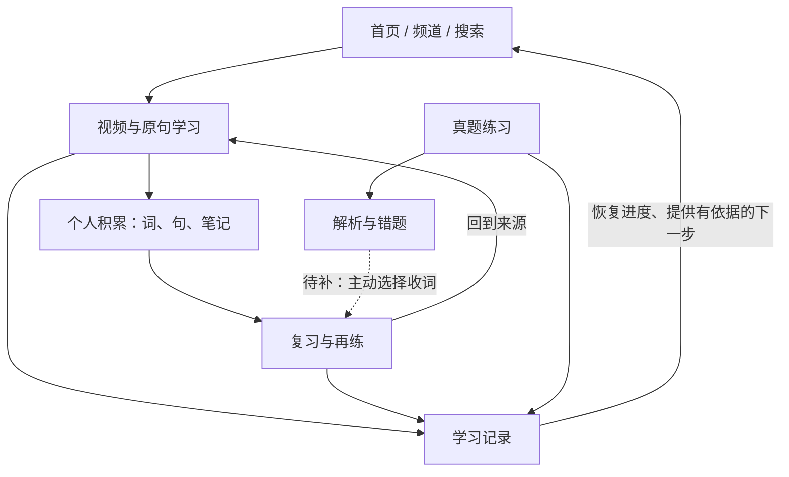

# SeeWord 产品框架大纲

日期：2026-10-20。性质：建议稿，待产品方向确认。本文先确定产品结构，不确定视觉样式，不代表已授权修改功能或数据。

已确认取舍（用户，2026-10-20）：**完整移除跟读功能及其录音、录音回放、原声对比、波形和口语评分规划。** 页面、学习资产、用户路径、统计、成就、引导与会员权益不再安排这项能力。原声播放、重听、词典发音继续保留。此处确认的是产品范围，实际代码清理尚未执行。

## 1. 这一轮要解决什么

先把「产品为什么存在、哪些能力是核心、每个模块解决什么问题、系统怎样积累学习结果」讲清楚。页面布局和视觉排在这些问题之后。

前一份[设计方向建议](design-direction-2026-10-20.md)中的首页压缩、标题和卡片调整，暂作为候选做法。先用本文确定它们要服务的产品目标，再决定是否采用。

## 2. 产品定位：真实语境中的英语学习

**推荐定位：帮助用户把真实英语内容，转成可以理解、记忆和反复练习的个人学习材料。**

产品的主要价值来自三件事：找到愿意学的内容；在原句里理解和练习；把学过的内容留住，并在之后再次用到。

对用户的主要承诺：

- 学习材料有真实来源，能回到原声和原句。
- 一次可以只学一小段，随时离开，也能接着学。
- 收下的词、句子和练习记录在后续继续有用。

真题练习保留完整的独立路径，服务明确备考的人。它与视频学习通过词汇和真实学习记录逐步连接。用户可以只看视频、只背词或只做题。

目前不把「完整四六级备考平台」「系统课程」作为现成能力对外承诺。

## 3. 系统的主线、专项和支撑

| 层级 | 内容 | 作用 |
| --- | --- | --- |
| 核心主线 | 发现内容 → 学习原句 → 收下词句 → 复习与再练 | 形成 SeeWord 的主要使用价值和回访理由 |
| 专项路径 | 真题练习 → 解析 → 错题重做 → 可选收词 | 满足备考需求，允许用户直接进入 |
| 个人积累 | 生词、收藏句、笔记、观看和作答记录 | 保存用户投入，并支撑下次继续 |
| 支撑能力 | 账号、设置、会员、通知、反馈、内容管理 | 保证系统可持续运行 |

产品需要同时回答：**现在做什么、上次做到哪、已经留下什么。** 首页主要回答前两项；词汇、收藏和个人记录主要回答第三项。

建议的连接方向如下。图中表示目标关系，各条连接的当前完成程度不同。

## 4. 模块边界

### 4.1 内容发现：帮助用户选

首页负责「今天从哪里开始」；频道负责「以后持续跟谁学」；搜索负责「我现在明确要找什么」。三者共用内容与学习信息，各自保留不同的选取方式。

主题是跨来源的内容分类；频道是稳定的内容来源或策展集合。若以后增加专题，专题应是一组围绕明确目标组织的有限内容，需有选择理由与顺序，不能只换名字重复频道。

### 4.2 视频学习：帮助用户听懂与理解

观看页是核心学习场所。围绕原声和当前句提供播放、重听、点词、释义、收藏与笔记；学习片段和完整视频共用这个场所。

查词和文稿首先作为观看页内的工具。只有独立使用价值足够明确时，再考虑独立页面。查词后应能够回到同一句，继续播放或重听。

### 4.3 词汇：帮助用户记住

词汇承担个人生词、来源上下文、复习和词单组织。视频词单、考试词单、自建词单是不同的组织方式，共用个人词汇与复习能力。

「今天到期」「全部生词」「按词单整理」是同一份学习积累的不同视图。快速过筛回答「哪些需要学」，复习回答「哪些需要再练」，两种动作需要区分。

### 4.4 真题练习：帮助用户练题与回顾

保留题型练习、阅读套卷、解析、历史和错题重做。下一轮先讲清楚实际覆盖的考试和题型。

答错可能来自词汇、理解、定位或作答策略。系统需要依据才能进一步归因；答错一道阅读题，不能自动把整段词汇标成不会。

### 4.5 我的：帮助用户管理自己的积累

集中个人概览、收藏、学习记录、周报和设置。它是用户找回学习资产和查看事实的地方。

资料编辑、统计、学习设置和账户管理可以继续使用分组或二级页面。默认进入「我的」时，建议优先让用户找到学习积累，而非先编辑头像。

### 4.6 内容管理：保证用户学到的材料可靠

管理端承担选材、处理、校对、提炼、编排和发布。前台的好体验依赖完整句子、可靠释义、可播放媒体和准确来源，不能全部依靠页面排版补救。

## 5. 功能取舍

以下「收起」指降低入口层级或减少默认展示；不表示删除已有用户数据、数据库表或业务能力。

| 处理方式 | 功能范围 | 判断 |
| --- | --- | --- |
| 核心保留并优先打通 | 视频发现、搜索、频道、原声字幕、点词、续学、收词、复习、原句回跳 | 支撑核心学习主线 |
| 保留并明确职责 | 句子收藏、视频收藏、笔记、词单、过筛 | 留下不同类型的个人积累，入口跟随具体场景 |
| 保留独立路径 | 真题题型练习、阅读套卷、解析、错题重做 | 满足备考需求，逐步接入共享词汇能力 |
| 保留为辅助能力 | 热力图、成就、周报、通知、会员、账户设置、反馈 | 有需要时可到达，避免占据每次学习的主操作区 |
| 可合并展示 | 生词在收藏页和词汇页的重复管理；分散的学习统计；重复的内容榜单入口 | 一个对象有一个主要管理位置，其它页面提供摘要或入口 |
| 暂缓新增 | 社区、用户投稿、积分商城、用户竞争榜、强制打卡任务、复杂 AI 学习计划 | 当前优先把已有学习路径接通 |
| 明确移除（已确认） | 跟读、录音、用户录音回放、原声对比、波形、口语评分 | 投入与收益不匹配，从产品范围中完整退出 |
| 单独论证后再做 | 听写、课程体系、完整听力/写作/翻译能力 | 需要独立的内容、评估和维护方案 |

原有视频热榜可作为发现排序或专题入口保留，暂不强化为一级产品模块。会员功能保留，具体权益、限制和付费策略需要另行确定；本大纲不改变支付和访问权限。

## 6. 页面大纲：先定职责，再定信息位置

一级导航建议先沿用现有的「首页、频道、练习、词汇、我的」。搜索属于全局查找能力；观看属于内容详情和学习场所；其它个人能力从「我的」及相关场景进入。

| 页面或页面组 | 唯一主要职责 | 主要信息 | 主要动作与后续连接 |
| --- | --- | --- | --- |
| 首页 | 给出当下容易开始的一步 | 可继续内容、一段精选、轻量复习入口、内容发现 | 继续或开始；进入观看、词汇、频道 |
| 频道目录 | 选择长期内容来源 | 学习方向、来源定位、真实内容样例、订阅状态 | 进入或订阅频道 |
| 频道详情 | 从这个来源挑一段 | 简介、适合的学习需求、建议起点、已收录视频 | 进入观看；保留返回位置 |
| 搜索 | 找到指定内容或用法 | 视频、字幕句、词汇、频道的分组结果和命中上下文 | 到视频、对应句或词义；保留搜索条件 |
| 观看 | 完成一次具体学习 | 原声、当前句、文稿、词义、来源、个人标记 | 听、查、收、记；结束后选择下一步 |
| 全文文稿 | 连续阅读与定位 | 有时间锚点的全文、译文开关、当前定位 | 回到对应视频位置 |
| 词汇首页 | 决定今天怎么复习 | 真实到期队列、可继续训练、近期生词、词库与词单入口 | 开始或继续复习，查找某个词 |
| 词单列表及详情 | 按来源或目标整理词 | 视频/考试/自建来源、词表、过筛与学习进度 | 过筛、复习、回来源；创建和整理放在次级位置 |
| 词汇训练及过筛 | 完成一轮明确练习 | 当前词、原句、作答或判断、轮内进度、结束反馈 | 继续、结束、回看原句；保留训练进度 |
| 练习首页及套卷列表 | 选择练什么 | 上次练习、题型、实际覆盖范围、套卷信息、错题入口 | 选题或选卷；直接开始 |
| 真题作答 | 专注完成作答 | 文章、问题、选项、作答进度、必要计时 | 保存/交卷；避免跳页打断作答 |
| 结果与错题 | 理解并处理错误 | 本次答案、正确答案、解析、题目来源、历史 | 重做或选收生词；收词连接待补齐 |
| 我的 | 找到个人积累与管理入口 | 学习概览、收藏、记录、周报、会员状态、设置 | 找回内容、查看记录、管理账户 |
| 收藏 | 找回想再次使用的内容 | 收藏视频、收藏句、关联笔记 | 看视频、回原句、再练；生词管理归词汇 |
| 学习记录 | 找回做过的内容 | 观看记录；逐步整合复习和作答记录 | 继续、回听原声、看解析；各类记录分别说明状态 |
| 周报 | 回顾一段时间的投入 | 实际学习行为、与自己过去的变化、可解释的下一步 | 回到具体材料或复习入口 |
| 会员、通知、反馈、设置 | 完成各自的服务事项 | 真实状态、明确操作、必要说明 | 回到触发它的场景 |
| 登录、注册、引导 | 建立账户并恢复原意图 | 必要账号信息、可跳过的兴趣/目标偏好 | 登录后回原内容；不要求先完成长问卷 |

同一页面在不同用户状态下可以改变主行动。首访没有记录时推荐开始；有未完成练习时提供继续；数据读取失败时不能误写成「没有记录」。

## 7. 系统深度连接的四个基础

### 7.1 共享学习对象

- **视频：** 完整内容和媒体来源。
- **学习片段：** 视频内有明确范围的一段内容，不复制成另一条学习记录。
- **句子：** 能定位到原声的语言上下文；字幕行可能只是一段断句，需要核对语义完整性。
- **表达：** 值得学的单词、短语或句型，绑定具体语境。编辑参考表达与原视频原话要区分。
- **个人生词：** 用户主动收下并参与复习的词。
- **词单：** 词汇的组织方式，不再创建独立的一套个人掌握状态。
- **作答记录：** 某次题目和答案的事实。

当前数据已有多项基础关联，但个人生词主要保存单个视频/字幕来源。跨视频、跨真题保留多个语境，是后续扩展项，不能假定已经支持。词形、原形和多义词的合并规则也需要单独核对。

### 7.2 共享上下文

从搜索、收藏、词单和复习进入视频时，应到达用户要看的句子或时间，并知道从哪里来。返回时恢复之前的关键词、筛选、滚动位置或训练位置。

明确点击「听这一句」时优先到该句；点击「继续学习」时恢复原播放进度。去原句核对一次，不应使用户丢失原训练会话。

### 7.3 共享状态，分别解释含义

| 行为或状态 | 它能说明什么 | 不应直接推导什么 |
| --- | --- | --- |
| 收藏视频 | 想找回或以后看 | 已看、已学会 |
| 收藏句子 | 想再次使用这句 | 已收下句中全部单词 |
| 加入生词 | 希望以后练这个词 | 自动收藏整个视频 |
| 看完视频 | 播放进度完成 | 听懂全部内容、掌握其中词汇 |
| 完成过筛 | 做过认识/不认识判断 | 长期掌握 |
| 完成复习轮 | 完成这轮训练 | 所有词永远不用再复习 |
| 真题答对 | 本次作答正确 | 英语等级或预测考试分数 |

一个操作在多个页面出现时，状态应同步；不同意义的操作仍分开保存。例如取消视频收藏，保留已经收下的词和笔记。

### 7.4 用事实提供下一步

第一阶段优先用可解释规则连接系统：有未完成记录则继续；有到期词则提供短轮复习；订阅频道有可学内容则推荐；某词复习困难且有来源则提供回听。

后续可以扩展到同词的其它语境、已收藏表达的再练、题目中的生词。没有关联依据时保留普通查找入口。不要仅凭一次看完或一次答错就判断整体能力。

## 8. 用四条用户路径检验框架

| 场景 | 目标路径 | 框架应保证 |
| --- | --- | --- |
| 新用户想轻松开始 | 一段精选 → 点词 → 主动收下一个词 → 以后复习 | 首次使用能形成一个有来源的个人积累；不强制走完所有步骤 |
| 老用户只有几分钟 | 继续上次或短轮复习 → 保存进度 → 离开 | 短时间也能完成一件事，下次能接着来 |
| 备考用户直接做题 | 题型/套卷 → 作答 → 解析 → 错题；可选收词 | 不被强制导向视频；答题过程稳定，交卷后再处理生词 |
| 用户想弄懂一个用法 | 搜索/收藏句 → 对应原声 → 查词与理解 → 收藏或记笔记 | 表达与来源关联清楚，下次能找回 |

连接验收还需覆盖：同词多来源、内容下架、字幕改动、无字幕来源、播放失败，以及中断后恢复。下架材料的个人记录应有明确可用状态，不能只留下失效按钮。

## 9. 后台也按这条主线组织

建议后台的大纲是：**内容供给、学习材料质量、前台编排、用户服务、运行情况。**

- 内容供给：候选内容、收录、处理、频道归属。
- 学习材料质量：字幕、翻译、断句、词义、媒体可用性；按问题找到具体视频处理。
- 前台编排：从真实材料提炼片段和学习重点，预览、发布、恢复上一版。
- 用户服务：账户、会员、订单、反馈和公告。
- 运行情况：处理失败、内容可用性、关键学习链路的异常。

AI 可协助提炼和生成草稿；原声、原句、时间和来源继续由真实内容约束，发布是独立动作。

## 10. 怎样结束反复“抽卡式”改设计

后续分五步推进，每步只解决对应的问题：

1. **产品大纲：** 确认定位、主线、模块和功能取舍。当前处于这一步。
2. **页面职责：** 为核心页面各写「用户来做什么、必须知道什么、完成后去哪」。先解决职责重叠。
3. **信息结构：** 用简单结构稿确定信息顺序、主要动作和关键状态。一次完整走通一条路径。
4. **整体视觉：** 在已确定结构上统一字体、间距、组件和交互状态；用一组核心页面一起看。
5. **实现与验收：** 用同一批用户场景验证，发现问题后记录它属于产品、信息、内容、交互还是视觉。

每次修改需说明：解决哪个用户问题、依据是什么、影响哪条路径。新增功能需要说明入口、输入、结果、保存位置、下次如何找到，以及维护责任。

下一轮先细化「首页 → 观看 → 词汇复习 → 回到原句」及「真题 → 解析 → 错题」两条路径。尚未确认框架前，不继续产出多套页面视觉方案。

## 11. 事实核对范围

本大纲参考了前一轮实际桌面页面观察，并核对当前路由、导航、搜索、收藏、词汇与词单、观看动作、首页编排和真题接口代码。

已确认代码基础包括：五个一级入口；视频与字幕搜索；句子收藏；个人生词的上下文与字幕来源；视频/考试/自建词单；词汇复习会话；真题和错题接口；会员购买页及内容编排后台。代码存在不等于本轮已完成端到端验收。已移出产品范围的旧功能，其代码仍需在实施阶段清理。

目标状态中的跨来源语境、题后收词、整合学习记录和个性化下一步仍需逐条核对与补齐。旧产品评审包含历史状态，不作为当前功能是否存在的依据。

本次只新增框架文档与调整文档间的指引；未修改产品代码、学习数据、权限或线上服务。自动化测试和完整用户路径验收未执行。
