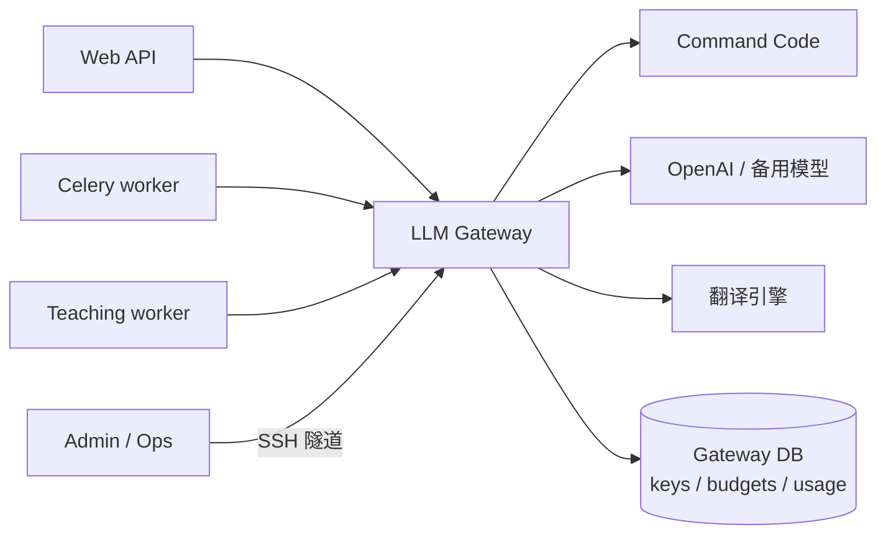

# SeeWord V2 方向对齐：三层路线、独立模型网关与个人记忆

日期：2026-11-02
状态：**方向决策已与负责人对齐；P01–P02 部分切片已提交（`2a07e571`），未对业务库迁移、未部署生产**。本文记录三项决定，不重复[V2 技术设计](v2-technical-design-2026-10-31.md)的正文。
代码基线：`master e3f5ecba`（2026-11-02）。
关系：本文**取代**技术设计 §1 的「不引入独立模型网关」与方案评审 D.7 的「现有 LLM 服务增强优先」；V2.0 的教学事务、内容内核与 MCP 边界仍按原设计执行。准备工作卡见 [V2 升级前准备清单](v2-preparation-2026-11-02.md)。

## 0 决策摘要

1. **路线分三层**：V2.0 可信内核、V2.1 AI 教学面与个人记忆、V2.2 外部生态。首版范围没有扩大，后续能力不再被「首版不做」隐去。
2. **模型调用改为独立网关**：采用成熟开源网关做底座，不手写协议与配额；provider key 只存在网关，后端只拿内部虚拟 key。网关负责路由、重试、预算、并发、用量与安全审计。
3. **个人记忆放在 V2.1，先研究再实现**：参考 Hermes、Mem0、Zep/Graphiti、Letta/MemGPT、LangMem 等社区方案，叠加教育场景需要的来源、可信度、过期、用户可控与删除；继续**不做**跨用户共享知识库。
4. **V2.0 仍然先做可信内核**：考试快照、内容 revision、教学事务、模型网关、一个宿主的 MCP 闭环。个人记忆在 V2.0 只落证据与契约，不抢首版范围。

## 1 三层路线

| 层 | 范围 | 用户可见结果 | 出口条件 | 明确不含 |
| --- | --- | --- | --- | --- |
| **V2.0 可信内核** | 教学会话 / attempt / 暴露 / 幂等；内容 revision 与 20 道金标题；独立模型网关；网页单题教学；一个宿主 MCP（私测，不公开）；开关与白名单 | 一道经核验的题能完成「初答 → 提示 → 复答 → 证据 → 解析」；外部宿主能读题、辅助复答、网页恢复；撤权后失效 | 重大答案错误 0；未授权写入 0；重复副作用 0；网关用量可追溯；私测默认关闭 | 听力/判断题型、个人记忆 CRUD、视频 AI 讲解、CLI/Skill、多宿主、语音、写作 |
| **V2.1 AI 教学面与个人记忆** | 听力 / 判断交互与教学规则；错误诊断与分层提示；个人记忆 CRUD 与检索；视频侧 AI 讲解/追问；少量经审核的真题延展题 | 教学不止阅读客观题；AI 能记住学习困难并解释「为什么记得」；用户可查、改、删记忆 | 记忆可查改删、导出/注销覆盖；延迟复测有口径；生成题经审核且与真题分开标记 | 共享知识库、批量仿真题、写作评分、全能 Personal Agent |
| **V2.2 外部生态** | CLI / Skill、第二宿主、宿主语音能力验证、OAuth 公开接入、兼容矩阵 | 用户可把 SeeWord 接入自己常用的 Agent；语音由宿主提供 | 一个以上宿主通过授权/读写/恢复/撤权回归；语音能力有实测记录 | 自建 ASR/RRT、未验证宿主的语音承诺、跨用户知识复用 |

**排期原则**：V2.1 / V2.2 不是自动排期，需在 V2.0 内核通过出口条件后单独决策；V2.0 的模型网关与记忆契约为它们留接口。

## 2 独立模型网关

### 2.1 为什么改

原设计倾向「后端进程内统一封装」，理由是少一个故障面、避免双写账本。现在改为独立网关，原因是对齐后的优先级变化：

- **provider key 不再散落在 web / worker / beat**，只存在网关，后端只拿内部虚拟 key；
- **路由、重试、超时、预算、并发、用量、审计集中在一处**，教学 worker 不需要各自实现；
- **多 provider / 多模型 / 翻译竞速**由网关配置，后端只发任务别名；
- **成熟项目已经解决了 OpenAI 兼容、虚拟 key、配额、fallback、日志与观测**，自研协议层不划算。

代价也要写清楚：多一个服务要部署、监控与备份；必须明确「谁是 usage / cost 的单一事实源」，否则会出现双账本；网关故障时教学要 fail closed，不能静默假分值。

### 2.2 目标拓扑

- 网关只在内网监听；不经过 nginx 公网入口，admin UI 不暴露公网。
- 后端通过内部 DNS / compose 服务名访问；生产可用 mTLS 或共享密钥。
- 网关数据库可与业务 PG 同实例、独立 schema / database；不引入新的 Redis 依赖，除非缓存或分布式限流需要。

### 2.3 职责边界

| 网关负责 | 后端负责 |
| --- | --- |
| provider key、模型目录、模型别名 | prompt、教学规则、内容与证据 |
| 路由、fallback、超时、重试策略 | 业务幂等、attempt、exposure、outbox |
| 内部虚拟 key、调用方认证 | 用户身份、账号有效性、scope |
| 预算桶、rate / concurrency、429 | 教学状态机与卡片构造 |
| usage / cost 账本、请求日志、脱敏 | 安全结果与业务关联 id |
| 可观测性、审计、告警 | 账号导出 / 注销的业务编排 |

**硬边界**：网关不知道「什么是教学」，不构造卡片、不判分、不写教学表；后端不保存 provider key，不直接 import 供应商 SDK 的调用路径。

### 2.4 候选项目

以下只列方向候选，**exact version / license / 当前能力均未验证**，由 E3a 选型 spike 锁定。

| 候选 | 形态 | 可能优势 | 需要验证的风险 |
| --- | --- | --- | --- |
| **LiteLLM Proxy** | Python，OpenAI 兼容代理 | 与现有 Python 栈一致；虚拟 key、预算、rate limit、fallback、spend tracking、Postgres、回调观测 | per-run 预算是否原生支持；代理自身资源占用；版本升级与配置复杂度 |
| **New API / One API 系** | Go，带管理 UI | 多渠道路由、用户/令牌配额、日志与后台管理成熟；中文社区资料多 | 自定义元数据与 per-run 预算；与 SeeWord 用户体系的映射；删除/匿名化接口 |
| **Portkey Gateway** | 独立网关 | 路由、guardrails、缓存、观测；部署轻 | 预算/配额是否满足私用；自托管能力与许可 |
| **Bifrost** | Go，高性能网关 | 低延迟、fallback、缓存、OpenAI 兼容 | 生态成熟度、预算/审计能力、许可 |
| **薄 FastAPI 适配层** | 自研 | 完全按 SeeWord 的 per-run 预算与删除契约 | 等于自建协议、重试、并发、观测；只在成熟项目无法满足时选择 |

**倾向**：先用 **LiteLLM Proxy** 做首选验证，**New API** 作为管理面/多渠道路由的备选；Portkey / Bifrost 作为性能或 guardrail 备选。任何候选都必须先过 2.5 的能力矩阵，不能因为「OpenAI 兼容」就直接上线。

### 2.5 必须具备的能力

- [ ] OpenAI-compatible `/v1/chat/completions`，支持流式、tool calling、结构化输出；
- [ ] 模型别名 / 任务别名；后端不硬编码 provider model；
- [ ] 每调用方虚拟 key；web / celery / teaching worker 分开；key 可轮换、可撤销；
- [ ] 预算 scope 至少覆盖 global / user / run；per-run 可用短时虚拟 key + `max_budget` + TTL 实现；
- [ ] rate limit 与并发上限；跨进程、跨 worker 不超额；
- [ ] usage 含输入/输出/缓存/推理 token；unknown usage 显式标记，不填 0；
- [ ] 失败、重试、取消、超时、fallback 可区分；上游重试由网关控制，后端 `max_retries=0`；
- [ ] 请求日志默认不存完整 prompt；可脱敏；可配置保留期；
- [ ] 支持按 user / run 删除或匿名化，供账号注销与导出使用；
- [ ] Postgres 持久化、健康检查、Prometheus / OTel、备份；
- [ ] 许可证与维护状态允许自托管私用；exact version 锁定。

### 2.6 账本归属

**单一事实源：网关。** 网关记录每次上游尝试的 usage / cost / 状态；后端只保留业务关联：

- `logical_call_id`、`run_id`、`step_id`、`task`、`user_id`（可脱敏）作为 metadata 传给网关；
- 后端不另建一份完整成本账本；如需本地对照，只存引用与业务结果，不重复计价；
- 若候选网关无法按 user / run 导出 usage，则加薄适配层或定时对账任务，**不能双写两份可互相矛盾的账本**。

账号生命周期：

- 注销时先停新调用，再调用网关的删除/匿名化；网关只保存 pseudonymous `user_id` / `run_id`，不存手机号、姓名、笔记；
- 正在结算的调用按 attempt id 完成 late settle；已脱敏的聚合用量可保留到保留期；
- 导出只含用户可读的调用摘要，不含 provider key、内部虚拟 key 或完整 prompt。

### 2.7 部署与安全

- [ ] 新增 `llm-gateway` compose 服务；固定镜像版本；健康检查；重启策略；资源上限；
- [ ] 只在内网监听，不经过公网 nginx；admin UI 通过 SSH 隧道或内网访问；
- [ ] provider key 只注入网关；后端 `.env` 删除 `COMMANDCODE_API_KEY` / `OPENAI_API_KEY`；后端改为 `LLM_GATEWAY_BASE_URL` + `LLM_GATEWAY_API_KEY`
- [ ] 后端 `Settings` 的 fail-closed 校验、`production_preflight.py` 与 compose 白名单同步改为网关配置
- [ ] `llm_provider.py` 保留「任务 → 模型别名」映射；provider model 目录与真实路由移到网关，避免两套目录
- [ ] `check_llm_provider.py` 改为检查网关健康 / 别名 / 真实冒烟，不再直连 provider
- [ ] 后端使用内部虚拟 key；按服务拆分；定期轮换；
- [ ] 出站 allowlist：只允许配置的 provider 域名；禁止任意 URL；
- [ ] 日志默认不落完整 prompt；错误日志脱敏；
- [ ] 网关不可用时：教学 fail closed（503 / `AI_SERVICE_UNAVAILABLE`），非关键任务可降级，不静默假结果；
- [ ] 备份网关数据库；升级与回滚流程；监控 5xx、429、预算阻断、延迟。

### 2.8 迁移阶段

| 阶段 | 内容 | 出口 |
| --- | --- | --- |
| **E3a 选型 spike（G0）** | 候选对比、exact lock、license、能力矩阵、Command Code 实测、结构化输出 / tool calling、预算与删除 | 选定网关与配置；不通过则改用薄适配层或重新选型，不退回进程内封装 |
| **E3b 部署** | dev / prod 服务、密钥、健康检查、监控、备份 | 网关可独立启动；后端可连通 |
| **E3c 单任务迁移** | 先把翻译或词注一条低风险路径切到网关，对比 usage / 延迟 | 用量与供应商账单对得上；可一键回退 |
| **E3d 全量迁移** | `AIService`、备用词注、翻译全部走网关；移除后端 provider key | 三出口覆盖；预算 / 并发生效 |
| **E3e 生命周期** | 删除/匿名化、保留期、导出、故障演练 | 注销与 late settle 通过；网关故障 fail closed |

### 2.9 验收

- [ ] 用量与供应商账单在约定误差内一致；unknown usage 不被写成 0；
- [ ] 两进程争最后预算不超额；per-run 短时 key 到期后不能继续调用；
- [ ] 429 / 预算耗尽 / 并发限制进入统一错误契约，可用时给 Retry-After；
- [ ] provider key 不出现在后端进程、日志、导出与前端；
- [ ] 网关故障时教学失败可解释，不产生假分值；
- [ ] 请求日志不含完整 prompt；删除/匿名化后无法按用户检索；
- [ ] 延迟开销有实测记录，P95 阈值在压测后设定；
- [ ] 升级、回滚、备份演练各一次。

## 3 个人记忆（V2.1）

### 3.1 决策与时序

- **V2.0**：只落学习证据与记忆契约——attempt、event、exposure 可回放；冻结 `personal_memories` 字段、来源与删除语义，不建用户可见 CRUD（表随 V2.1 迁移）。
- **V2.1**：研究社区方案，做个人记忆的提取、检索、更新、删除与教学接入。
- **V2.2**：跨宿主记忆连续性（同一用户、不同 Agent），但不做跨用户共享知识库。

**V2.1 的推进顺序**：

| 阶段 | 内容 | 出口 |
| --- | --- | --- |
| M0 研究 | 对比 Hermes / Mem0 / Zep / Letta / LangMem / Cognee 的分层、写入、检索、删除与评测 | 选定架构与评测口径；不写业务代码 |
| M1 基础 | `personal_memories` 表、CRUD、用户可见列表 / 编辑 / 删除 | 可查改删；导出 / 注销覆盖 |
| M2 教学接入 | 提示、反馈、讲解风格、复习建议；来源引用 | 延迟复测口径与隐私负控通过 |
| M3 跨宿主 | 同一用户在不同 Agent 间的记忆连续性（V2.2） | 多宿主一致；仍不跨用户 |

### 3.2 参考系统与借鉴边界

| 参考 | 借鉴 | 不照搬 |
| --- | --- | --- |
| Hermes | 分层记忆、memory provider 的可替换边界 | 文件式存储、全量对话落盘 |
| Mem0 | 提取 → 更新 → 检索的流水线；user / session / agent scope | 其默认自动写入与跨用户复用 |
| Zep / Graphiti | 时间有效性、事实的产生与失效 | 完整时序知识图谱的重运维 |
| Letta / MemGPT | working memory 与 archival memory 的分层 | 把整个 Agent 运行时搬进 SeeWord |
| LangMem | 记忆 CRUD 工具化、读写接口 | 直接依赖其托管服务 |
| Cognee | 图谱化记忆的评估方法 | 首版引入图数据库 |

**许可证**：只借设计思路，不复制源码；实际依赖前核对 exact version 与 license。TypeWords 的 GPL 边界同样适用于记忆与教学规则。

### 3.3 记忆分层

| 层 | 内容 | 生命周期 |
| --- | --- | --- |
| Working | 当前教学会话 T、当前 item、最近 attempt、提示/揭晓 | 会话内；不长期保存 |
| Episodic | 发生了什么：attempt、hint、reveal、feedback、视频/词汇事件 | 随账号保留；来源可追溯 |
| Semantic | 稳定事实与偏好：目标考试、级别、学习目标、讲解偏好、反复错误模式 | 可修订、可过期、可删除 |
| Procedural | 哪种提示/讲解对该用户有效 | 版本化；用于教学策略，不直接展示 |
| Profile | 掌握度、streak、CEFR 等聚合 | 现有 `UserLearningProfile`；派生值，不是原始记忆 |

### 3.4 数据模型（建议）

`personal_memories`：

- `id, user_id, category, content, source_type, source_ref, confidence, verification, version, created_at, updated_at, expires_at, deleted_at`
- `source_type`：`user_statement` / `attempt_outcome` / `model_inference` / `system`
- `verification`：`verified` / `unverified`；模型推断默认 `unverified`
- 唯一性按用户 + 语义键；修订保留版本，不原地覆盖历史来源

`memory_sources`（或复用事件 id）：记录每条记忆引用的 attempt / event / 用户原话；删除来源时同步失效或标记。

`memory_retrievals`（评测用）：记录哪次教学检索了哪些记忆、是否被用户纠正；用于 precision / stale rate，不用于训练。

若需要语义检索，优先 **pgvector**（同 PG，不新增向量数据库）；首版也可以先用结构化过滤 + 关键词，等真实检索集证明不足再引入向量。**不引入独立向量数据库。**

### 3.5 写入策略

- [ ] 只从明确用户陈述、已验证学习结果、或多次重复的模式写入；
- [ ] 不从自由聊天静默推断掌握度；不存完整私聊、模型思维过程；
- [ ] 模型推断的记忆先 `unverified`，经用户确认或重复证据再升级；
- [ ] 冲突按时间、来源、置信度处理；保留版本与来源；
- [ ] 目标/偏好可设过期时间；过期后不参与检索；
- [ ] 用户可标记「记错了」，立即降级/删除并清缓存。

### 3.6 读取与教学接入

- [ ] 检索严格按 `user_id`；禁止跨用户；
- [ ] 按相关性 + 时间 + 置信度取 top-k；设 token 预算；
- [ ] 记忆用于提示、反馈、讲解风格与复习建议；不改变正式成绩、mastery 或有效学习日；
- [ ] 卡片/回答引用记忆时给出「为什么记得」的来源链接；
- [ ] 删除/过期后缓存与检索同步失效。

### 3.7 用户控制与生命周期

- [ ] 记忆列表、详情、编辑、删除、标记错误；
- [ ] 「为什么记得」显示来源（attempt / 用户原话 / 系统）；
- [ ] 导出包含记忆与来源；注销删除记忆与检索记录；
- [ ] 敏感信息（手机号、笔记全文、第三方私聊）不进入记忆；
- [ ] 保留期与隐私页同步。

### 3.8 评测

- [ ] 记忆 precision / recall（人工标注集）；
- [ ] 用户纠正率、过期记忆命中率；
- [ ] 检索 token 成本与延迟；
- [ ] 对延迟复测的影响（预先写口径，不能事后挑指标）；
- [ ] 隐私负控：跨用户检索、导出泄漏、删除后仍可检索、prompt 泄漏；
- [ ] 质量回归集：20 道金标题 + 10 条教学错误路径。

### 3.9 反模式

- 不做跨用户共享教学知识库；
- 不把模型推断写成已验证事实；
- 不把完整对话或思维过程当记忆；
- 不让记忆改变正式分数/mastery；
- 不做无界增长、无过期、无删除的「永久记忆」；
- 不引入独立图数据库/向量库作为首版前提。

## 4 相对 2026-10-31 设计的变更

| 原设计 | 2026-11-02 决定 |
| --- | --- |
| §1 / D.7：不引入独立模型网关，优先后端进程内增强 | **改为独立网关**；后端只留业务与 prompt，provider key 移出 |
| 模型账本在 backend PG，三出口进程内包装 | **网关拥有 usage / cost 单一事实源**；backend 只存业务关联与对账引用 |
| 个人记忆「本期不建」 | **V2.1 建**，先研究社区方案，V2.0 只落契约与证据 |
| 首版范围 = 单题教学 + 计量 + 一个 MCP 宿主 | **不变**；听力/判断、视频 AI、CLI/Skill、多宿主、语音放 V2.1 / V2.2 |
| 不做共享知识库 | **不变** |
| 线上继续 S6，B04 只影子 | **不变** |

## 5 不改的底座

- 单后端 Learning Core；PostgreSQL 仍是学习事实的权威；Redis 只做 broker / 通知。
- 视频 head / GPU / tail 管线、GPU worker 拓扑不动。
- 旧整卷一次交卷语义不动；教学 attempt 另建追加记录。
- 退役功能不恢复。
- 公共放量仍等 A12 真实样本；V2.0 默认关闭、白名单私测。

## 6 待验证与待拍板

1. **网关选型**：LiteLLM Proxy / New API / Portkey / Bifrost 的 exact version、license、per-run 预算、删除接口。
2. **账本拓扑**：网关独立 DB 还是业务 PG 独立 schema；如何做 late settle 与注销脱敏。
3. **per-run 预算实现**：短时虚拟 key、网关原生 run scope，还是薄适配层。
4. **记忆检索**：先结构化 + 关键词，还是一开始引入 pgvector；是否引入 embedding 模型与成本。
5. **记忆写入确认**：哪些类别需要用户确认（目标、偏好、错误模式），哪些可自动。
6. **V2.1 时机**：是否与 V2.0 并行做研究，还是 V2.0 出口后再开。
7. **宿主与认证**：扣子 + Bearer / 豆包 + OAuth / 暂不定；仍待 G0-4。

## 7 本轮边界

- 本文只记录方向与架构，**未安装、未部署、未压测任何网关**；候选能力、许可证与版本均待 E3a 验证。
- 未实现个人记忆、未建表、未做检索或评测；社区方案只作设计参考，未复制代码。
- 未修改业务代码、迁移、生产配置；准备工作卡中的验收项仍未执行。
