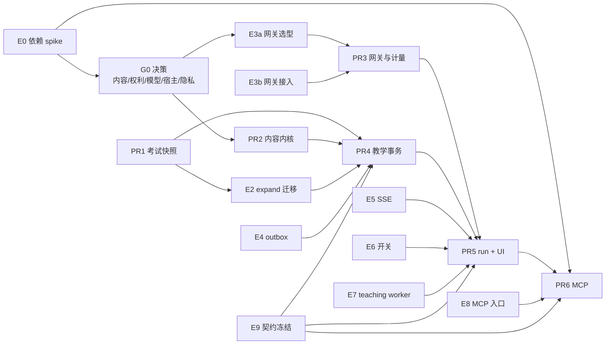

# SeeWord V2 升级前准备清单

日期：2026-11-02
修订：2026-11-02 按评审补齐 PR1 回填 / 旧交卷暴露、teaching worker、MCP 入口、契约冻结、隔离 PG 与数据生命周期（P0 + P1）；同日按方向对齐改为三层路线、独立网关与 V2.1 个人记忆。
状态：**2026-11-02 已进入分切片实施，默认关闭、白名单私测；未部署生产**。本文保留开工前核查与待验收工作卡，不把开发中代码写成已通过能力。最新实施决定以[技术设计开头](v2-technical-design-2026-10-31.md)为准。
代码基线：`master e3f5ecba`（2026-11-02）。改动代码后文中的文件与行号会漂移，实施时以 `grep` 为准。
事实源：[V2 技术设计方案](v2-technical-design-2026-10-31.md)、[V2 方案评审](v2-plan-review-2026-10-31.md)、[开发计划](development-plan-2026-10-29.md)。
方向对齐：[V2 三层路线、独立模型网关与个人记忆](v2-direction-alignment-2026-11-02.md)（2026-11-02 决定，取代本文原 E3 的进程内封装）。
范围说明：本文的「V2」指 **SeeWord 产品与技术一体化方案 V2.0**，不是前端交互升级（见 [frontend-ui-interaction-upgrade-2026-11.md](frontend-ui-interaction-upgrade-2026-11.md)），也不是本地遗留的 `ui-v2` 界面实验分支。

## 0 结论

1. **V2 新增可信教学能力线**：单题教学、通用 MCP 服务、独立模型网关与授权撤销。首轮 Codex / Claude，后续 DSH / WorkBuddy；豆包 App / 网页先探测能力，不以扣子或 TRAE 代替。
2. **代码实施中**：考试快照、教学内容/事务、run、连接与网页入口分工开发；实际测试、迁移和宿主验收结果另记，不再使用“代码零落地”描述当前工作区。后端不预建第二套完整网关成本账本。
3. **已确认的产品约束**：自动核验、V2 教学日预算 1 美元（不含旧翻译）、run/反馈 24 小时、脱敏账本 7 日、教学独立统计。内容许可、网关与宿主运行能力仍需证据，按切片门禁放行。
4. **工程侧唯一必须先修的内部前提是考试快照漂移**；PR1（旧考试快照）现在就能开工，且不依赖任何外部决策。
5. **2026-11-02 方向更新**：路线分 V2.0 / V2.1 / V2.2 三层；模型调用改为**独立网关**，取代本文原 E3 的进程内封装；个人记忆放 V2.1。详见[方向对齐文档](v2-direction-alignment-2026-11-02.md)。
6. 其余工程准备（依赖兼容 spike、expand 迁移、网关、outbox、SSE、开关、teaching worker、MCP 入口、契约冻结）可以并行，但**不要先搭 Agent 框架或 MCP 业务**——内容质量是 P0，框架会放大错误而不是解决错误。

## 1 首版目标与边界

首版只要求跑通这一条真实链路：

> 用户打开一道经核验的题，创建教学会话 T → 网页明确提交初答 → 请求提示或直接解析 → 外部宿主使用同一 T 提交带来源标记的复答 → 网页按 T 恢复 → 撤销连接后外部调用失效。

**路线分三层，首版只做第一层**：

| 层 | 范围 | 本文关系 |
| --- | --- | --- |
| **V2.0 可信内核** | 教学会话 / attempt / 暴露 / 幂等；自动核验内容 revision 与 20 题质量回归；独立模型网关；网页单题教学；通用 MCP 与逐宿主兼容验证（私测）；开关与白名单 | 本文的准备与门禁都服务这一层 |
| **V2.1 AI 教学面与个人记忆** | 听力 / 判断交互与教学规则；错误诊断；个人记忆 CRUD；视频侧 AI 讲解；少量经审核的延展题 | 不在本文开工范围；见[方向文档](v2-direction-alignment-2026-11-02.md) |
| **V2.2 外部生态** | CLI / Skill、第二宿主、宿主语音、OAuth 公开接入、兼容矩阵 | 不在本文开工范围；见[方向文档](v2-direction-alignment-2026-11-02.md) |

**V2.0 不做**：整卷草稿恢复、考试转教学自动转换、完整个人记忆 CRUD、词汇多语境、逐次复习日志、调度切换、未经实测的宿主兼容承诺、语音评测、写作评分、跨用户知识库、CLI 安装器。不恢复任何已退役功能。个人记忆、听力/判断、视频 AI、CLI/Skill 与语音是 V2.1 / V2.2 的内容。

## 2 实施前现状核查（2026-11-02，历史基线）

以下表格记录实施前只读核查，不能当作当前代码状态：当时未跑测试、未连生产库、未执行迁移、未改业务代码。内容统计引用评审文档的实算结果，不代表生产现状。当前变更与验证看工作区源码及本文件末尾实施记录。

| 项目 | 代码事实 | 对 V2 的影响 | 证据 |
| --- | --- | --- | --- |
| 考试开考快照 | `create_paper_session` 只建会话、不写题目快照；daily / wrong_redo 虽写 placeholder，判分仍 `SELECT` 当前题库；`ExamSession` 没有快照版本字段 | 开考后改题 / 删题会让首次判分与重放不一致；教学初答挂接与复答「原成绩不变」没有可信基准 | `backend/app/services/exam_service.py:136`、`:519`；`backend/app/models/exam_test.py:78` |
| 试卷页恢复 | 页面每次挂载都 POST 新 attempt | 旧页面行为不能冒充 V2 的「按 T 恢复」 | `frontend/src/app/(main)/practice/exams/[id]/page.tsx:50` |
| 模型计量 | `_chat` 只记模型 / task / 耗时日志，不读 usage、不记 token、无账本、无预算与并发闸；备用词注客户端与翻译 `_call_engine` 还有两条出口 | Agent 放开后无法回答「花了多少、谁花的」，也没有硬闸 | `backend/app/services/ai_service.py:87`、`:418`；`backend/app/services/translation/__init__.py:189` |
| 模型接入形态 | 后端 `AIService` / 翻译直连 provider，没有独立网关；provider key 在 backend / worker 环境里 | 2026-11-02 决定改为独立网关，原设计「不引入网关」被取代；PR3 按网关重写 | `backend/app/services/ai_service.py`、`backend/app/services/translation/__init__.py`；[方向文档](v2-direction-alignment-2026-11-02.md) §2 |
| 教学 / Agent / MCP | 应用源码无工具循环、无教学表、无外部连接；依赖里没有 mcp / authlib / oauth 相关包 | 全部从零建 | `backend/requirements-cloud.txt`（`grep -i mcp` 无结果） |
| 依赖锁 | `openai==1.30.0`、`httpx==0.27.0`、`starlette==1.6.0` | MCP SDK 与这套精确依赖是否兼容未验证，属 G0 阻断项 | `backend/requirements-cloud.txt` |
| 学习事件 | LearningEvent 契约 v2、行为事件 v3；`LearningEvent` 无业务幂等键，`emit_event` 用 savepoint 吞异常 | 新流程必须走严格投影 + outbox，不能沿用旧 `emit_event` 当事实存储 | `backend/app/services/event_contract.py:21` |
| 账号导出 / 注销 | 导出是显式 24 项清单；注销会按 `user_id` 外键自动删表，但排除表是显式清单 | 新表不登记导出会漏数据；模型账本要「脱敏保留」而不是删除，必须显式处理 | `backend/app/services/account_data.py:262`、`:64`；`backend/app/tasks/account_tasks.py:214` |
| 反向代理 | `nginx.conf` / `nginx.ssl.conf` 的 `/api/` 只有 WebSocket Upgrade 头，没有 SSE 缓冲 / 缓存控制 | run events 不能直接复用普通 API location | `nginx.ssl.conf:93` |
| 内容质量 | 本地导入源 7915 条题记录、770 条有 `explanation`、去重后仅 10 条占位串；首批金标题不存在 | P0：不先建审核题集，Agent 会把占位解析放大成「权威讲解」 | 评审 A.1（本轮未复算） |
| 功能开关 | 现有开关是 env 布尔 + DB 单行 `AdminSetting` 两层 | V2 开关应沿用同一模式，默认关闭 + 用户白名单 | `backend/app/core/config.py`、`backend/app/models/admin_setting.py` |

## 3 G0 / T0 决策工作卡

这些事项决定「哪一层能开工」，**不是工程排期能替代的**。每张卡完成后，把结论写回本节并注明日期；未完成时对应切片保持关闭。

### G0-1 内容资格（阻塞 PR2 及之后）

- [ ] 确定首批题型（首版从阅读客观题起步，不承诺考试听力）
- [ ] 建立 20 道金标题的稳定 `question_key`（`exam:{level}:{year}:{month}:{set_no}:{number}`）
- [ ] 逐题核验：标准答案、考查点、证据区间、每项干扰项说明、分级提示
- [ ] 提示不等于完整答案；答案必须在有效选项内；题型可判分
- [ ] 自动核验按冻结规则执行，记录核验版本、来源指纹、检查项与时间，状态为 `auto_verified`；不伪造人工审核人
- [ ] 准备 10 条教学错误路径（证据不足、干扰项误解、直接答案、无效追问等）
- [ ] 准备系统负控：提示注入、scope 不足、重复写入、预算耗尽、模型 429 / 超时、取消 / 断线恢复

**验收证据**：逐题自动核验报告与可重放的内容证据；集内重大答案错误 0；含证据不足 / 来源冲突负控；记录适用题型，不外推全题库。自动核验不构成人工复核或教学效果证明。

**注意**：20 题只用于质量回归，不是教学有效性的统计保证；未核验内容不得进入教学、模型上下文或 MCP，不能以字段非空作为核验。

### G0-2 材料使用范围与权利（阻塞 PR2 / PR6）

- [ ] 明确首批材料的来源与授权范围（现有 `HelloCET` / `guojiya.cn` / `cet4-6.xdf.cn` 署名不证明授权）
- [ ] 分别记录三种 permitted use：站内展示 / 模型处理 / 外部再分发
- [ ] 确定原卷 PDF 与 MCP 返回原文的边界
- [ ] 记录 `rights_policy` 与撤回方式
- [ ] 明确撤回后的行为：历史会话也不再向外部或新模型发送正文，只返回状态与受控结果摘要；站内历史展示由 rights policy 决定

**验收证据**：逐来源的权利结论；撤回时站内、模型、外部三档各自的处理方式；不满足的范围不出现在 MCP 工具返回中。

### G0-3 模型能力、网关与成本上界（阻塞 PR3 / PR5）

- [ ] 选定一个支持所需工具调用 / 结构化输出的模型，做真实能力测试
- [ ] 选定独立网关底座（LiteLLM Proxy / New API / Portkey / Bifrost 等），锁定 exact version / license / 维护状态
- [ ] 验证网关的 OpenAI 兼容、streaming、tool calling、结构化输出与翻译路径
- [ ] 验证 global / user / run 预算、rate / concurrency、usage、unknown usage、取消与 late settle
- [ ] 验证 provider key 隔离、请求日志脱敏、删除 / 匿名化接口与保留期
- [ ] 明确 per-run 预算方案：短时虚拟 key、网关原生 run scope，或薄适配层
- [ ] 记录网关故障策略：教学 fail closed，非关键任务可降级，不产生假分值
- [ ] 记录延迟开销与资源占用；P95 阈值在压测后设定
- [ ] 验证输入上界、输出 cap、计费语义、缓存 / 推理 usage 行为
- [ ] 记录模型 / 计价 / 网关配置的版本与复核日期
- [ ] 备用模型通过同一金标题回归后才启用
- [ ] 确认供应商条款允许私测用途
- [ ] 确定私测初值：每 T 一个 active run、每用户一个模型在途、全站四个模型在途、教学 worker 并发二；最多 6 个模型回合、8 次上游尝试、每步最多 4 个工具调用、排队 60s、执行总期限 30s、单次输出 1024 token
- [ ] 翻译竞速两路各自预占 / 结算；本地取消 loser 仍可能收费
- [ ] P95 / 成功率 / 成本阈值在真实阶梯压测后设定；没有样本不宣称性能通过

**验收证据**：模型能力测试记录；网关选型矩阵与 exact lock；可信成本上界；`python backend/scripts/check_llm_provider.py --list|--test` 的输出；无可信上界的模型不得进入公开硬预算模式。

**注意**：免费模型目录来自供应商页面，会漂移；不能从「OpenAI 兼容」推断参数或 usage 行为相同。以上是待压测的配置起点，不是容量结论。

### G0-4 宿主、认证与 SDK 锁定（阻塞 PR6）

- [ ] 首轮 Codex / Claude，随后 DSH / WorkBuddy，分别锁定版本/传输/认证并做闭环；豆包 App / 网页先探测自定义 MCP 能力
- [ ] 确认宿主支持的认证方式：自定义 Bearer 或 OAuth
- [ ] 锁定一行兼容记录：`host/product/client_version + SDK exact_version/hash + protocol_date + auth_kind + supported_methods + tool_schema_version`
- [ ] 在隔离环境解析、导入并在生产镜像验证 MCP SDK 与当前精确依赖
- [ ] 若宿主只支持 OAuth，单独估算最小授权链，不临时开放匿名访问
- [ ] 确定最小 scope 集合；默认只授本人安全读权限，写与揭晓必须单独授权
- [ ] 明确凭据卫生：至少 32 字节随机、只显示一次、hash 唯一、常量时间校验、不保存明文、无 refresh token
- [ ] 明确撤销语义：撤销与写工具锁同一连接行；撤销响应后不再接受新的工具写入
- [ ] 记录协议兼容边界：2026-07-28 与宿主只支持 2025-11-25 时的实测组合；不能把网页 SSE 的 `Last-Event-ID` 恢复搬成 MCP 协议扩展
- [ ] 无 Origin 的服务器宿主请求仍需完整认证；Host / Origin 白名单与 CORS 一致
- [ ] 若走 OAuth，列出最小验收项：code + PKCE、resource / audience、scope、redirect 精确匹配、code 一次性、令牌撤销、`/.well-known/` 真实可达

**验收证据**：兼容记录；隔离环境导入与镜像构建结果；宿主实测读题 / 交卷记录；撤销后下一次工具执行失效。

**注意**：SDK 文档默认值不能推断协议可用；验证前 `MCP_*` 开关保持关闭。若无法在当前栈安全集成，先交付受保护 Learning Core，MCP 后置。

### G0-5 隐私、保留期与开关（阻塞 PR4 / PR5）

- [ ] 更新隐私页：教学输入、自述、出站字段、供应商与保留期
- [ ] 确定保留期：run 输入 / 安全 step / 事件、脱敏调用账本、教学 attempt
- [x] 产品保留期已确认：run 操作输入 / 安全 step / 事件与反馈 24 小时，脱敏调用账本 7 日；教学 attempt 随账号保留（清理执行仍需验收）
- [ ] 确认不收集第三方完整私聊 / 音频，不记录模型思维过程；ZDR 配置不能替代供应商实际能力与条款核验
- [ ] 定义 `TEACHING_ENABLED`、`TEACHING_RUNS_ENABLED`、`MCP_READ_ENABLED`、`MCP_WRITE_ENABLED` + 用户白名单
- [ ] 确认关闭状态下仍可读已提交状态、导出与撤销连接
- [ ] 确认注销顺序：先撤外部连接、取消 run，再删除教学与运行数据

**验收证据**：隐私文案变更；开关矩阵；关闭状态下不新建 run、不丢已提交事实的验证。

### G0-6 公开放量运维收口（不阻塞私测，阻塞公开）

- [ ] A12 真实基线：2026-10-31 已上生产，至少两周且有样本，按样本成熟而非日历判断
- [ ] 回调密钥两侧轮换
- [ ] 站外告警 / Sentry 真实投递
- [ ] 站外定时备份 cron 与异地恢复演练
- [ ] GPU 机旧 `SeeWordCelery` 服务与系统 Python 是否仍在消费云端队列，核实并收口

**验收证据**：每项的真实执行记录；未执行的项目不得写成通过。

## 4 可并行的工程准备

以下工作不依赖 G0 全部结论。分两类看：

- **门禁**：E0 依赖 spike、E1 考试快照（含暴露接入）、E2 expand 迁移、E3a 网关选型、E6 开关骨架、E9 契约冻结。它们决定 PR1 / PR4 能否安全落地，完成度计入 §6 的「可以开工」。
- **并行实施准备**：E3b 网关部署与接入、E4 outbox、E5 SSE、E7 teaching worker、E8 MCP 入口。它们可以提前写，但**完成度不计入「V2 可以开工」**，避免把「建了表 / 接了队列」误读成 PR4 / PR5 已就绪。

E0 与 E1 可并行；E2 与 E1 共用迁移线性顺序，必须单 head。

### E0 依赖兼容 spike（G0-4 的工程侧）

前置：无。
交付：

- [ ] 一次性 venv 中解析官方 MCP Python SDK 与当前锁
- [ ] 验证导入、ASGI mount、宿主 lifespan 显式启动 session manager
- [ ] 在 CPU 生产镜像中构建一次，不做业务接线
- [ ] 记录 exact version / hash、失败原因与替代方案

验收：能得出「可集成」或「先只交付 Learning Core」的明确结论；不顺手升级整套运行依赖，不放宽 `.pip-audit-ignore`。
回滚：删 venv 与临时依赖，仓库依赖不动。

**2026-11-03 隔离结论**：`mcp>=1.30` 要求 `uvicorn>=0.31.1`（1.x 另需 `httpx>=0.27.1`），与云端
`uvicorn==0.29.0` / `httpx==0.27.0` 冲突；在隔离 runtime（`mcp 2.0.0` + 自己的 uvicorn）下，
适配层可挂载、鉴权拒绝为 401，`initialize` / `notifications/initialized` / `tools/list`（9 个工具）
均通过。生产镜像仍未验证，`MCP_SDK_ENABLED` 保持关闭。证据见
[`docs/evidence/v2-mcp-spike-2026-11-03/README.md`](evidence/v2-mcp-spike-2026-11-03/README.md)。

### E1 PR1 旧考试快照（最优先，纯内部）

前置：无。exposure 表可与 E1 同批迁移，或由 E2 先建表；但合入教学入口前必须接完「旧交卷写答案可见」。
交付：

- [ ] `create_paper_session` 在同一事务写完整 `ExamAnswer` placeholder（冻结 `question` JSON，含答案）
- [ ] paper 模式提交改为回填 placeholder，不再 `db.add` 新行；否则会与 `uq_exam_answers_session_question` 唯一约束冲突
- [ ] paper / daily / wrong_redo 三种模式统一按 placeholder 集合判分，不接受任意题号；未提交按未答处理
- [ ] daily / wrong_redo 判分改读 placeholder 的快照，不再 `SELECT` 当前题库
- [ ] `ExamSession` 增加 `snapshot_schema_version` / `snapshot_completed_at`（expand 迁移）
- [ ] 缺快照的旧未提交会话返回 409 `EXAM_SNAPSHOT_UNAVAILABLE`，提示重新开始；已有 placeholder 是否足够按校验结果处理
- [ ] 旧整卷交卷在同一事务写答案可见（`user_question_exposures` / legacy answer available）
- [ ] 历史映射完整度按用户记录；无法映射的资格为 `unknown`，不冒充首次接触；新用户基线只在经过所有出站路径后建立
- [ ] 已提交历史保持原结果，不自动重评分；旧 raw score 不变
- [ ] 旧 `submit_answers` 的响应字段结构与幂等语义不变；判分依据改为快照（这正是要修的差异）

验收：

- [ ] 开考后修改题目答案 / 删除题目，首次提交与重放使用同一快照
- [ ] paper 模式重复提交不触发唯一冲突；daily 的首次返回与后续重放一致
- [ ] 旧 API 响应字段不变；前端无需改动
- [ ] 一次性 PostgreSQL 上两个并发提交只产生一套答案，`_claim_submit` 语义不变
- [ ] 旧交卷答案可见与整卷结果同事务；回填不把历史未知资格写成「已独立作答」

回滚：本项不涉及教学入口，回退兼容代码即可，已写快照保留。**不把当前题库回填成过去开考时的事实**。

### E2 expand 迁移骨架（先建表，不启用）

前置：E1 的迁移顺序与命名约定；单 head，避免与 E1 的迁移分叉。
交付：

- [ ] `teaching_sessions` / `teaching_items` / `teaching_attempts`
- [ ] `user_question_exposures` / `user_question_disclosures`
- [ ] `teaching_operations` / `teaching_feedbacks`
- [ ] `learning_event_outbox`
- [ ] `model_call_ledger` / `model_budget_buckets` / `model_concurrency_limits` 的归属由 E3a 决定：网关自带则不重复建；共享 PG 则独立 schema
- [ ] 若 backend 保留关联表，只存 `logical_call_id` / `run_id` / `task` 引用，不复制 usage / cost
- [ ] `external_connections` / `external_credentials`
- [ ] `agent_runs` / `agent_steps` / `agent_run_events`
- [ ] 账本 user / run 关联用 `SET NULL`，不 `CASCADE`；bucket / limit 用不可变 UUID 主键，`scope_key` 脱敏但主键不变
- [ ] 同批登记 `account_data.EXPORT_ORDER`；凭据明文 / hash 不进导出与日志
- [ ] 若账本在业务 PG，加入注销排除并定义脱敏结清：去掉 user / session / run / request 关联，保留供应商 attempt id、bucket UUID 与用量，late settle 按 attempt_id 完成；若在网关，按 E3a 的删除 / 匿名化契约执行
- [ ] held / quarantine 未处理前不按保留期裁剪
- [ ] 写清 FK / CASCADE / SET NULL、索引、空值与历史默认值
- [ ] 补保留期清理任务：run 输入 / 安全 step / 事件及反馈 24 小时、脱敏账本 7 日；待结算调用不得提前清理

验收：

- [ ] 一次性 PostgreSQL 上 `upgrade` / `downgrade` 往返通过
- [ ] `python scripts/check_schema_drift.py` 无漂移
- [ ] 导出清单与注销演练覆盖新表：凭据明文 / hash 不进导出；账本按网关契约匿名 / 删除，不按用户检索
- [ ] 注销与 settle 两种并发先后都能完成；全局账本不丢，late settle 仍能结算
- [ ] 新表在旁边存在时旧考试、视频、事件路径回归不变

回滚：只回退迁移与代码；有新数据后不把删表 downgrade 当常规回滚。

### E3a 独立网关选型（门禁）

前置：G0-3 的模型与额度范围。
交付：

- [ ] 候选对比：LiteLLM Proxy / New API / Portkey / Bifrost / 薄 FastAPI 适配
- [ ] 锁定 exact version、license、维护状态、部署依赖
- [ ] 用 Command Code 实测 OpenAI 兼容、streaming、tool calling、结构化输出、翻译
- [ ] 实测 global / user / run 预算、rate / concurrency、usage、unknown usage、取消与 late settle
- [ ] 实测 provider key 隔离、请求日志脱敏、删除 / 匿名化、保留期
- [ ] 实测 per-run 预算方案：短时虚拟 key、原生 run scope 或薄适配
- [ ] 记录网关故障策略：教学 fail closed，非关键任务降级，不产生假分值
- [ ] 记录延迟开销与资源占用

验收：选定网关或明确改用薄适配层 / 重新选型；不退回进程内封装；能力矩阵逐项有证据；许可证允许自托管私用。
回滚：删除 spike 环境；仓库依赖不动。

**2026-11-03 实测与适配层**：LiteLLM v1.106.6 在修正 `coordination_redis` 后，跨 worker 预占、
成员/团队日预算与 run 竞争通过；native 缺口是 **unknown usage 结算为 0** 与 **断线释放输出预占**。
重新选型复测 New API `v1.0.0-rc.47`（AGPL）与 Bifrost `v2.4.0`（Apache-2.0）均更差，没有原生
全通过的候选。已在合成栈加入薄适配层（入站拒绝超出输出上限、断线后继续排空；出站缺少 usage 时
注入保守上界），同一探针 10/11 通过，唯一失败项是有界探针本就标注「未证明」的午夜 late settle。
真实供应商计价、输出上限与账单对账仍未验证，`LLM_GATEWAY_GOVERNANCE_VERIFIED` 保持 `false`。
证据与复跑命令见
[`docs/evidence/v2-gateway-reselection-2026-11-03/README.md`](evidence/v2-gateway-reselection-2026-11-03/README.md)、
[`docs/evidence/v2-gateway-spike-2026-11-03/README.md`](evidence/v2-gateway-spike-2026-11-03/README.md)
与 [`deploy/v2-gateway/adapter/README.md`](../deploy/v2-gateway/adapter/README.md)。

### E3b 网关部署与后端接入（并行）

前置：E3a 通过。
交付：

- [ ] `llm-gateway` compose 服务；健康检查、metrics、备份、资源上限
- [ ] 只在内网监听；admin UI 不公网；provider key 只在网关
- [ ] 后端改为 `LLM_GATEWAY_BASE_URL` + `LLM_GATEWAY_API_KEY`；`Settings` fail-closed、preflight 与 compose 白名单同步
- [ ] `llm_provider.py` 保留任务 → 模型别名；provider 目录与真实路由移到网关
- [ ] `check_llm_provider.py` 改为检查网关健康 / 别名 / 真实冒烟
- [ ] 后端 `AIService` / 备用词注 / 翻译指向网关；SDK `max_retries=0`
- [ ] 任务别名 / 模型路由在网关；backend 不硬编码 provider model
- [ ] 内部虚拟 key 按 web / celery / teaching worker 拆分；可轮换、可撤销
- [ ] global / user / run 预算；per-run 短时 key 或原生 run scope
- [ ] 网关为 usage / cost 单一事实源；backend 只存 `logical_call_id` / `run_id` 关联
- [ ] 先迁移一个低风险任务（翻译或词注），再全量；保留回滚开关
- [ ] 注销 / 导出与网关删除 / 匿名化契约
- [ ] 保留期清理任务与故障演练

验收：

- [ ] 用量与供应商账单一致；unknown usage 不写成 0
- [ ] 两进程争最后预算不超额；per-run key 到期后不能继续调用
- [ ] `429 BUDGET_EXCEEDED` / `CONCURRENCY_LIMITED` 进统一错误契约，可用时给 Retry-After
- [ ] provider key 不出现在后端进程、日志、导出与前端
- [ ] 网关故障时教学返回 503 / `AI_SERVICE_UNAVAILABLE`，不产生假分值
- [ ] 删除 / 匿名化后无法按用户检索
- [ ] 延迟开销有实测记录；PR3 以硬预算 / 并发闸通过为完成

回滚：关闭 AI 新入口或回到已验证的网关配置；不以应急直连绕过统一硬闸，不双写两份成本账本。

**2026-11-03 接入状态**：生产 compose 增加 `llm-gateway` profile（LiteLLM + 入站适配 + 出站 shim +
`schema=litellm` 的独立库 schema + 带密码的 coordination Redis），Redis ACL 增加独立 `gateway`
身份，`bootstrap_gateway.py` 幂等创建 V2 team（$1/日、成员 $0.1/日、UTC 零点）。同一份生产模板接
合成 provider 已验证 200 与 key spend 0.0081；新的 Command Code key 下只有
`reflection/beam:free` 通过 chat/翻译全部冒烟，真实网关链路返回 200。
**2026-11-04 生产 provider 已切换**：`COMMANDCODE_MODEL=reflection/beam:free`、
`TRANSLATION_ENGINE=commandcode`，backend/celery 冒烟全部通过，站点 health/login/api 正常；
网关本身因生产机只剩约 303 MB 可用内存仍未部署。降配评估（1 worker / DB 池 5）测得
LiteLLM 本体 320–380 MiB、shim 56 MiB、adapter 62 MiB，合计 440–500 MiB；256m 上限直接
OOM，靠 swap 硬跑不可取。需要把生产机升到 4 GB 或改用独立网关主机。
`LLM_GATEWAY_GOVERNANCE_VERIFIED` 与 `TEACHING_RUNS_ENABLED` 保持 `false`。
细节见 [`docs/evidence/v2-gateway-real-2026-11-03/README.md`](evidence/v2-gateway-real-2026-11-03/README.md)
与 [`docs/evidence/v2-gateway-capacity-2026-11-04/README.md`](evidence/v2-gateway-capacity-2026-11-04/README.md)。

### E4 事件严格投影 + outbox

前置：E1 / E2。
交付：

- [ ] 提取不吞异常、不自行 commit 的严格投影函数，不调用旧 `emit_event` 后直接认为成功
- [ ] 新流程与 attempt 同事务写 outbox
- [ ] 投递器「插入事件 → 仅首次插入才更新计数 / 目标 / streak → 标 delivered」同一事务
- [ ] 唯一 `(user_id, business_operation_key, event_type)`；失败退避，超限 dead 保留告警
- [ ] 更新 `VALID_EVENT_TYPES`、`FLOW_SOURCES`、契约版本、前端镜像与 measurement 消费方
- [ ] 迟到 / 乱序事件按 `occurred_at` 写事实，不把 `today_date` 回退

验收：

- [ ] 业务成功后投影失败可重投，计数 / streak 不重复
- [ ] 重复 origin_event 不重复投影；缺失可对账补齐
- [ ] 自述、提示、模型代做、揭晓后复答不进入正式成绩 / mastery / 有效学习日
- [ ] 跨午夜、昨天事件晚到、重复补发、时区变更均有用例

回滚：消费方兼容历史版本，保留事件，不回写旧口径。

### E5 SSE、nginx 与前端流客户端

前置：E2 的 run events 表结构。
交付：

- [ ] nginx 独立流式 location：关闭 response buffering / cache、`X-Accel-Buffering: no`、有限 read timeout
- [ ] 保留 Authorization 与所选 MCP 协议头；局部 `add_header` 不丢 HSTS / CSP
- [ ] 前端另建带 Bearer 的 fetch 流客户端，复用 authStore 刷新互斥
- [ ] 首包 5s、心跳 10s、空闲 20s；单次订阅最长 60s，可重连续读终态
- [ ] 心跳用 SSE 注释，不占 sequence；每次补读用短 DB session，不让 SSE 长时间占事务
- [ ] 断线带 `after=N` 重连，不重新 POST；解析任意 UTF-8 chunk、跨 chunk 行分隔与多行 data

验收：

- [ ] 本机 HTTPS nginx 生产镜像链路上流式及时到达
- [ ] 重复 sequence 丢弃、缺口先 GET 状态、游标过期 410 `EVENT_CURSOR_EXPIRED`
- [ ] 断线 / 换 worker / 撤回 / 跨入口更新后重连旧 run 均不重建执行
- [ ] 390 与 1440 宽度实际走查（ego-browser），Next dev 成功不能代替

回滚：回退 nginx location 与前端订阅，不影响已提交事实。

### E6 开关骨架

前置：G0-5。
交付：

- [ ] `TEACHING_ENABLED` / `TEACHING_RUNS_ENABLED` / `MCP_READ_ENABLED` / `MCP_WRITE_ENABLED`
- [ ] env 总闸 + DB 用户白名单共同生效，默认关闭；白名单若需新表 / 新字段，同批迁移
- [ ] 关闭新建 / 写入后仍允许本人读取已提交状态、导出与撤销连接
- [ ] 新增 `teaching` Celery 队列的消费者声明，但先不接业务任务
- [ ] 新增 env 变量登记进 `backend/scripts/production_preflight.py` 与生产 compose 白名单

验收：

- [ ] 关闭时新入口返回 503 `SERVICE_UNAVAILABLE`，不是 `FEATURE_RETIRED`
- [ ] 已执行调用按 30s 上限结束 / 取消并结算
- [ ] 云端 worker 不消费 teaching，教学 worker 不消费视频队列，GPU worker 不载入教学模块
- [ ] preflight 对弱 / 缺密钥、开关误开、compose 白名单漂移仍然失败

回滚：关 env 总闸即停新入口。

### E7 teaching worker 与部署

前置：E2 的 run 表、E6 的队列声明。
交付：

- [ ] 同一 backend 镜像新增 teaching worker 服务：`celery -A app.tasks.celery_app worker -Q teaching --loglevel=warning`
- [ ] 只消费 `teaching` 队列；云端 worker 保持 `-Q celery`，GPU worker 不载入教学模块
- [ ] Compose dev / prod 增加服务与 env 白名单；worker 不执行迁移（与现有 worker 一致）
- [ ] 初值：教学 worker 并发二；排队期限 60s，领取后执行总期限 30s，所有重试共用剩余时间
- [ ] beat 每 10s 扫描 queued / 超期 run 与租约，补发 / 终止幂等
- [ ] Web 进程内不启动后台模型任务；SSE 只读已持久化事件

验收：

- [ ] 停 worker 后会话与已提交成绩仍可查询，模型解释可降级为审核过的固定卡片
- [ ] 重新启动后 queued run 续跑；重复投递不重复执行
- [ ] 旧 epoch 的迟到响应仍结算账本，但不推进 run
- [ ] 教学 worker 与视频管线、GPU 转录互不消费对方队列

回滚：停新 worker，保留已提交事实；关 `TEACHING_RUNS_ENABLED` 停止新建 run。

### E8 MCP 入口与反向代理

前置：E0 的 SDK 兼容结论、G0-4 的宿主与认证结论。
交付：

- [ ] canonical endpoint 固定 `/api/v1/mcp/`（含末尾斜杠）；mount prefix `/api/v1/mcp`，内部 `streamable_http_path="/"`，避免默认 `/mcp` 叠加
- [ ] 宿主 ASGI lifespan 显式管理 SDK session manager，不依赖挂载子 app 自动启动
- [ ] dev rewrite 与生产 nginx 都有显式 location；不能被 Next 登录跳转或前端 fallback 接走
- [ ] 透传 Authorization 与实测需要的协议头；不照搬普通 API 的 `Connection: upgrade`
- [ ] Host / Origin 精确白名单与 CORS 一致；无 Origin 的服务器宿主请求仍需完整认证
- [ ] 若走 OAuth，`/.well-known/` 在 dev rewrite 与 nginx 都显式转到对应服务
- [ ] 客户端直接配置 canonical URL，不依赖 307 跳转
- [ ] MCP 错误按协议区分 HTTP 认证错误、JSON-RPC 协议错误与工具业务失败，不包成 HTTP 200 或统一 envelope

验收：

- [ ] 一个锁定宿主完成 10–20 次读题 / 交卷 / 恢复；错误 token、过期、错版本、断网重试均有记录
- [ ] 撤销后下一次工具执行失效；范围不足不能写
- [ ] 本机隔离 HTTPS nginx 与生产镜像链路上均可直达，不落到登录页

回滚：先撤写 scope，再关 `MCP_*`；网页深链仍可用。

### E9 契约冻结（错误码、身份、版本与卡片）

前置：G0-5；与 E2 同批。
交付：

- [ ] 新错误码加入 `backend/app/core/errors.py` 与前端 DTO：`EXTERNAL_TOKEN_INVALID`、`INSUFFICIENT_SCOPE`、`IDEMPOTENCY_CONFLICT`、`TEACHING_REVISION_CONFLICT`、`TEACHING_STATE_CONFLICT`、`CONTENT_REVISION_MISMATCH`、`EXAM_SNAPSHOT_UNAVAILABLE`、`EVENT_CURSOR_EXPIRED`、`BUDGET_EXCEEDED`、`CONCURRENCY_LIMITED`
- [ ] 复用现有 `VALIDATION_ERROR` / `NOT_FOUND` / `AI_SERVICE_UNAVAILABLE` / `SERVICE_UNAVAILABLE`，不重复定义
- [ ] 固定 `Principal` 字段：`user_id`、`actor`、`request_id`、`connection_id?`、`granted_scopes`、`credential_issued_at?`；身份与 scope 只由服务端注入
- [ ] 固定版本字段：`content_revision_id`、`grading_version`、`teaching_policy_version`、`prompt_version`、`toolset_version`、`card_schema_version`、`event_schema_version`
- [ ] `frontend/src/types/teaching.ts` 与后端 Pydantic 一一对应；卡片是判别联合 `question/hint/evidence/analysis/summary/status`
- [ ] 固定体积上限：单条消息 4000 字符、答案 64 字符、每卡 16KB、每次最多 8 张卡
- [ ] 卡片动作只用服务端枚举 `submit_answer/request_hint/reveal_answer/continue/open_source`；链接只接受同站相对深链或通过许可校验的素材地址
- [ ] 模型只输出有限 `TeachingIntent` 与证据引用；service 验证后构造卡片，不接受 HTML、组件代码、API URL 或任意 action

验收：

- [ ] Pydantic / TypeScript 字段一一对应；OpenAPI 契约测试通过
- [ ] 未知字段 422；未知版本 / 动作显示可恢复状态，不执行
- [ ] 模型伪造 `submit_answer`、`reveal_answer` 或自填评分被 route / service 拒绝
- [ ] 错误码在前后端消费一致，MCP 适配器不机械套用 HTTP envelope

回滚：契约按版本兼容；旧客户端遇未知版本显示可恢复状态，不回写旧口径。

## 5 推荐顺序与门

### 5.1 PR 切片索引

详细任务仍以[技术设计 §12.3](v2-technical-design-2026-10-31.md) 为准；这里只给读者定位，不复制设计正文。

| 切片 | 一句话范围 | 主要依赖 |
| --- | --- | --- |
| PR1 旧考试快照 | 三种模式开考冻结、快照判分、缺快照处理、旧交卷答案暴露接入 | E1 |
| PR2 内容内核 | revision / evidence / 发布门、首批金标题与导入失效 | G0-1、G0-2 |
| PR3 模型控制 | 独立网关部署与三出口迁移、预算 / 并发、失败与取消结算、管理端查询 | G0-3、E3a、E3b |
| PR4 教学事务 | T / item / attempt / exposure / operation / feedback、HTTP、导出 / 注销 | PR1、PR2、E4、E9 |
| PR5 run 与 UI | 有限 Loop、teaching worker、持久事件、typed cards / fetch SSE | PR3、PR4、E5、E7 |
| PR6 外部闭环 | 连接 / 撤销、锁版 MCP、只读 → 辅助提交 → 网页恢复 | G0-4、PR5、E8 |

### 5.2 顺序

关键依赖：

- PR4 不需要 LLM 就能完成一题，是验证状态机、幂等、暴露与 outbox 的最佳切片，应尽早做。
- PR5 / PR6 必须过 PR3 的网关额度边界，否则放量后无法止血；网关是 PR3 的前置，不在 backend 内做完整账本。
- 公开放量还要等 G0-6 的 A12 真实样本（至少两周且有样本）；日历到期不等于样本够了。
- PR1 的 exposure 实体可由 E1 同批迁移或 E2 先建表，但 E1 的交付里必须接完「旧整卷交卷同步记答案可见」；教学入口合入前还要接完历史回填与资格 `unknown`。

## 6 准备阶段的完成定义（Definition of Ready）

V2 可以进入实施，需要同时满足：

- [ ] G0-1 至 G0-5 都有书面结论；不通过时范围已收窄并重新估算，不是默认可开工
- [ ] E0 给出「SDK 可集成」或「MCP 后置」的明确结论
- [ ] E3a 给出选定网关、exact lock、license、预算 / 删除能力结论；不通过时明确改用薄适配层或重新选型，不退回进程内封装
- [ ] E1 已合入：开考冻结、三种模式按 placeholder 判分、paper 提交回填、缺快照 409、旧交卷答案可见
- [ ] 隔离 PostgreSQL 可用（一次性库 + `PG_TEST_URL`），PR1 的并发与快照一致性验收**实际执行**，不是跳过
- [ ] E2 的 expand 迁移在一次性 PostgreSQL 上往返通过，导出 / 注销演练覆盖新表
- [ ] E9 的错误码、`Principal`、版本字段与 `types/teaching.ts` 已冻结，前后端契约测试通过
- [ ] `TEACHING_*` 与 `MCP_*` 开关默认关闭，白名单机制可用
- [ ] 隐私文案与保留期有结论，未核验内容无法进入教学 / 模型 / MCP

**以上为完整私测开放的门禁，不阻塞 PR1、内容自动核验准备与独立选型 spike 等各自前置已满足的切片。未通过对应验收时，不宣称该能力已交付。**

## 7 不要做的事

- 不要先搭 Agent 框架或 MCP：解析质量是 P0，框架选型会放大错误而不是解决错误。
- 不要在旧整卷 `submit_answers` 外面套事务：它自己 commit / rollback；新教学服务要抽取不提交的纯判分规则。
- 不要把站内 JWT 直接交给外部宿主，也不要让 opaque 凭据走 `resolve_token_user`。
- 不要手写网关协议、配额与重试；先评估成熟网关，只有 per-run 预算 / 删除契约不满足时才做薄适配层。
- 不要把 provider key 留在 backend / worker，也不要在网关与后端双写两份可互相矛盾的成本账本。
- 不要用 SQLite 验证行锁、并发与预算闸；必须用一次性 PostgreSQL 的独立 session / 进程。
- 不要用只读 MCP 冒烟冒充 S1.5：只读成功只证明「连得上」，不证明交卷闭环。
- 不要把 MCP 错误包成 HTTP 200 或统一 envelope：协议错误、认证错误与工具业务失败要分开。
- 不要把网页 run events 的 `last_event_id/after` 恢复搬成 MCP 协议扩展；2026-07-28 传输不再支持用 `Last-Event-ID` 恢复 MCP SSE。
- 不要把网关只当旁路日志：没有硬预算 / 并发闸，PR5 / PR6 不能放行。
- 不要把旧成绩批量标成不可信后排除；旧成绩保留 `legacy_server_grading`，不改变历史统计。
- 不要为了让新门禁变绿放宽 `.mypy-baseline`、`.pip-audit-ignore`、`frontend/scripts/check-design-system.mjs`。
- 不要恢复跟读、成就、热力图、周报、每日计划等已退役功能。

## 8 与现有计划的衔接

- **2026-11-02 方向更新**：路线分 V2.0 / V2.1 / V2.2；模型调用改为独立网关；个人记忆放 V2.1。原技术设计 §1 的「不引入独立网关」与评审 D.7 的「现有服务增强优先」已被[方向文档](v2-direction-alignment-2026-11-02.md)取代；V2.0 的教学事务与内容内核不变。
- V2 的 S0/S1 与迭代 5 不是替代关系。A12 基线（2026-10-31 上生产）未满两周且无足够样本前，不放量体验改动；V2 的金标题与账本不改用户可见入口，可以先做。
- 迭代 3 遗留：回调密钥两侧轮换、A09 生产告警真实投递 / 备份 cron、GPU 机旧服务拓扑，应在放量前核实并收口；安排独立变更窗口。
- 迭代 4 的隔离 production smoke 已有历史实跑，但 `PRODUCTION_REGRESSION=1`、Firefox / WebKit 首跑、原 PowerShell 脚本仍列为遗留；教学 UI 放量不能把已有 smoke 等同完整生产 / 跨浏览器回归。
- B02–B05、A14 研究与 V2 无直接依赖，但都受 A12 基线约束；不要用 V2 的准备进度替代它们的验收。

## 9 本轮核查边界

- 只读源码与文档；**未执行**后端 / 前端测试、迁移、生产或隔离环境操作、浏览器走查、宿主 E2E、预算压测。
- 内容统计（7915 题 / 770 条 explanation / 10 种占位串）引用自 [V2 方案评审](v2-plan-review-2026-10-31.md) A.1，本轮未复算，也不代表生产库现状。
- MCP SDK 兼容、宿主认证能力、模型工具调用与计费上界均**未验证**；文中所有「建议」都不能当作已通过的结论。
- 独立网关的候选版本、license、per-run 预算、删除 / 匿名化接口均**未验证**；个人记忆方案只有方向，没有表、没有检索、没有评测。
- 「零落地」结论基于对 `backend/app`、`frontend/src`、依赖与迁移的 `grep`，不是对生产库的核查。
