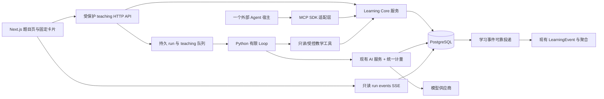

# SeeWord V2 技术设计方案

日期：2026-10-31  
状态：待实施设计，供拆分 PR 与技术评审；不是已交付能力或上线证明。  
代码基线：`master 2e92255b`。配套事实与风险见 [V2 方案评审](v2-plan-review-2026-10-31.md)；产品输入为该评审引用的 V2.0 与交接稿。  
范围：可信单题教学、网页与一个外部 MCP 宿主继续同一学习流程、模型计量、授权和可恢复执行。本次只新增本文档。

## 1. 设计结论与首版边界

采用 **现有 Python 单后端 + 关系数据库 Learning Core + 有限教学 Loop + 官方 MCP Python SDK 适配层**。继续使用现有 Next.js、PostgreSQL、Redis、Celery，不引入独立模型网关、通用工作流引擎或向量数据库。

首版必须完成这一条真实链路：

> 用户打开一道经核验的题，创建教学会话 T → 网页明确提交初答 → 请求提示或直接解析 → 外部宿主使用同一 T 提交带来源标记的复答 → 网页按 T 恢复 → 撤销连接后外部调用失效。

以下决定作为实施起点：

| 问题 | 首版决定 | 边界 |
| --- | --- | --- |
| 考试与教学 | 正式整卷考试继续一次交卷；单题教学另有 session/item/attempt | MCP 单题提交不调用旧整卷 submit，不给未答题批量判错 |
| 谁提交用户答案 | 网页按钮确定性提交；内置模型无提交/揭晓权限 | 聊天“选 C”可形成草稿建议，不能直接生成用户成绩 |
| 外部作答 | 允许有 scope 的宿主直接追加辅助教学 attempt | 标记外部转述/独立性未知，不改变整卷成绩、掌握度或有效学习日 |
| 内容权威 | 标准答案、分级提示、证据、逐项解析先审核并版本化 | 未核验不能靠模型补成权威；不以字段非空作为核验 |
| Agent 的作用 | 查询允许的上下文、诊断为假设、组织已获准内容和下一动作 | 作答前不开放自由生成解析；不能修改答案或自填评分 |
| 执行托管 | Runtime 仍是 backend 模块，长回合交专用 `teaching` Celery worker | 与现有 `celery`、`transcription_gpu` 消费者隔离；不随 SSE 连接执行 |
| 强一致状态 | PG 管理会话、幂等、run、账本与预算 | Redis 只作现有 broker/通知，不能成为成绩或撤权的唯一事实源 |
| 对外协议 | 一个宿主、一组锁定 SDK/协议配置 | 只读通过不等于 BYOA 交卷闭环通过；不承诺多宿主与语音 |

完整个人记忆 CRUD、词汇多语境、逐次复习日志和调度切换后置。线上继续 S6；FSRS 与既有 B04 自研影子的分歧仍需产品决策。Pi 为对照候选，不能因提供工具循环就直接替换现有 Python 服务；其 SDK 面向 Node.js/Bun/TypeScript，集成还涉及桥接与计量边界，依据见配套评审 D.7。

## 2. 当前代码接缝与目标组件

| 现有落点 | 本方案的改动边界 |
| --- | --- |
| `backend/app/services/exam_service.py` | 修复所有考试模式开考快照；抽出可复用纯判分规则，保留旧 submit 的响应/幂等语义 |
| `backend/app/models/exam_test.py` | 保留 `ExamAnswer(session_id, question_id)` 唯一约束；补快照集完成标记/版本，不塞多次教学答案 |
| `backend/app/services/home_content_service.py` | 借鉴不可变版本、来源指纹、生成占位的现有模式；不复用首页内容表 |
| `backend/app/services/ai_service.py` 与 `translation/__init__.py` | 三类 SDK 调用共同进入计量包装；保留 SDK import 的现有允许位置 |
| `learning_event_service.py` / `event_contract.py` | 新流程用严格投影与可靠投递；现有宽容 `emit_event` 不作为唯一事实存储 |
| `backend/app/tasks/celery_app.py` | 注册教学队列/任务、run 巡检与事件投递；原视频管线任务不改队列 |
| `backend/app/api/dependencies.py` | 提炼共同账号有效性检查；站内 JWT 和外部 opaque 凭据分别解析 |
| `frontend/src/app/(main)/practice/exams/[id]/page.tsx` | 按模式分支，教学用 URL 中的 T 恢复；旧页面每次挂载新建考试 attempt 的行为不能冒充恢复能力 |
| `frontend/src/lib/createApiClient.ts` | 继续处理 JSON API；另建流式客户端，复用 token/刷新策略 |
| `account_data.py` / `account_tasks.py` | 新数据导出、用户 FK 与注销处理同批交付；凭据与敏感内部字段不导出 |



拟新增目录按业务组织：`models/teaching.py`、`models/model_call.py`、`models/agent_run.py`、`models/external_connection.py`、`models/learning_event_outbox.py`；`services/teaching/`、`services/model_metering.py`、`services/external_connection_service.py`、`services/learning_event_delivery.py`；`api/v1/teaching.py`、`api/v1/external_connections.py`、`integrations/mcp/`、`tasks/teaching_tasks.py`。这是落点建议，非要求先批量创建空模块。

新计量模块接收“执行一次 SDK 请求”的异步闭包，不直接 import `openai`。这样无需放宽 `pyproject.toml` 的 INV-005/TID251 白名单。模型调用与教学规则仍由原 service 层承载。

## 3. 身份、版本与可信度契约

新增入口统一接受服务端构建的 `Principal`：

```text
user_id (仅 system 可空), actor=user_ui|internal_agent|external_agent|system,
request_id, connection_id?, granted_scopes, credential_issued_at?
```

`user_id/actor/scopes/connection_id` 不在模型工具输入 schema 内；请求中的同名字段拒绝。资源按当前用户查询，他人资源与不存在统一 404。系统后台调用也必须带明确的服务 actor，并受全局额度约束。

三种可信度分开存储：

| 字段 | 证明什么 | 不证明什么 |
| --- | --- | --- |
| `content_status=verified` | 该内容 revision 经指定人员核验，来源与证据符合发布门 | 用户已掌握、材料永远不会撤回 |
| `server_graded=true` | 服务端对该次答案按冻结标准答案执行确定性判分 | 用户亲自/独立作答，内容一定是已审核版本 |
| `answer_origin` 与 `assistance` | 输入渠道、已知提示/揭晓/历史暴露 | 外部宿主实际完整对话或没有使用其他帮助 |

外部答案固定 `answer_origin=external_reported`、独立性 `unverified`。网页明确提交标 `ui_explicit`，也只声称系统内记录到的帮助情况，不能把它宣传成监考级证明。旧成绩保留 `legacy_server_grading`，内容状态/初答资格未知时用 unknown，不批量写成 false 后改变历史统计。

版本至少包含：`content_revision_id`、`grading_version`、`teaching_policy_version`、`prompt_version`、`toolset_version`、`card_schema_version`、`event_schema_version`。创建教学会话时固定其版本，不随后台发布自动切换；模型路由实际响应的模型标识也写账本。

## 4. 可信内容、快照与来源生命周期

### 4.1 稳定题目身份与不可变内容

稳定 `question_key` 使用规范化卷身份加题号：`exam:{level}:{year}:{month}:{set_no}:{number}`。它不依赖可被重导更换的数据库 UUID；来源冲突或同键不同题不能自动合并为“已核验”。发布前先核对卷、题号与内容。

| 实体 | 核心字段与约束 |
| --- | --- |
| `exam_analysis_revisions` | `id, question_key, question_id?, revision_no, source_fingerprint, question_payload, correct_answer, grading_version, learning_objectives, option_analyses, reviewed_hints, analysis_payload, rights_policy, verified_by/at, status, created_at`；唯一 `(question_key, revision_no)` |
| `exam_evidence` | `id, revision_id, material_key, source_revision, unit, start, end, quote_hash, kind`；FK 到内容 revision；边界和摘录 hash 由发布门校验 |
| 当前题库关联 | `ExamQuestion` 仅指向当前候选/发布 revision；不让导入器直接修改已核验内容 |

`question_payload` 包含题干、材料、选项及规范化题型；答案只在服务端。内容 body 与证据一经发布不 UPDATE，新修改生成下一版。状态/许可可变为 retired/withdrawn，但不能借改状态改正文。来源指纹覆盖材料、题干、选项、标准答案及定位约定；不把旧占位 explanation 当有效解析输入。

文本区间首版固定为规范化原文的 Unicode code point 半开区间 `[start,end)`，保存 `normalization_version`；前端先用 `Array.from(text)` 按同单位处理，不能用 UTF-16 下标直接切。音频区间用毫秒整数，绑定素材 revision 与时长；本版首批题为阅读客观题，不据视频听写推断考试听力素材齐备。

发布门检查：答案在有效选项内、题型可判分、全部干扰项有说明、证据区间可定位、来源/许可范围明确、分级提示经审核且提示不等于完整答案、审核者与版本完整。未通过只留草稿，不进入教学白名单。

### 4.2 现有考试快照修复

创建 paper/daily/wrong_redo 任一考试会话时，在同一事务写完整 `ExamAnswer` placeholder 与快照，并记录 `snapshot_schema_version/snapshot_completed_at`。提交后按该快照判分、回放和展示；题库改题/删题不会切换作答依据。

旧未提交会话没有可靠开考快照时，不能假装“已经冻结”：缺失者返回 409 `EXAM_SNAPSHOT_UNAVAILABLE`，提示重新开始；已有 placeholder 是否足够按校验结果处理。已提交历史保持原结果，不自动重评分。迁移不把当前题库内容回填成过去开考时的事实。

目前 `exam_service.submit_answers` 自行 commit，重复提交分支还会 rollback。新教学服务不在它外面套事务：复用/提取不提交的判分规则，新事务自己拥有提交边界；旧 API 用兼容 wrapper 保留原行为。

### 4.3 来源变更与撤回

导入器更新当前题库时使其发布指针失效，或通过读取时来源指纹比较判失效；明确选一个事实源，避免各写入口重复维护失效逻辑。推荐沿用首页的**读取/发布时重算指纹**模式，新建会话只接受仍匹配的 verified revision。

普通改版不改变历史会话固定的 revision。安全/权利撤回是另一状态：撤回后即使历史会话也不再向外部或新模型发送正文，只返回状态与受控结果摘要；是否允许本站历史展示由 rights policy 明确。`rights_policy` 分别约束站内展示、模型处理和外部再分发，深链不携带媒体访问 token。

## 5. 教学会话、逐次作答与暴露

### 5.1 最小数据模型

| 实体 | 字段、索引与作用 |
| --- | --- |
| `teaching_sessions` | `id, user_id, status=active/completed/abandoned, revision, current_item_id?, policy_version, source_exam_session_id?, source_exam_answer_id?, created_at/updated_at`；首版一个来源单题一个 T；唯一 `(user_id, source_exam_answer_id)`，无来源为 null |
| `teaching_items` | `id, session_id, question_key, content_revision_id, ordinal, state, next_attempt_no, last_attempt_id?, draft_answer?, draft_revision, source_exam_answer_id?`；唯一 `(session_id, ordinal)` 与 `(session_id, question_key)`；同一 T 内不重复插同题 |
| `teaching_attempts` | `id, item_id, attempt_no, user_answer, correct, grading_version, role=initial/retry/delayed_retest/legacy_exam, answer_origin, server_graded, assistance_snapshot, occurred_at, source_exam_answer_id?`；唯一 `(item_id, attempt_no)`；只追加 |
| `user_question_exposures` | `user_id, question_key, max_hint_level, feedback_count, first_answer_available_at?, origin, updated_at`；唯一 `(user_id, question_key)`；跨会话单调不回退 |
| `user_question_disclosures` | `user_id, content_revision_id, answer_confirmed_at?, analysis_revealed_at?, reason`；唯一 `(user_id, content_revision_id)`；控制该版本内容是否已获准可见，不与全局暴露混用 |
| `teaching_operations` | `id, user_id, operation_namespace, operation_id, operation_type, request_hash, status, result_refs, created_at`；唯一 `(user_id, operation_namespace, operation_id)`；namespace 为 web 或 `mcp:{connection_id}`，由服务端构造；存结果引用，不缓存跨权限的完整答案响应 |
| `teaching_feedbacks` | `id, user_id, session_id?, source_connection_id?, operation_id, content, verification=unverified, source_kind, occurred_at, expires_at`；待验证自述，不更新正式成绩/掌握度 |

所有用户数据沿 FK 绑定账号，子数据通过父归属读取。操作键由网页为一次明确动作生成，或外部宿主为一次业务意图生成；`request_id`、模型 `tool_call_id`、Celery `task_id` 不替代业务幂等。

### 5.2 状态与揭晓政策

item 的显示状态：`awaiting_answer → graded → coaching → retry_ready → completed`；直接揭晓可从任一活动态转为 `answer_revealed`，之后仍可复答，但不能回到“未见答案”的资格。会话完成/放弃不删除已有 attempt。

普通读题不含答案/解析隐藏字段。提示动作提交审核过的下一等级提示；直接答案动作先记录暴露再返回解析。首版作答前不让模型自由生成解释，也不把标准答案注入该阶段的模型上下文，避免正确字段裁剪后仍从自由文本泄题。

服务端返回判分结果中的标准答案、逐项解析或证据若足以揭晓答案，均视为 `answer_available`；先冻结该次作答提交前的 assistance，再更新暴露。暴露代表系统已使答案可见，不声称用户实际阅读。

普通首次提交默认只返回 `correct` 与 attempt 标识，不自动下发标准答案/逐项解析，保留“错误反馈→提示→复答”路径。错误反馈也增加 feedback_count，下一次只能算 retry；答对即已确认标准选项，记录 answer available。用户明确揭晓才返回完整解析；已看答案后的复答始终保留其暴露标签。

`initial` 资格同时要求该用户该逻辑题没有先前 graded 尝试/反馈、提示或答案暴露，且历史映射完整；新建 T 不重置资格。全局 exposure 只用于保守判断帮助历史，**不授予新内容版本的读取权**。rev1 的揭晓不能直接开放修改过答案的 rev2；答正确认/显式揭晓写该 revision 的 disclosure 后，才允许分析读取。

跨 T/标签页按 `user_id + question_key` 同一暴露行裁决。首次接触该题时用 upsert 确保行存在，所有帮助/提交操作都锁此行；历史已交卷题目保守回填为 legacy answer available。旧正式成绩仍是原 raw score，本版不赋予它“无提示测评”新含义。

不能只做一次历史回填：PR1 同时让功能开启后的旧整卷提交，在自己的交卷事务中按稳定 question_key 同步记录答案可见，再返回整卷答案。历史映射是否完整按用户记录回填资格；无法映射的旧数据对应测评资格为 unknown，新注册且经过所有出站路径的新用户才可直接建立基线。回填未完成的既有用户不冒充首次接触。旧 raw score 不受这些资格字段影响。

### 5.3 一个写动作的事务

所有既有会话教学写入按固定顺序锁定：外部连接（若有）→ 教学 session → run（若有）→ 内容 revision → 按 question_key 排序的 exposure/disclosure → item → operation。连接撤销也用同一连接行锁；涉及多个键一律排序。一个短事务执行：

1. 校验本人、scope、入口开关及账号/连接有效性。
2. 查询已完成 operation；同键同载荷返回原结果引用，异载荷 409。**重放先于旧 expected_revision 拒绝**，否则成功后重试会被自己的 revision 更新挡住。
3. 校验 `expected_revision` 和当前状态，固定规范化答案及当前 assistance。
4. 新增 attempt 或帮助/反馈记录，递增 session revision；需要时写事件 outbox。
5. 保存 operation 与结果引用，一起 commit；响应 DTO 再按当前权限构建。

判分使用固定 revision 的纯规则，不调用 LLM。事务失败则 operation、attempt 和 outbox 全部回滚；成功但响应丢失可按同 operation 重放。模型请求、broker 请求和 SSE 等待均不在该事务里。

创建 T 没有现成 session 可锁，单独采用“创建 session + 创建 operation”同事务及唯一键裁决：相同 operation 并发时，唯一冲突的整个事务回滚，再用新事务读赢家收据；两次调用返回同 T。request_hash 覆盖操作类型、目标及规范化业务输入（排除 operation_id 本身），不只对 answer 求 hash。从旧已交卷来源重复继续，由 session 上唯一 `(user_id, source_exam_answer_id)` 返回同一教学对象；若冲突也回滚整笔创建后再读赢家。

### 5.4 与旧整卷考试的桥接

首版提供两种教学起点：从核验题直接创建 T，或从**已交卷**考试的单题结果创建 T。后者核对原题面/选项/答案 hash 与 verified revision，匹配才关联原初答；不匹配返回 409 `CONTENT_REVISION_MISMATCH`，保留原结果并允许另开当前版本教学。

引用原初答标 `legacy_exam`，不再发 practiced_items，不再次累计完成数。重复来源关联有唯一约束。尚未交卷的正式考试不能借单题 MCP 提交提前判分；用户可继续原考试或先交卷。本版不实现整卷草稿恢复/考试转教学自动转换。

最小闭环的恢复对象始终是新的 T，而非把旧未提交整卷伪装成可恢复教学。用户若另开同题教学后再做旧考试，旧 raw score 保持原语义；教学收益评价只看新流程记录到的 assistance，不能据此宣称旧考试是独立作答。

## 6. HTTP API 与前端卡片契约

所有路径为拟新增；JSON API 延续 `{code,message,detail?}` 错误 envelope。新写请求含 `operation_id`；修改既有资源还带 `expected_revision`。不在 body 接受可信身份/评分字段，未知字段 422。

| 方法与路径 | 作用与关键输入 | 返回 |
| --- | --- | --- |
| `POST /api/v1/teaching/sessions` | `operation_id`、核验题引用或已交卷来源 | 201；T、item、revision、公共卡片；幂等重放 200 |
| `GET /api/v1/teaching/sessions/{T}` | 本人教学状态 | 当前 revision/item、裁剪卡片、attempt 摘要、最新 run |
| `PUT /api/v1/teaching/sessions/{T}/draft` | item、草稿答案、当前题、expected_revision | 200；只存草稿，不判分、不记学习事实 |
| `POST /api/v1/teaching/sessions/{T}/attempts` | item、答案、operation、expected_revision | 201/200；追加 attempt 与判分，不改考试总分 |
| `POST /api/v1/teaching/sessions/{T}/hints` | 明确请求下一提示 | 200；先记暴露再给审核提示 |
| `POST /api/v1/teaching/sessions/{T}/reveal` | 明确请求直接答案 | 200；先记暴露再给解析卡 |
| `POST /api/v1/teaching/sessions/{T}/feedback` | 受限长度的自述 | 201/200；待验证反馈，不推进 mastery/streak |
| `POST /api/v1/teaching/sessions/{T}/complete` | operation、expected_revision、结束/放弃动作 | 200；保存终态与总结，不删除历史或重计成绩 |
| `POST /api/v1/teaching/sessions/{T}/runs` | 用户消息/教学意图、operation | 202；run_id、state_url、events_url；不提交答案 |
| `GET /api/v1/teaching/runs/{R}` | 本人状态/安全结果 | run 状态、last_sequence、结果快照、错误 |
| `GET /api/v1/teaching/runs/{R}/events?after=N` | 只读订阅持久事件 | fetch SSE；绝不创建/恢复执行 run |
| `POST /api/v1/teaching/runs/{R}/cancel` | 幂等取消 | 当前状态与 cancel_requested；不撤销已提交事实 |

示例提交（标识符是示意值）：

```json
{
  "operation_id": "45dcf1af-3b3b-45a4-9a46-44967fd90f41",
  "expected_revision": 3,
  "item_id": "item-1",
  "answer": "C"
}
```

页面复用 `/practice/exams/{paper_id}`，教学参数为 `mode=teach&teaching_session_id=T&item=I`。有 T 就 GET 恢复，不能在 effect 中再 POST 新 T；首次创建成功后 replace URL。T/I 只是资源引用，后端仍查归属。与原 `mode=exam` 的整卷流程分支清楚，不新增一级导航。

后端 Pydantic 与 `frontend/src/types/teaching.ts` 一一对应，固定卡片为判别联合：`question/hint/evidence/analysis/summary/status`。公共头至少有 `schema_version/card_id/session_id/item_id/session_revision/kind`；payload 依 kind 校验。模型只输出有限 `TeachingIntent` 与证据引用，service 验证后构造卡片，不能输出 HTML、组件代码、API URL 或任意 action。

所有读取（会话、attempt、run、事件、操作重放与 MCP）都按 **当前允许披露级别（含公共题面及该版本 disclosure）∩ 当前 connection scopes ∩ 当前 rights policy** 投影。仅 `teaching:read` 的连接，即使用户在网页已揭晓，也不能从恢复卡片/历史结果夹带标准答案或 analysis；不能把持久化 safe_result 当成可对任意读者原样返回的响应缓存。

卡片动作只用服务端枚举 `submit_answer/request_hint/reveal_answer/continue/open_source`；前端映射到固定函数。链接只接受服务端生成的同站相对深链或通过许可校验的素材地址。未知版本/动作显示可恢复状态，不执行。复用设计 token 和题目展示组件；将 ExamRunner 的题面渲染拆成可复用组件，不能把它内部整卷 submit 生命周期一起搬进教学。

建议初始体积限制：单条消息 4000 字符、答案 64 字符、每卡 16KB、每次最多 8 张卡；最终按首批题材校验调整。请求与模型输出都设上限，响应中不带供应商栈、完整 prompt 或密钥。

## 7. Agent 执行、故障恢复与网页 SSE

### 7.1 有限 Loop 与持久 run

首版 Python Loop 的每步为：加载服务端状态 → 根据当前 disclosure 构建最小上下文 → 申请模型额度 → 调用模型 → 严格验证 intent/tool 参数 → 调用只读/受控工具 → 持久化安全结果/卡片 → 决定结束或下一回合。

内置工具表只包含安全取题、取已允许的证据/解析、取复习任务及查询本次状态；用户提交、hint/reveal 和反馈写入走 HTTP 确定性动作。route、registry、service 三层都检查 actor，模型伪造 `submit_answer` 即使猜中工具名也不能写入。前置状态只允许预审核提示卡和操作建议；自由解释仅在已揭晓/允许分析的状态开放，仍以 verified 内容为依据。

| 实体 | 最小字段与约束 |
| --- | --- |
| `agent_runs` | `id, user_id, session_id, operation_id, request_hash, status, prompt/toolset/policy_version, bound_session_revision, queue_deadline_at, execution_deadline_at?, cancel_requested_at?, lease_owner/epoch/expires_at, last_sequence, error_code, created_at/finished_at`；唯一 `(user_id, operation_id)`；一个 T 最多一个 active run |
| `agent_steps` | `id, run_id, seq, kind=model/tool/card, operation_key, input_hash, safe_input?, safe_result?, status, model_call_attempt_id?, lease_epoch, created_at/finished_at`；唯一 `(run_id, seq)` 和 `(run_id, operation_key)` |
| `agent_run_events` | `run_id, sequence, type, schema_version, session_revision, safe_payload, occurred_at`；唯一 `(run_id, sequence)`；仅供运行恢复与 UI，非第三套学习统计事件 |

run 状态：`queued → running → succeeded/failed/cancelled/needs_retry`。create API 在一笔事务写 run 与 queued 意图，提交后最佳努力发专用 `teaching` 队列，只传 run_id。`queued` 行本身可由 beat 补派，无需复制视频 `pipeline_dispatches` 表或新增第二张 run 派发表。

worker 通过条件更新领取 run 并递增 lease_epoch；所有推进状态的写入检查 epoch。重复 Celery 投递不重复执行。每步前检查取消、deadline、账号/连接状态、入口开关和 session revision。用户在另一入口提交或揭晓导致 revision 变化时，旧 run 停止为 `needs_retry/TEACHING_CONTEXT_CHANGED`；不能把旧状态的卡片写回当前页面。

每次模型真正 dispatch 前也校验当前内容许可/撤回状态，缓存的 safe_input 不豁免。模型 await 期间仍可并发改状态，因此**发布结果时再次短事务锁 session→run→内容 revision**，核对 bound revision、epoch、取消、deadline、当前 rights；step 结果、卡片与 run event 一起提交。失配只记录 needs_retry/受限状态，不发布旧卡片；调用账本仍独立结算。

模型返回后先持久化安全输出与计划工具 step，再执行工具；已 committed step 可重放。持久化前崩溃或模型可能已调用但无可靠结果时，标 uncertain，不自动重发同一步。旧 epoch 的迟到响应仍结算账本，但不能推进 run。若未来新增数据库写工具，必须先实现“领域写入 + operation/step + outbox”同事务，不能直接开放现有自行 commit 的服务。

建议私测初值：每 T 一个 active run、每用户一个模型在途、全站四个模型在途、教学 worker 并发二；最多六个模型回合、八次上游尝试、每步最多四个工具调用、一次只执行一个工具。排队期限 60s，领取后的**执行总期限 30s**，所有重试共用剩余时间；输出每次最多 1024 token，run 总 token 额度从受控配置读取。以上是待压测的配置起点，不是性能或容量结论。

beat 每 10s 扫描 queued/超期 run 和租约，重发/终止逻辑幂等；既有云端 worker 不消费 teaching，新 worker 也不消费视频队列。关闭 worker 后会话与已提交成绩仍可查询，模型解释可以降级为审核过的固定卡片。

### 7.2 执行与订阅分离

`POST runs` 创建执行，`GET events` 只读，不在 Web 进程内启动后台模型任务。SSE 断线只结束网页订阅；用户取消须 POST cancel。worker 崩溃按 run 状态恢复，不能靠浏览器重连重跑工具。

```text
id: 18
event: card.upsert
data: {"schema_version":1,"run_id":"run-1","sequence":18,"session_revision":4,"type":"card.upsert","payload":{"card":{"schema_version":1,"card_id":"card-1","session_id":"session-1","item_id":"item-1","session_revision":4,"kind":"status","payload":{"text":"已完成本轮讲解"},"actions":[]}}}

```

持久事件类型为 `run.started/run.progress/card.upsert/run.completed/run.failed/run.cancelled/content.restricted`；心跳用 SSE 注释，不占 sequence。卡片与终态必须先入 PG 再通知，Redis 通知丢失后仍可从 PG 补读。首版不直接透传模型原始 token 流，只流式发送已验证的状态/完整卡片，避免未经检查内容先到用户。

客户端用带 Bearer 的 fetch，复用 authStore 的刷新互斥与 expired/unavailable 区别，所有会话写入仍经 authHelpers。连接前或初始 401 只刷新一次；网络/刷新暂不可用不清空登录。流开始前错误走 HTTP envelope，开始后失败事件带同形错误；不尝试修改已发送的 HTTP 状态。

重放时重新执行统一出站投影。内容撤回后以相同 sequence 的 `content.restricted` 安全占位代替正文；活动订阅在下一次许可检查追加该控制事件，使客户端移除对应卡片。GET T 的受限状态也清除该素材的本地卡片缓存。不能追回已发给宿主的内容，但缓存/历史重放不能继续泄出。客户端已处于 revision 5 时，revision 4 的卡片只推进游标、不覆盖当前 UI；收到更高 revision 先 GET T，再合并卡片，旧 run 终态不回退当前 session。

收到重复 sequence 丢弃，有缺口先 GET run 状态并补读；重连只带 `after=N`，不重新 POST。游标已清理则 410 `EVENT_CURSOR_EXPIRED`，改读安全结果快照。解析器处理任意 UTF-8 chunk、跨 chunk 的行分隔和多行 data，不用简单 `chunk.split("\n\n")` 假定边界完整。

首包建议 5s、心跳 10s、空闲 20s；事件订阅单次最长 60s，可重连读取终态。周期复查账号/连接、到期 token 不继续推私有内容。每次补读用短 DB session，不让 SSE 长时间占事务/连接；run 终态或客户端退出即释放资源。sequence 的更新由锁 run 的事务统一分配，支持两个 Web worker 切换。

## 8. 模型计量、预算与并发硬闸

### 8.1 封装与账本

统一包装三个现有出口：`AIService._chat`、备用 client 的 `_generate_word_notes_one_batch`、翻译 `_call_engine`。SDK 客户端显式关闭隐藏自动重试（`max_retries=0`），由受控层决定重试、次数、deadline；业务翻译重试每次都重新准入和记账。先结算响应 usage，再解析 JSON，格式错误不等于没花 token。

`CallContext` 包含 `logical_call_id/provider_attempt_id/request_id/task/provider_account_id/engine/model/user_id?/run_id?/step_id?/flow_id?/source/price_version/input_ceiling/output_cap/deadline_at`，全部由服务端形成。后台无用户调用也记入 system/global 桶。工具返回、提示与记忆只传最小必要范围，日志不存完整 prompt 或模型思维过程。

| 实体 | 字段与约束 |
| --- | --- |
| `model_call_ledger` | 每次供应商尝试一行：logical_call_id、attempt_no、上下文关联、请求/响应 model、provider_request_id、execution_status、dispatch_started_at、deadline、usage_status、输入/输出/缓存/推理 token、reserved/charged token 与 cost、price_version、slot_status、错误/取消、时间；唯一 `(logical_call_id, attempt_no)`；user/run 关联可空并 SET NULL，不能随 run CASCADE 丢账 |
| `model_budget_buckets` | 不可变 UUID 主键、scope=`global/user/run`、scope_key、window_start、token/cost limit、used、reserved；唯一 `(scope,scope_key,window_start)`。global/user 按 UTC 日，run 使用固定生命周期窗口 |
| `model_concurrency_limits` | 不可变 UUID 主键、scope、scope_key、max_inflight、held_slots；唯一 `(scope,scope_key)`，**没有日窗口**；held 包含 quarantine，跨午夜仍占槽 |

金额用整数微美元或固定精度 Decimal；unknown 保留空 usage，不能填 0。attempt 保存原预占 bucket/并发行 UUID，午夜后结算仍回到原窗口，不能扣进另一日或让新日并发归零。scope_key 与账号/run 关联可脱敏，**UUID 主键始终不变**；late settle 按 attempt_id 重读 PG 引用，不能由旧 CallContext 的 user/run id 推导桶。reserve/settle/sweep/purge 都按固定顺序锁并发行、预算桶、attempt；不引入 Redis 配额与 PG 账本双写。

### 8.2 准入、调用、结算

1. **reserve 短事务**：锁预算桶，校验 `used + reserved + 本次上界 <= limit`、共享并发与 run 剩余次数；写 reserved 账本与额度/槽位后提交。
2. **dispatch 标记**：先持久化 dispatch_started，再发网络请求。该标记与实际发包之间无法原子化，崩溃恢复保守认定“可能发出”。
3. **调用**：不持有业务/预算行锁；供应商请求 timeout 不超过 run 剩余期限。每次重试/备用引擎都申请独立 attempt。
4. **settle 短事务**：锁同桶与该 attempt；终态条件保证仅结算一次。释放预占，转入实际或保守消耗，释放/隔离并发槽位，记录结果。
5. **业务处理**：校验结构与内容再推进教学状态；业务回滚不能抹掉独立事务中的模型消耗。

| 结果 | 预算与恢复 |
| --- | --- |
| 确定未发送 | 记录 not_sent，释放预占和槽位 |
| 有可靠 usage | 按实际结算，含后来 JSON/内容校验失败 |
| 完整响应无 usage | 预占上界转保守消耗，usage=unknown |
| 超时/取消/断线/进程丢失且可能已发出 | 保守消耗，不自动退款，不自动重发该 step；run 可进入 needs_retry |
| 后续取得可靠供应商用量 | 幂等 reconciliation 调整差额，保留原值与调整来源 |
| 实际高于可信上界 | 如实记账、报警并熔断该模型的硬预算准入，不能把实际值截回额度内 |

租约过期不证明供应商停止执行。uncertain 槽位进入 quarantine；无法核实完成时私测采用熔断/人工确认恢复，不能自动释放后继续宣称控制了供应商端实际并发。取消也不追溯撤销已发生费用。翻译竞速两路各自预占/结算，本地取消 loser 仍可能收费；新 Agent 首版不竞速模型。

**上界的前提**：模型能力/计价配置有版本，已验证其输入上界、输出 cap 与实际计费语义。仅有 `:free` 名称或本地估算 tokenizer 不足以保证费用上界；缺可信上界的模型不进入公开硬预算模式，私测只在明确额度和风险限额下启用。DB 无法预占时 fail closed；供应商账单本身仍需对账，不能把本系统准入限制说成供应商账单保证。

私测先选一个支持所需工具/结构化输出的模型，记录实际能力测试；不能从“OpenAI 兼容”推断所有工具参数、缓存/推理用量或 usage 行为相同。备用模型通过相同金标题回归才能启用；不在本文写死当前免费目录、价格或许可结论。

## 9. 学习事件的可靠投递与统计兼容

权威学习事实是 attempt，现有 `LearningEvent` 仍是唯一服务端学习事件表，客户端交互仍进 `BehaviorEvent`。新增 `learning_event_outbox` 是事务投递队列，不是第三套分析总线。

outbox 字段：`event_id, user_id, attempt_id?, business_operation_key, event_type, event_value, schema_version, flow_id, actor, origin_host?, answer_origin, verification_method, occurred_at, event_date, payload_version, payload, status=pending/delivered/dead, attempts, next_attempt_at, last_error`；唯一 `(user_id, business_operation_key, event_type)`。

`LearningEvent` 增加可空且唯一的 `origin_event_id`（历史 null 兼容）、attempt/actor/来源与核验字段。投递器锁 due outbox，执行“插入事件 → 仅首次插入才更新计数/目标/streak → 标 delivered”同一事务；冲突不重复投影。失败全部回滚、退避重试，超限 dead 行告警保留。

必须提取不吞异常、不自行 commit 的严格投影函数，不能调现有 `emit_event` 后直接认为成功。原函数暂留给旧流程兼容；教学新流程先迁入严格路径。历史重放、旧初答挂接、hint/reveal 和自述不自动发普通 practiced_items。

迟到/乱序事件按发生时保存的 `occurred_at/event_date/timezone` 写事实，不能用投递时刻重判学习日。现有 daily progress 的“日期变化就 reset”与递增 streak 不能直接用于补发：严格投影锁 profile，按有效事件重算受影响日、今天缓存与连续学习区间，历史事件不得把 today_date 回退到昨天。重算与投影提交同一事务，验证跨午夜、昨天事件晚到、重复补发和时区变更；必要时合并同用户批次减少重算。

更新范围包含 `VALID_EVENT_TYPES`、`FLOW_SOURCES/normalize_source`、版本、前端 analytics 镜像和 measurement 消费方。actor/暴露状态过滤写入服务端版本化定义，不能只在页面上过滤。默认外部辅助提交与内置 Agent 行为不增加正式成绩/mastery/有效学习日；网页明确作答是否计入活动按教学事件契约另行固定，不能沿用旧练习计数器的隐式副作用。

新 `flow_id` 使用 **teaching_operation_id/attempt 对应的稳定操作标识**，session_id 作为关联字段，避免同 T 的多次作答被折成一个 flow。管理端分别展示客户端意图重复、服务端 origin_event 重复/缺失、待投递积压年龄。现有 `_event_quality` 的服务端 set 只能作 flow 匹配，不能证明业务 exactly-once；本设计承诺的是幂等副作用，不承诺消息只投递一次。

学习收益实验独立于活跃统计：初答、提示、揭晓、立即复答、延迟复测分组。主指标须同时验证答案与证据定位，排除已揭晓/外部代答样本的独立性假设，并报告样本与流失；20 题是质量回归集，不是有效性统计保证。

## 10. 外部连接与 MCP

### 10.1 凭据、scope 与撤销

外部 opaque token 与站内 JWT 分开解析，共同复用账号有效性规则；不能把 opaque token 直接传进 `resolve_token_user`。外部工具每次检查 PG 中连接/凭据状态、scope、签发/过期时间、封禁、改密失效策略；数据库不可用拒绝访问，不借 Redis 黑名单的降级行为维持外部权限。

| 实体 | 核心字段 |
| --- | --- |
| `external_connections` | `id, user_id, host_label, auth_kind, granted_scopes, created_at, expires_at, revoked_at, last_used_at` |
| `external_credentials` | `id, connection_id, token_hash, issued_at, expires_at, revoked_at, last_used_at`；hash 唯一；支持轮换，不保存明文 |

用户在已登录的网页创建连接、选择最小 scope，并在安全配置渠道得到一次显示的限时高熵凭据；不得粘贴进普通聊天或日志。凭据至少 32 字节随机，使用标识符查找并常量时间校验 hash。首版不设计 refresh token。`host_label` 是连接元数据，不能当作通过密码学验证的宿主身份或授权依据。

Web 管理路径为 `/api/v1/external-connections` 的 GET/POST，`/{C}/credentials` 的 POST，`/{C}/revoke` 的 POST。撤销幂等；事务提交后新工具执行立即失效。写工具与撤销锁同一连接行，撤销响应后不能再提交新的工具写入；此前已完成的作答保留。读取/长任务在下一检查点停止继续发送私有内容。

申请注销即停止新外部调用并撤销连接，作为**新增外部访问政策**实施；不改变现有冷静期 Web 登录规则。撤销注销不会自动恢复旧连接。改密或封禁也不自动恢复已撤凭据。

建议 scope：`learning:profile:read`、`teaching:read`、`teaching:analysis:read`、`teaching:analysis:reveal`、`teaching:attempts:submit`、`learning:feedback:write`、`review:read`。默认只授本人安全读权限；新增写入与揭晓必须单独授权。

### 10.2 工具与业务语义

MCP 与网页调用同一 service，不能转 HTTP 绕回旧整卷 submit。首版工具如下，所有会话/item 引用均校验本人归属：

| 工具 | scope | 语义 |
| --- | --- | --- |
| `get_learning_profile` | profile:read | 只给授权学习概况，不默认给手机号、笔记、记忆或聊天 |
| `list_teaching_sessions` | teaching:read | 分页列本人最近活动 T/I 与恢复深链，帮助“继续昨天”定位同一会话 |
| `get_teaching_session` / `get_exam_question` | teaching:read | 按 T/I 读取安全题面与版本；不按任意题库 id 开答案口 |
| `get_question_analysis` | analysis:read | 仅返回已对该用户/题标记为可见的解析；未揭晓态拒绝并给网页动作深链 |
| `reveal_question_analysis` | analysis:reveal | 显式动作；幂等记录全局暴露后返回可信解析，不能标 readOnly |
| `submit_answer` | attempts:submit | 同 T/I 追加外部辅助 attempt，原始成绩不变 |
| `record_learning_feedback` | feedback:write | 保存 unverified 自述，不能写分数/掌握度 |
| `get_review_tasks` | review:read | 读取本人到期任务与可用深链，不直接推进调度 |

表中 scope 使用上节完整前缀。只读 PoC 不开放 submit、feedback、reveal；它只能验证授权连接和查询，不能作为 S1.5 交卷验收。工具 annotations 只用于说明，安全由 service 执行。

外部 submit 的结果必须显式包含：

```json
{
  "attempt_id": "attempt-2",
  "actor": "external_agent",
  "answer_origin": "external_reported",
  "server_graded": true,
  "independence": "unverified",
  "counts_toward_official_score": false,
  "counts_toward_mastery": false,
  "counts_toward_meaningful_learning_day": false
}
```

外部答对同样会让该答案可被确认，必须更新暴露；下一次网页作答不能洗成无提示初答。网页后续确认仅追加关联 attestation，不覆写原 attempt 或恢复独立性。宿主自己的 token/模型成本与完整私聊不可见，不计为 SeeWord 模型使用量。

网页“在已连接 AI 中继续”只复制本人 T/I 与操作指引，不含凭据；外部也可通过 list_teaching_sessions 定位。两种方式都纳入首个宿主 E2E，不能靠开发者手工注入 ID 才完成演示。所有分析读取仍绑定具体 content_revision_id 的 disclosure，不能由同 question_key 的旧版暴露放行。

### 10.3 协议版本与 ASGI 装配

公开 canonical endpoint 选 **`/api/v1/mcp/`**（含末尾斜杠），便于复用现有 `/api/` 反代。采用官方 Python SDK 的 ASGI app 适配，不自行编写 JSON-RPC/协商逻辑；mount prefix `/api/v1/mcp` 配内部 `streamable_http_path="/"`，避免默认 `/mcp` 再次叠加。客户端直接配置 canonical URL，不依赖 307 跳转；dev/生产代理都验证此路径。宿主 ASGI lifespan 显式管理 SDK 的 session manager；不能以为挂载子 app 会自动启动它。依据：[Python SDK ASGI 指南](https://py.sdk.modelcontextprotocol.io/v2/run/asgi/)（读取 2026-10-31，页面未单列发布日期）。

官方 2026-07-28 Streamable HTTP 与 2025 系列存在实质差异，包括移除 GET stream/协议 session，以及请求流关闭的取消语义；2026 版不支持用 Last-Event-ID 恢复 MCP SSE。不能把本方案网页 `GET run events?after=N` 的业务恢复搬成 MCP 协议扩展。依据：[2026-07-28 传输绑定](https://modelcontextprotocol.io/specification/2026-07-28/basic/transports/streamable-http)。

实施前锁定一行兼容记录：`host/product/client_version + SDK exact_version/hash + protocol_date + auth_kind + supported_methods + tool_schema_version`。优先验证当前规范，若目标宿主只支持 2025-11-25，则只开放经该组合实测的兼容配置；**不能从 SDK 文档默认值推断某协议已可用**。SDK/依赖兼容与实际锁定版是 G0 阻断项，未验证前 MCP 开关保持关闭。

现有 cloud 运行集锁有 `openai==1.30.0`、`httpx==0.27.0`、`starlette==1.6.0`。MCP SDK 与这些精确依赖是否兼容必须在隔离环境解析、导入及生产镜像验证；本设计不假定兼容，也不为 SDK 无评估地升级整套运行依赖。若无法在当前栈安全集成，先交付受保护 Learning Core，重评适配层落点后再开放 MCP。

MCP 由 SDK 生成协议响应、工具错误与鉴权 challenge；当前 FastAPI HTTP envelope 只用于普通 JSON API，不能把所有 MCP 错误包成 HTTP 200 或统一 envelope。对 2026 协议流关闭按规范取消，但已提交 PG 副作用不回滚；用同业务 operation_id 重试查原结果，不能把新的 JSON-RPC id 当新的学习动作。

### 10.4 私测认证与标准 OAuth 的边界

若宿主能安全配置自定义 Bearer，首版可用上述限时 opaque 凭据，但只称私测认证。若宿主必须 OAuth，必须在连接前补齐最小标准授权链或延期该宿主，不能临时开放匿名访问。

标准路线以 MCP server 为资源服务器，账号身份仍由 SeeWord 绑定；采用可维护的授权服务器/成熟库，不手写 OAuth 密码学。授权 code + PKCE、受保护资源/授权服务器元数据、resource/audience、scope、redirect 精确匹配、code 一次性/有效期和令牌撤销按锁定版本校验。元数据 URL 与 WWW-Authenticate challenge 要经过真实反代可访问，不能落到 Next 登录页；供应商 key 不进入外部授权流。[官方授权规范](https://modelcontextprotocol.io/specification/2026-07-28/basic/authorization)说明了资源服务器、授权服务器与客户端的职责。

OAuth 授权服务器选型、发行 SDK 版本和目标宿主认证能力本轮未完成 PoC，不在文中编造已通过的精确版本/兼容承诺。opaque 路线失败不会自动放宽为无认证；需要 OAuth 时新增工作量重新估算。

## 11. 部署、隐私与关闭策略

### 11.1 进程和反向代理

保持 API 服务与两个 Gunicorn worker；新增同一 backend 镜像的 teaching worker，显式只消费 `teaching` 队列，并配置到 Compose 环境白名单。沿用原 Celery beat，新增 run sweep/事件投递任务。GPU worker 不载入教学模块、不消费教学队列。

nginx 为教学 events 与 MCP 配置明确的流式 location：关闭 response buffering/cache，使用有限 read timeout，保留 Authorization 与所选 MCP 协议头；不能照搬普通 API 的 `Connection: upgrade`。由上游返回 `Cache-Control: no-store` 与 `X-Accel-Buffering: no`。测试 gzip/flush、慢客户端、token 到期及安全头继承；局部增加 `add_header` 时不能丢原 HSTS/CSP。

Host/Origin 精确白名单与 CORS 一致；没有 Origin 的服务器宿主请求仍需完整认证。只放行实测协议需要的 header/method，不能从含旧 session 的 SDK 示例机械复制。若启用 OAuth，`/.well-known/` 路由在 dev rewrite 与 nginx 都显式转到相应服务；业务恢复链接不带 bearer。

### 11.2 个人数据生命周期

教学输入可能包含作答、自述和个人目标，超出现隐私页“仅字幕 AI 处理”的范围。白名单私测前更新用途、供应商、出站字段与保留期，用户明确知道外部宿主会拿到什么。默认不收集第三方完整私聊/音频，不记录模型思维过程；ZDR 配置不能替代供应商实际能力/条款核验。

建议保留期作为待确认配置：run 操作输入/安全 step 结果与事件 7 日，脱敏调用账本 30 日；教学 attempt 随账号保留，用户可按产品政策删除。过期事件游标返回 410 但会话/attempt 仍可恢复；输入/结果清理后不能靠旧 step 自动重跑。长期个人记忆本期不建，反馈到期后不检索。

新用户表与子表进入导出/注销测试，导出只含用户可读事实、来源/核验/帮助信息及本人费用摘要；不含凭据明文/hash、内部输入快照或安全参数。注销先撤连接、取消 run，再删除教学与运行数据。

正在结算的模型调用不能随 run 删除而丢失全局预算：账本先去除 user/session/run/request 等可识别关联，保留供应商尝试 id、原 bucket UUID 与纯用量直至结算/保留期结束；用量最终留在无用户标识的 global 日桶。user/run bucket 与并发行的 scope_key 脱敏，UUID 主键不变，结清后删除。`_purge_user` 的 FK 动态删除前按 settle 同锁序完成这一步；late settle 仅按 attempt_id 和 PG 中的 UUID 引用完成。held/quarantine 未处理前不得按保留期裁剪；不新增笼统的“永远保留个人账本”豁免。

### 11.3 独立开关

开关建议为 `TEACHING_ENABLED`、`TEACHING_RUNS_ENABLED`、`MCP_READ_ENABLED`、`MCP_WRITE_ENABLED` 加 DB 用户白名单，默认关闭，按 env 总闸与 DB 范围共同生效。模型预算/审计独立于体验开关。

关闭新建/写入后仍允许本人读取已提交状态、导出与撤销连接；停止新 run，已执行调用按 30s 上限结束/取消并结算，不能抹掉已提交事实。旧考试和视频流程继续走原路径。异常模型先熔断该模型，不靠关闭预算闸维持教学可用。

## 12. 错误、验收与实施切片

### 12.1 新增错误契约

| 情况 | HTTP / code |
| --- | --- |
| 格式/未知字段 | 422 `VALIDATION_ERROR` |
| 外部凭据无效/过期 | 401 `EXTERNAL_TOKEN_INVALID`；协议入口带规范 challenge |
| scope 不足 | 403 `INSUFFICIENT_SCOPE` |
| 他人或不存在的资源 | 404 `NOT_FOUND` |
| 同操作键不同 payload | 409 `IDEMPOTENCY_CONFLICT` |
| 版本/状态变化 | 409 `TEACHING_REVISION_CONFLICT` / `TEACHING_STATE_CONFLICT` |
| 内容 hash 不匹配 / 历史快照缺失 | 409 `CONTENT_REVISION_MISMATCH` / `EXAM_SNAPSHOT_UNAVAILABLE` |
| run 绑定上下文已变化 | run error `TEACHING_CONTEXT_CHANGED`，状态 needs_retry |
| 游标已过期 | 410 `EVENT_CURSOR_EXPIRED` |
| token/费用或共享并发不足 | 429 `BUDGET_EXCEEDED` / `CONCURRENCY_LIMITED`，可用时给 Retry-After |
| 上游模型失败 | 502 `AI_SERVICE_UNAVAILABLE` |
| 临时关闭、DB/服务不可用 | 503 `SERVICE_UNAVAILABLE` |

错误码统一加到 `core/errors.py` 与前端 DTO；临时关闭不用表示永久退役的 `FEATURE_RETIRED`。MCP 适配器按协议区分 HTTP 认证错误、JSON-RPC 协议错误与工具业务失败，不直接机械转换这张 HTTP 表。

### 12.2 必须验证的性质

| 验收组 | 正向与负控 | 通过证据 |
| --- | --- | --- |
| 内容与快照 | 开考后改答案/删题；证据越界；来源更新；撤回；旧结果挂接 hash 不符 | 首次/重放一致，未核验/撤回内容不能进新教学/模型/MCP |
| 尝试与暴露 | 同 operation 并发创建；双标签提交；reveal/submit 并发；旧考试新交卷再开 T；跨版本取解析 | 一个动作一份副作用；初答不变；暴露不回退但不授新版权限；原整卷不被单题提交 |
| 权限与教学 | 他人 id、伪造 actor/scope/分数、题干提示注入、模型伪造 submit/reveal | route/service 均拒绝；普通读题无答案；提前自由文本无法输出解析 |
| 网关 | 两进程争最后预算；reserve/dispatch/settle 崩溃点；unknown usage、竞速取消、跨日并发/结算 | mock 调用数/费用桶/槽位一致；午夜不重置在途；未知不归零；重复结算无二次扣减 |
| run | 双消息、旧 epoch、模型在途时 reveal/撤回、落库前 revision 改变、取消 | uncertain 不盲目重发；发布事务拒旧结果；已提交事实保留 |
| 事件 | 业务成功后投影失败、重投、重复 origin_event、dead 行恢复 | 一条事实一次投影，计数/streak 不重复；缺失可对账补齐 |
| SSE/前端 | chunk 切分、重连/重复/缺口、游标过期、换 worker、撤回、跨入口更新后重连旧 run | 不重建 run/不重交；旧 revision 不覆盖新状态；受限内容不重放；刷新暂不可用不登出 |
| MCP/授权 | 一个锁定组合 10–20 次读题/交卷/恢复；撤销并发、过期、错版本、断网重试 | 两端同 T/版本/attempt，外部辅助属性保留；撤销返回后无新写入 |
| 账号生命周期 | 导出越用户、凭据泄漏、purge 与 settle 两种并发先后、user/run 槽位清理 | 私有数据删净，UUID 引用不变且 late settle 完成，全局账本不丢 |
| 生产链路 | 本机隔离 HTTPS nginx + 390/1440 ego-browser、键盘、流式负控 | 首包/卡片及时显示，鉴权/安全头/缓存正确；Next dev 成功不能代替 |

真正的行锁/并发性质必须用一次性 PostgreSQL 的独立 session/进程验证，不能用 SQLite 通过替代。前端跑现有 check/相关单测，后端跑相关单测/PG 集成、迁移往返/schema drift；新依赖做审计与生产构建兼容。不能为新增设计放宽既有门禁。

质量门为 20 道经审核题 + 10 条教学错误路径（证据不足、干扰项误解、直接答案、无效追问等），另设系统负控。发布需要集内重大答案错误 0、未授权写入 0、重复副作用 0；P95/成功率/成本阈值在真实阶梯压测前设定，未有样本不声称性能通过。

### 12.3 按门拆 PR，失败即停依赖项

| 切片 | 主要交付 | 依赖 / 出口 |
| --- | --- | --- |
| G0 技术与内容资格 | 权利/审核资源、模型能力/计费上界、宿主账号/认证方式、SDK exact lock 及依赖兼容 | 不触生产；MCP、模型能力或材料前提失败就收窄范围/重新估算 |
| PR1 旧考试快照 | 开考冻结、快照判分、历史缺快照处理、旧交卷答案暴露接入 | 原 API/PG 并发；暴露实体可随 PR4 先建表再启用，合入教学入口前必须接完 |
| PR2 内容内核 | revision/evidence/发布门、首批金标题及导入失效 | 原始来源可追溯、hash/区间校验、旧题只读兼容 |
| PR3 模型控制 | 三出口统一计量、预算/并发、失败与取消结算、管理端查询 | mock 与跨进程准入负控先通过；新 Agent 仍关闭 |
| PR4 教学事务 | T/item/attempt/exposure/operation/feedback、HTTP、导出/注销 | 无 LLM 也可完成一题；初答/复答/reveal/幂等与事件投递通过 |
| PR5 run 与 UI | 有限 Loop、teaching worker、持久事件、typed cards/fetch SSE | 先白名单一题；恢复、超时、取消及 HTTPS nginx 验收 |
| PR6 外部闭环 | 连接/撤销、锁版 MCP、只读→额外授权辅助提交→网页恢复 | 一个宿主完成最小故事；失败只算已验证的部分，不扩散兼容承诺 |
| 后续 | 记忆、多语境、review log、调度对照、多宿主、OAuth 公开运营 | 单独决策；不能顺带恢复退役功能 |

这些切片细化评审 E 的四周路线，不是新增工期承诺。PR4 的严格事件投递/消费者要在教学产生正式统计前完成；PR5/PR6 必须通过 PR3 额度边界。若 G0 发现宿主只能 OAuth，授权服务器方案前移到 PR6 前并单独估算。

迁移采用 expand → 兼容代码 → 小批回填/核对 → 白名单。旧内容不能回填成已核验，旧未知来源/曝光不能伪造。回滚优先关新入口、回退兼容代码并保留新事实；有新数据后不把删表 downgrade 当常规回滚。生产发布仍走现有部署流程，本文不授权发布/迁移。

公开放量还依赖 A12 的真实流量观察及运维遗留收口，条件见配套评审；日历到第 3/4 周不自动放行。规则、样本、API、部署/开关和回归各有一个版本化事实源，后续实现不能把本文的草拟字段当成已存在 schema。

## 13. 本轮核查与待决事项

已核查：当前源码接缝、考试提交事务/页面创建行为、现有 AI 调用路径、事件失败和统计去重边界；通过指定 web-search 技能进行了两次 Exa 官方资料搜索、一次 Firecrawl 批量提取（三个原始页面）。未使用高成本 task/research/crawl；密钥仅由技能从既有配置读取，未在对话或文档输出/复制。

本次只写文档，未安装 SDK、未改业务代码/配置、未运行新设计的测试、迁移、浏览器验收或任何生产操作。配套评审中的 66 项测试是上一轮既有用例结果，不是本文方案的验证。

实施前仍需确定：首批题型和审核人；材料三种使用范围；模型能力/可靠成本上界与供应商许可；宿主及 SDK/协议 exact lock；OAuth 是否前置；数据保留期与隐私文案；真实性能阈值。G0 给出结论后再把建议初值写成可执行配置。

Sources:

- [MCP Streamable HTTP，协议版本 2026-07-28](https://modelcontextprotocol.io/specification/2026-07-28/basic/transports/streamable-http)：当前传输、取消、请求头与旧版边界；读取于 2026-10-31。
- [MCP Authorization，协议版本 2026-07-28](https://modelcontextprotocol.io/specification/2026-07-28/basic/authorization)：OAuth 角色、发现、资源与授权约束；读取于 2026-10-31。
- [官方 Python SDK v2：Add to an existing app](https://py.sdk.modelcontextprotocol.io/v2/run/asgi/)：ASGI 挂载、路径与宿主 lifespan；读取于 2026-10-31，网页版本不能替代发行包锁定。
- [Pi SDK](https://pi.dev/docs/latest/sdk)：执行语言与会话/工具集成边界；本聊天上一轮于 2026-10-31 读取，尚未安装或做比较 PoC。
- [本仓 V2 方案评审](v2-plan-review-2026-10-31.md)：现状、风险、原产品输入与上一轮测试边界。
