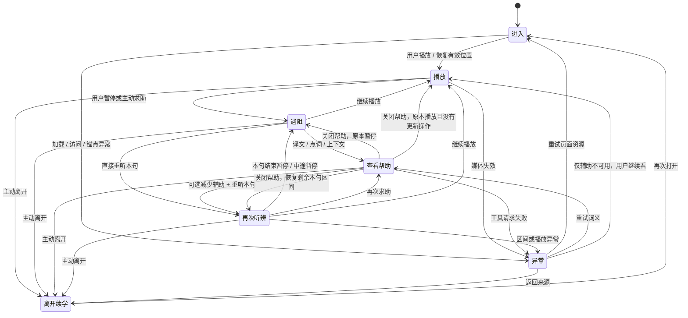

# 观看核心路径：七状态与低保真交互结构

状态：已按用户授权的实施方案更新规则；实现与验证见 [05-implementation-2026-10-21.md](05-implementation-2026-10-21.md)。主依据为用户提供的 v2.0，改造前证据见 [01-analysis.md](01-analysis.md)。

## 设计目标及已确认规则

让用户在当前观看场景完成「尝试听 → 求助 → 少一点辅助再听 → 继续/离开」，随时允许跳过求助或减少辅助。不创建闯关、听懂评分或强制结束页。

用户已确认：

- **本句重听到句末暂停**；点击文稿行则从该处连续播放，两种动作有不同名称。
- **首访默认双语**；已有字幕偏好保留，不强制无字幕首听。

其余规则与本次前后端实施方案共同作为验收依据。

## 一条状态流



七状态是体验场景，不是七个需要强制按顺序经过的页面。「遇阻」只能来自用户动作，系统不根据停顿或回放次数推断用户没听懂。「异常」可以只发生在词卡局部，不应总是替换整页。

## 一套信息骨架

保持现有导航与用户壳。下图只表示信息优先级，不决定颜色、字号和具体像素。

### 桌面

```text
返回来源  |  视频标题
来源 · 必要内容状态                       [收藏/笔记：次级]

+--------------------------------------+----------------------+
|                                      | 文稿（可收起）       |
|              视频                    | 当前句高亮           |
|                                      | 相邻上下文           |
| 播放/暂停 · 进度 · 倍速 · 全屏       | 点行从该处继续播放   |
+--------------------------------------+----------------------+
| 当前目标句  时间/句序                                       |
| 英文原句（按字幕模式）                                    |
| 中文译文（按字幕模式）                                    |
| [上一句] [重听本句] [下一句]  辅助：双语/英文/中文/关闭     |
| [继续播放]                              [收藏这句：次级]   |
+------------------------------------------------------------+
点词帮助：贴近当前句，显示词义与对应原句；有明确关闭和重听出口
```

### 手机

```text
返回来源 / 标题（现有壳）
+--------------------------------+
|              视频              |
+--------------------------------+
| 当前句：英文 / 可收起译文      |
| [上一句] [重听本句] [下一句]  |
| 辅助模式  [继续播放] [文稿]   |
+--------------------------------+
| 文稿/上下文（按需展开）       |
+--------------------------------+
全站底部导航（保留）
```

手机词卡在页面内容空间中打开，保持至少一种可用的目标句标识与关闭出口。短视口时可覆盖文稿；不得覆盖返回、关闭及重听操作。长原句必须有展开路径。不能仅靠把字缩小满足首屏。

## 七个关键状态的结构稿

### S1 进入

```text
返回来源 · 视频标题 · 来源
[封面 / 准备播放]
[播放] 或 [继续播放 · 上次位置]
字幕：双语（或已有偏好）        [文稿]
```

- 先确定进入意图与资源可用性；有记录才出现继续文案。
- 显式句子链接定位完成后显示目标时间/句子；未请求自动播放则保持暂停。
- 浏览器阻止自动播放时显示可点的播放按钮，不把被拒绝解释成用户已经播放。
- 等待历史记录时，用户一旦主动操作进度/播放，其新意图优先，晚到响应不得拉走位置。

### S2 播放

```text
[原声连续播放]
当前句随播放更新
[暂停]  [重听本句]    [译文/字幕模式]
文稿中当前行轻量高亮
```

- 画面与媒体状态为事实源；缓冲、暂停、结束分别表达。
- 正常观看无需点词、收词或逐句操作。
- 倍速改变不改变目标句身份；拖动进度按新位置更新当前句。
- 播放完成只说明媒体到达结尾；提供再看/返回等轻量出口，无「已经听懂」结论。

### S3 遇阻

```text
[视频暂停，保留画面]
目标句 · 7:53
So when you trip on something, it means you walk into it.
[查看译文/点词] [重听本句] [继续播放]
```

- 用户暂停、点词或选择某句时建立目标句上下文。
- 当前没有可靠句子时，保留普通播放和时间跳转，解释「本段暂无可用句子定位」。
- 相邻字幕若属于同一语义句，帮助区可展示上下文，但不未经校验自动合并为新的可重听区间。

### S4 查看帮助

```text
[视频暂停]
目标句不变 · 7:53
英文原句 / 中文译文
┌ 词义帮助：trip                         [关闭] ┐
│ 本句相关释义优先；完整词典按需展开           │
│ 原句来源与当前目标一致                     │
│ [词典发音] [可选收词] [重听本句]            │
└────────────────────────────────────────────┘
[少一点辅助再听] [继续播放]
```

- **已确认：**打开点词帮助暂停并保存被点句子；关闭恢复此前播放状态，原本暂停则保持暂停，原本重听则恢复剩余区间至句末。关闭不定位；期间的新操作使旧恢复指令失效。词典发音手动触发，恢复原声前停止。
- 点击词不再自动播放词典发音；用户点发音时播放，避免与原声争音。原声启动时停止词典发音。
- 快速切词只展示最后一次目标的结果；关闭后不因旧响应重开或重新填充。
- 静态词义、增强内容分别处理 loading/error；增强失败仍保留基础释义，基础失败有局部重试与关闭。
- 收词是次级可选动作。词义帮助不跳到词汇页，不要求收词才能继续。

### S5 再次听辨

```text
[原声：仅重听目标句]
目标句 · 7:53                 辅助：本次仅英文 / 本次关闭
[显示帮助] [停止重听]
句末自动暂停 → [再听一次] [继续播放] [恢复辅助]
```

- 普通「重听本句」保留当前辅助，只播放一次并停在句末。
- 「少一点辅助再听」是另一种可选重听方式：双语→英文，英文/中文→关闭；已关闭时直接重听，不伪造又减少一档。
- 临时减少辅助同时作用于当前句、全文文稿和已打开的词卡；仍保留非文本的时间/句序标识和恢复入口。
- 本次临时模式不写入长期偏好；重听结束先保留临时模式，避免句末立刻把答案亮回来。用户可恢复辅助、再次求助或继续播放。
- 点击继续播放、换句、拖进度或切视频时结束临时重听并恢复原偏好；用户显式更改字幕模式则以新选择为准。
- **已确认：**点击文稿行从该处连续看；明确「重听本句」到目标 end 暂停，两者不混用。
- 区间到期、页面异常、离开时均清理本次边界监听。手动 seek、换句和第二次重听使旧边界失效。
- 原视频内嵌字幕/文字不能由站内开关消除，必要时提示并选用适合的内容样本。

### S6 离开与续学

```text
[返回来源]
必要时显示：正在保存位置 / 保存失败可重试
不要求完成整段、收词或填写听懂自评

再次进入：[继续 · 已确认保存的位置] / [播放]
显式「听这一句」：以本次点选目标为准
```

- 定时保存仍保留；暂停、主动导航离开、页面隐藏时追加适当的保存机会，去重且防止旧请求覆盖新位置。
- 站内离开可触发保存并处理失败，不能无限阻塞退出；网络失败不能显示已跨设备保存。
- 关页/崩溃没有绝对可靠的网络保证；以服务端最后确认的位置为跨设备事实。可另评估带时间戳的同设备兜底，其失败也不能影响退出。
- 后退到已离开页面时，临时重听定时器和旧工具面板不自动复活。
- P0 保证观看位置与有效外部锚点优先级；完整恢复词汇训练会话等按 v2 归 P1。

### S7 异常

```text
返回来源始终可用
[媒体不可用：重试 / 返回来源]
或 [视频可播：本段暂无字幕，继续观看]
或 [词义失败：局部重试 / 关闭帮助]
或 [原句位置已变化：说明降级，选择继续方式]
```

- 媒体请求失败、缓冲超时、自动播放受阻、字幕缺失、译文缺失、词义失败、锚点失效、下架、登录/权限到期分开处理。
- 字幕缺失不阻止视频播放；译文缺失保留英文；词义失败不清除目标句；下架保留个人记录。
- 权限反馈只解释既有权限状态并提供合法出口，不新增付费规则或尝试绕过访问检查。
- 数据加载失败不能渲染成「没有记录」；保存失败不能显示「已保存」。

## 必要的状态边界（实现建议，不指定新框架）

| 状态               | 来源与生命周期                               | 作用                                               |
| ------------------ | -------------------------------------------- | -------------------------------------------------- |
| 媒体状态与位置     | 真实播放器；视频切换重置                     | ready/loading/buffering/paused/playing/ended/error |
| 跟随中的当前句     | 按媒体时钟定位                               | 正常播放高亮                                       |
| 帮助/重听的目标句  | 用户点击时捕获 video/subtitle/start/end/text | 不能随着后台时钟或全片同词搜索而变化               |
| 字幕长期偏好       | 复用 watchStore                              | 用户明确选择时保存                                 |
| 本次辅助覆盖       | 当前重听任务内存                             | 不改长期设置，退出任务可恢复                       |
| 定位意图与命令代次 | 显式点击/续播/普通进入                       | 确保晚到请求、旧边界不能覆盖新动作                 |
| 保存状态           | 请求确认与最后有效位置                       | 不和「听懂」「掌握」混用                           |

这些边界可通过现有 hook 与少量纯函数实现，不需要把七个体验状态做成跨全站的重型状态机。

## 三条不能含糊的规则

1. **意图优先级：**用户最新操作 > 有效显式句/时间锚点 > 有效历史进度 > 起点。失效锚点先说明，再允许用户选择备用位置；不冒充准确命中。
2. **目标有效性：**时间需有限、非负、start < end，媒体元数据可用后再验证范围；无效时禁用本句区间播放，保留普通观看与返回。重转写后的旧 ID 不保证稳定。
3. **字幕质量：**当前行只是一段残句时，P0 样本需要人工校准可听边界；通用内容可显示相邻上下文。自动语义拼接不作为本轮无成本兜底。

## 评审焦点

双语默认、本句重听停止和词卡关闭恢复三项规则已确认，无需重复决策。真实用户任务测试仍需验证操作能否被发现、帮助是否打断理解，以及减少辅助后能否听辨目标原声；工程用例通过不等同于这些结果已验证。

默认双语与本句停止规则无需再次确认。技术误差、第三方能力与字幕质量通过验收暴露；不能通过临时换一种页面样式处理。
