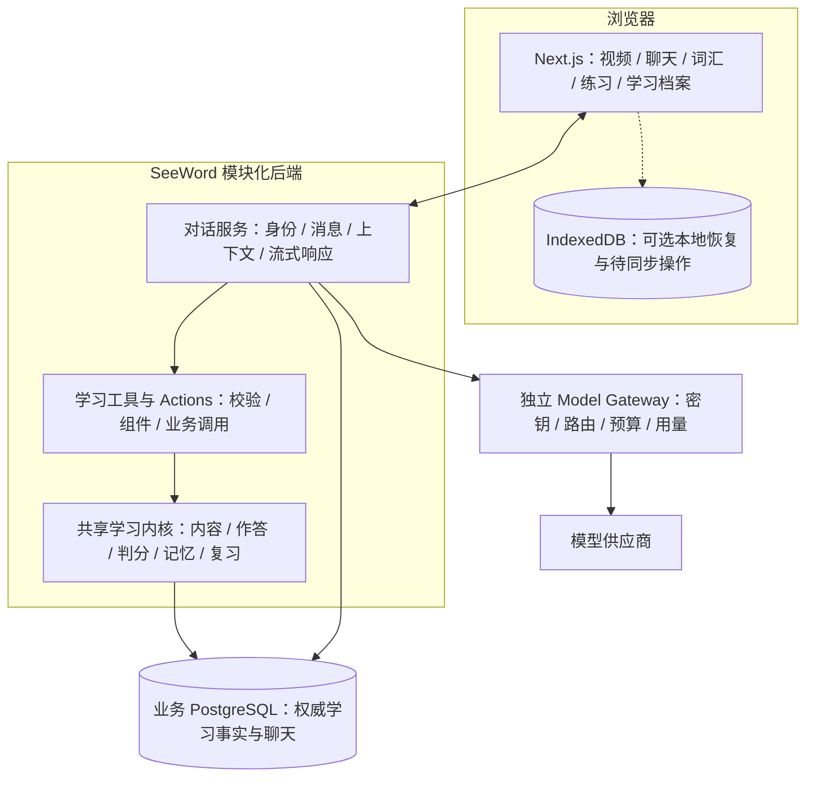

# V2 AI 学习助手实施计划：对齐 ChatGPT 的对话与学习交互

更新：2026-11-05。状态：**已按本次用户决策更新规划，尚未实施本计划新增能力**。

本文是本轮 AI 学习助手目标与后续切片的唯一说明，承接[目标框架](architecture.md)、[共同学习契约](contracts.md)和[整体实施主线](execution.md)。文档保留原文件名以兼容已有链接；P02.1 已实现的内容及实际验证仍只以[实施记录](implementation.md#p021--任务对话持久化引用回复与学习闭环)为准，不能用本计划改写现状。

本轮只保存计划、同步文档指针，业务实施保持暂停；不修改业务代码、启动服务、迁移或部署。交互描述用于确定产品行为和后端协议，不重建原型、独立前端工程或视觉设计稿。后续用户端实现需按本文语义接入，不能把后端接口完成记为完整体验交付。

## 1. 已确认的目标与取舍

- **以聊天为入口**：采用用户指定的 ChatGPT 网页版交互方向，可以不选题就开始；一段聊天能讲题、查词、看视频、练听力和组织复习。
- **教法随问题变化**：不固定为苏格拉底式提示或先讲后练。用户问释义就解释，要求提示就少量提示，要求完整解析就讲清楚；信息不足时才追问。
- **跨任务学习教练**：依据目标、可用时间、真实学习记录和相关记忆推荐下一步；用户可跳过或随时换话题。
- **聊天内可以操作**：正文之外，支持可选追问、澄清选项和学习组件；截图中的四题小测、已答进度、原位反馈是代表性需求。
- **一个老师，共用内核**：沿用模块化单体、独立模型网关与既有 GPU worker。先扩展现有运行骨架，不引入第二套执行器、评分系统或多个在线导师；本阶段不新增通用 Agent 框架。
- **保留完整 V2 目标**：V2.0–V2.2、阅读/判断/听力/视频/词汇、个人记忆、四宿主及两种外部推理模式仍按目标框架验收。先做单一材料或一个宿主只是实施切片。

### 1.1 最新范围修正：对齐聊天体验，不以自主 Agent 为前提

用户进一步明确：网页端优先对齐 ChatGPT 的对话和交互体验。产品是否需要自主 Agent 取决于任务本身，不能由“网页端”或“支持工具调用”推导出必须引入 Agent 框架；本计划也不对 ChatGPT 内部实现作假定。

当前采用 **现有 Python 后端中的对话服务 + 受控模型出口 + 按需学习工具 + Widgets/Actions**。普通问题直接流式回答；需要材料或学习记录时查询相应业务服务；练习点击直接由服务器处理。聊天历史、相关记忆、跨任务恢复和建议仍保留，但不要求系统自行拆解长期目标并在后台持续执行。

Deep Agents 与 Pi 均不作为当前底座或前置选型，不安装这两套框架，不为此新增 Node Agent 服务。上一轮“二选一优先 Deep Agents”的建议由本次范围修正取代。自主规划、子 Agent、文件/终端环境和长时间无人值守任务均不进入当前交付；将来出现具体需求再单独论证。

“跨任务教练”表示同一助手能利用已获准历史衔接不同学习活动，并按用户需要给建议；外部 Agent 四宿主仍属于原定接入目标，不等于站内必须运行复杂 Agent。现有 AgentRun/Step/Event 名称保留为执行与恢复的技术实现，不据此扩大产品能力。

架构选择是结合本仓已有治理能力的工程判断，不是框架性能实测结论。上下文筛选、明确的工具职责和任务评测可参考 [Anthropic 上下文工程](https://www.anthropic.com/engineering/effective-context-engineering-for-ai-agents)与[工具设计](https://www.anthropic.com/engineering/writing-tools-for-agents)。

## 2. 当前起点与必须解决的差距

| 当前起点（2026-11-05 静态核对） | 后续变化 |
| --- | --- |
| `teaching_runs.py` 每轮只有一个模型或 policy step；揭晓前返回固定引导 | 新导师能在当前披露范围内直接解释、追问或使用工具，不再全局套用固定回复 |
| `TeachingMessage`、`AgentRun` 强制绑定教学 session；消息还绑定题目 revision | 聊天独立存在，各消息块和工具步骤按需要关联一个或多个任务 |
| `teaching_gateway.py` 固定 128 output tokens、JSON 短答，并拒绝 tool calls | 新教练使用独立能力配置，验证工具调用、正常讲解长度与真实流式 |
| 每次 completion 都签发带整轮额度的新 key | 多步执行必须共用同一个 run 预算凭据，不能靠相同 alias 或 metadata 假定共享额度 |
| `deploy/v2-gateway/adapter/app.py` 两层转发均先读完整响应；SSE 按字符串判断 usage | 改为真实增量转发，并解析有效 usage 对象；`usage:null` 不得被当作已知用量 |
| 已有幂等、取消、epoch/revision 隔离、事件续读及当前权限投影 | 复用并扩展到跨任务和组件动作，不以增加能力为由放宽门禁 |

这些是本地代码事实与静态风险判断，不是对生产状态、真实供应商能力或教学效果的证明。原业务库迁移状态、实际消费者和服务版本仍须在实施前核查。

### 2.1 目标架构与模块映射

以下按最新“对齐 ChatGPT”要求简化用户参考图，是职责与调用关系，不代表已经部署的服务。原图四个 Engine 仅作下表的职责对照，不要求分别建设四个引擎；优先复用现有服务。

| 图中模块 | 在本计划中的职责与边界 |
| --- | --- |
| Agent API / Orchestrator | 在当前方案中收敛为对话服务，统一当前身份、聊天焦点、受控上下文和响应生命周期；分发明确动作，不持有第二套学习事实 |
| Tutor Engine | 按用户问题选择解释、提示、追问或理解检查；通过受控模型出口生成内容，写操作仍交统一命令层 |
| Interaction Engine | 组装和投影学习组件，校验 action，调用领域服务执行；组件中的分数、揭晓和进度来自领域回执，不在组件层重新判分 |
| Progress Engine | 基于实际作答、帮助和复习事件形成可追溯的派生读模型；模型错因分析保留为有来源的待验证假设，不直接修改正式成绩或能力结论 |
| Planning Engine | 读取目标、到期项、进度与相关记忆，组织复习及学习建议；调度由版本化规则执行，FSRS 按[目标框架的算法决策门](architecture.md#0-v2-目标依据与范围)推进，不恢复退役每日计划 |
| Model Gateway | 独立部署，拥有供应商凭据、模型路由、预算与 usage/cost；不管理聊天、题面、判分或学习档案，确定性作答无需经过模型 |

共享学习内核承接既有领域归属，Engine 名称不产生新的事实拥有者；个人记忆与可信材料仍由对应领域管理。运行中的队列、GPU worker 与网关拓扑继续按[整体架构](architecture.md#1-整体结构)，本图不替代部署图。

### 2.2 PostgreSQL 与 IndexedDB 的边界

业务 PostgreSQL 是学习状态、消息、题目版本、作答及事件的权威来源。IndexedDB 属于浏览器，不能画成后端并列访问的另一权威数据库；当前源码检索未发现 IndexedDB/Dexie/idb 接入，是否引入仍为用户端恢复切片的可选实现，不是后端交付前提。

如引入，只保存允许持久化的本地交互状态、用户未提交草稿和待同步命令；不缓存隐藏答案、受限材料正文、凭据或模型 key。退出登录、切换账号或删除相关数据时清理对应本地内容，不能绕过当前权限投影。

待同步命令保留原 operation_id、目标和预期版本；联网后以服务端回执核对并同步。过期版本走冲突处理，不自行换新操作编号覆盖服务器状态；未确认同步的操作不能展示为已完成或据此重新计算复习调度。跨设备恢复和跨宿主接力仍以服务器数据为准。

## 3. 交互与教学行为

### 3.1 三类交互分别定义

| 类型 | 目的与示例 | 默认行为 |
| --- | --- | --- |
| Suggested Follow-ups（推荐追问） | “再举个例子”“比较这两个词”“让我练一下” | 作为可选后续请求；点击和直接打字都可继续，不执行隐藏写入 |
| Clarifying Questions（澄清问题） | “你想问哪一道题？”“这次有多少时间？” | 只在缺失信息会改变结果或目标不明确时出现；选项之外允许自由输入 |
| Learning Widgets（学习组件） | 小测、词卡、证据定位、片段播放、复习任务 | 承载真实任务操作和状态，按组件约定触发 action 并原位更新 |

Guided Conversation 表示在有需要时引导过程，不意味着每轮必须问选择题。Generative UI 在本计划中是“模型按需选择经过定义的组件并填入结构化内容”；前端不执行模型生成的任意代码或 HTML。

官方 [ChatKit Widgets](https://developers.openai.com/api/docs/guides/chatkit-widgets)支持在聊天内呈现组件；[ChatKit Actions](https://developers.openai.com/api/docs/guides/chatkit-actions)允许组件交互触发服务器处理、组件更新或后续响应，无须用户重新发送聊天消息。这里借鉴它们的交互与事件模型，不将采用整套 SDK 当作前置。

### 3.2 自然语言与当前焦点

| 用户表达或动作 | 确定行为 |
| --- | --- |
| “这句什么意思？” | 回答词句问题；不自动视为揭晓整题 |
| “给一点提示” | 记录相应帮助，提供当前获准的有限提示 |
| “直接解析”“告诉我答案” | 目标唯一且有权限时，由命令层执行揭晓，再读取获准解析；无需重复确认 |
| 当前教学题等待回答时说“我选 B” | 作为明确教学提交，调用现有作答服务后反馈 |
| “可能是 B”“是不是 B？” | 保留讨论，不默认为提交或增加 attempt |
| 点选即时小测的答案 | 组件已明确标示“选择即提交”时，提交该题并原位反馈 |
| 正式考试中选择选项 | 仍按原流程保存草稿，明确交卷后判分，不被通用组件改成点击即交卷 |
| “继续上题”“昨天那道题” | 恢复匹配任务；存在多个合理目标时才提供简短候选 |

聊天保存当前焦点及关联任务，写动作绑定稳定目标，不以“最后一张卡片”推断题目。任务切换不丢进度。用户直接问的内容优先；连续提示无效时换讲解方法，不让学生反复猜答案。

### 3.3 截图小测的完整闭环

1. 根据当前问题和用户意愿，展示“练一下”的可选入口或直接提供相关小测；用户可继续聊天或跳过。
2. 创建服务端冻结的练习题面、选项、标准答案及解析；前端提交前不收到隐藏答案。
3. 展示题目与“已答 0/4”。用户选答后，服务器完成判分、帮助/暴露记录和操作回执，再更新该题反馈与进度。
4. 正确与否及已有解析由确定性服务返回；每次点击不必调用大模型。个性化解释、针对错因换教法或用户追问时才调用模型。
5. 允许从任一题追问“为什么另一个不行”，并将问题绑定到该题；返回聊天后小测状态保持。
6. 完成后可以推荐针对性复习；接受推荐、看完解析或说“懂了”均不等于完成复习或证明掌握。

首个切片从已核验题目或已审核模板组装小测。后续模型生成的小测必须标记为生成练习，通过结构、唯一答案、证据支持和干扰项检查后才能发布可作答组件；检查未通过不展示作答入口。所有练习保留生成/核验版本及帮助来源，不混成真题、正式成绩或未经验证的掌握度。

## 4. 后端模型、接口与动作

### 4.1 聊天与任务分离

- 新增统一 Conversation 和 Message 存储，聊天可无任务；以任务关联记录引用现有领域资源。同一任务可在另一段聊天恢复，任务进度仍归其原领域。
- 消息以 blocks 保存正文、来源引用和组件引用。每块保留必要的 task、材料 revision、引用及披露依赖，混合来源块在任一必要来源受限时整体限制。
- AgentRun 关联聊天和输入消息，原教学 session 关联变为兼容字段；Step 持有实际访问资源的版本，Event 不再强制代表单一 session revision。
- 组件定义与领域资源引用持久化；作答、判分、揭晓和完成状态从领域事实投影，不能另存一套互相矛盾的 widget 成绩。pending、loading 等仅是交互状态。
- 原教学上下文 v1 保留为考试任务适配器；导师上下文组合当前问题、焦点任务、学习目标、相关历史与受控记忆。通用英语问答可无任务、无题库引用，不伪造证据。

### 4.2 新接口边界

以下是待实现的逻辑契约，不是已经注册的 wire schema。实施时在现有 `/api/v1` 和错误 envelope 下落地：

| 接口 | 用途 |
| --- | --- |
| `POST/GET /tutor/conversations` | 创建及分页列举聊天 |
| `GET/PATCH/DELETE /tutor/conversations/{id}` | 读取、重命名、归档或删除聊天；删除语义见第 6 节 |
| `POST/GET /tutor/conversations/{id}/messages` | 发送消息及分页恢复；写入带 operation_id、聊天版本和可选任务引用 |
| `POST /tutor/conversations/{id}/actions` | 提交组件动作；绑定 widget/block、action、稳定目标、预期版本与幂等操作编号 |
| `GET /tutor/runs/{id}`、`GET /events`、`POST /cancel` | 沿用现有运行状态、游标续读和取消语义，不创建第二套执行引擎 |

动作响应返回领域回执、更新后的资源版本和组件投影；需要后续推理时才附同一运行体系下的 run 引用。历史、组件和事件读取继续使用当前身份投影，禁止缓存私有题面和解析。实体字段及实际 wire schema 在实施切片中归各自 schema 文件维护，不在多个文档复制。

### 4.3 统一命令执行层

- 自然语言和按钮进入同一命令层，绑定原始用户消息或 action、唯一目标、参数、expected revision、operation_id 和服务端身份。模型只产生提案，不能伪造 `user_ui` 或持有任意写权限。
- 明确的当前用户请求可直接执行；含糊目标显示澄清组件。只读 scope、旧按钮、模型建议、引用材料中的指令都不构成写授权。
- 客户端 action payload 一律重新校验；答案、判分结果和 actor 不信任前端。重复点击、网络重试及跨入口重放只产生一次副作用。
- 由 run 派发的写命令，须按统一锁顺序，在提交领域变化的同一事务内复查 run 状态、lease_epoch、取消标志、当前授权和目标 revision，并原子提交命令回执；不能仅在模型请求或最终回复时检查。无需模型的直接组件动作仍按领域事务校验并提交，不为每次点击额外创建模型 run。
- 自己的动作改变任务版本时，仅据本 run 已提交命令的 `before_revision → after_revision` 回执更新对应依赖，再重建上下文；不能无条件接受最新版本。外部写入、授权变化和其他资源版本仍独立阻断旧结果。
- 工具成功且事务提交后才能展示成功回执。异步后续讲解失败不撤销已提交作答，也不把未完成工具写成成功。

## 5. 对话服务、上下文与模型出口

### 5.1 单轮对话与按需工具

默认路径为“接收消息 → 组装相关上下文 → 一次模型请求 → 流式展示并保存”。不先生成任务规划，也不为普通问答启动多步工作流。需要检索或操作时才调用学习工具，必要时再让模型结合工具结果回复；工具调用是对话增强，不要求引入通用 Agent harness。

首批工具覆盖授权材料搜索、任务上下文、原文/时间定位、词典查询、学习证据、到期复习及任务打开；写操作统一走第 4 节命令层。工具返回有界、带来源的结果，不暴露任意数据库、脚本执行或任意 URL 访问。组件判分与更新可不调用模型。

按需工具增强启用后，每 run 的保护上限仍为最多 3 次模型调用、4 次工具调用，串行执行；这些是上限，不是每次对话必须完成的步骤。排队上限沿用 60 秒，认领后执行硬期限 60 秒，单次模型调用最多 25 秒，均受剩余时间与预算进一步限制。达到上限返回已有结果和明确状态，不额外调用模型“总结一下”。

每轮按需组装相关材料、任务状态、学习目标、用户近期答案与理由、已使用帮助、最近对话和相关记忆。长历史使用带来源依赖的结构化摘要；消息完整保存不等于完整发送给模型。材料或记忆撤回时，历史摘要和检索缓存同样失效。

### 5.2 预算与真实流式

- 整轮只签一个 run 凭据并供所有模型 step 共用，绝对过期时间绑定执行 deadline，不能每步重新发满额 key 或延长期限。崩溃后不确定的已派发 step 不自动重放或另发满额凭据。
- 保留当前 global `$1/day`、user `$0.10/day`、run `$0.02` 硬上限，usage/cost 仍只归网关。若预算不能支持合格回答，明确记录能力/成本约束，不能绕过预算或声称短截断回答已达标。
- 新教练能力配置从 4096 input、1024 output tokens 上限验证；与旧 128-token 模式隔离。请求长度、token 上界和预算预占须一致；超长材料按相关片段检索，不直接截断关键题干。实际供应商工具调用、截断率和讲解质量通过后才启用。
- 两层代理实施增量转发；解析跨网络块的 SSE、tool-call 参数片段及有效 usage。缺 usage 或 `usage:null` 走保守结算并保持未知标记，不当作零用量。
- 正文使用有序、不可变的已提交 text blocks，持久化后发布；事件携带稳定 message_id/block_id 和事件序号，按当前权限投影，客户端按序号与 block_id 去重，只追加未展示块。组件状态更新另带 widget_revision，旧版本不覆盖新状态；不通过反复读取同一可变正文块来模拟增量输出。
- 组件定义完整校验后才可点击，半截 JSON 不执行动作；生成中的消息与已完成消息区分。不展示隐藏推理或供应商原始错误。
- 停止或权限变化后禁止新输出和新步骤；已发送上游请求继续排空结算。阻止后续披露不等于能够收回已经展示给用户的文字。重连与历史恢复不重新启动模型。

## 6. 记忆、学习建议与生命周期

记忆和账号生命周期继续遵守 [CTX06](contracts.md#ctx06-记忆与账号生命周期)，本计划增加以下接入语义：

- “记住我喜欢先看原句”可直接保存为用户陈述；模型从答题推断的错误模式进入未确认候选，保留来源，不从一次错误下稳定诊断。
- 推荐结合目标、可用时间、到期复习和真实近期事件；无历史时给一般建议，不声称了解薄弱点。推荐可以解释依据并跳过；默认在用户进入或询问时提供，不新增后台通知或恢复退役每日计划。
- 首期用 PostgreSQL 结构化过滤与来源检索；尚无检索评测证明需要前，不新增向量或图数据库。
- 聊天删除后不再读取其消息和摘要；由该聊天原话派生、失去唯一有效来源的记忆同步失效。明确说“忘记这件事”则删除对应记忆及其派生检索/摘要，并阻止旧任务重新提取；不隐式删除原始作答或正式成绩。
- 聊天可归档；归档保留可恢复内容，不等于删除。聊天、记忆和领域任务分别删除，删除一题不能级联删除整段多任务聊天。
- 导出、注销及当前权限投影覆盖消息、组件、任务关联、摘要、记忆与检索记录；短期 run 清理不删除长期聊天，跨系统清理继续有意图与回执。

## 7. 实施切片、兼容与回退

下列是 P02 后续细化，和整体 P03–P06 衔接；**保存本文不启动这些切片**。

| 顺序 | 交付切片 | 最小出口与消费者 |
| --- | --- | --- |
| P02.2 | 单轮模型出口与真实流式 | 一次正常对话可流式输出，usage:null、取消结算与网关预算通过；后续启用工具续答前另验证同 run 多次调用共享额度及参数分片 |
| P02.3 | 独立聊天、消息和任务关联 | 无任务聊天及两任务切换可恢复；旧教学消息接口同源兼容，导出注销覆盖 |
| P02.4 | 统一 actions 与即时学习组件 | 核验材料组成四题小测，点击/文字走同一命令层，原位反馈、幂等及正式测评边界通过 |
| P02.5 | 按需工具增强与教学质量 | 提示/完整解析/词句问答/追问均可，引用定位可核对；需要工具时共享预算、停止/重试及实际教学质量通过，不以自主规划为出口 |
| P04 关联切片 | 记忆、跨任务建议和其余材料 | 可解释推荐、记忆纠错删除及跨材料恢复；与词汇 occurrence、逐次复习日志和调度版本衔接 |
| P03/P05/P06 关联 | 外部接力、运营及最终发布 | 四宿主/两模式、权益成本、实际迁移与回退分别取得证据，不以单个组件替代 |

在不改变顺序的前提下，各切片可并行准备静态 schema、隔离测试和材料；真实模型、真实内容来源与使用权证据仍是启用出口，不阻止无关的独立准备。外部自行推理可按原 P03 使用确定性内核先验证，不等待平台老师全部完成。

迁移先核查真实 schema 和消费者。每个旧教学 session 回填一个聊天及任务关联，旧消息保留 ID、顺序和材料依赖；新存储成为唯一消息写入点，旧消息端点按对应任务过滤投影。原 cards 请求摘要、领域 API 和外部权限保持兼容；旧表/列的删除另做后置迁移。

上线先关闭新增能力，隔离 PG 演练回填、历史权限及旧入口对照后按能力切流。回退关闭新入口/组件动作和模型循环，保留已产生消息与领域事实供读取恢复；不以删表或删除用户学习记录作为回退。SDK/UI 替换不得改变学习状态拥有者或引入第二份权威聊天历史。

## 8. 验收与证据

| 类别 | 必测场景 | 对应整体验收 |
| --- | --- | --- |
| 聊天与教学意图 | 无任务提问、释义、有限提示、直接解析、明确/含糊作答、任务指代、跨任务恢复 | AC03–06、AC14 |
| 组件与命令 | 四题小测进度/反馈、每题追问、重复点击、旧组件版本、撤权、文字/按钮同一操作；正式测评只保存草稿 | AC03–05、AC14 |
| 执行与流式 | 同 run 累计预算、重派发不重发满额 key、期限、usage 三种状态、取消与 late settle、参数碎片、重连不重启或重复文本 | AC06、AC08、AC12 |
| 跨资源隔离 | A 题揭晓不泄漏 B 题、来源撤回后的消息/摘要/组件、自己动作版本更新、外部版本冲突、过期 worker | AC03–06 |
| 记忆与账号 | 自述/推断区分、纠正/过期/删除、删除后缓存/旧任务复活、聊天删除与任务保留、导出注销 | AC07、AC11 |
| 兼容与生态 | 旧 API/cards/消息 ID、隔离迁移回填、前向回退、四宿主与两模式的真实接力 | AC02、AC09、AC13–15 |

若后续采用 IndexedDB，另验账号隔离/退出清理、草稿恢复、同 operation_id 重传、离线操作与服务器版本冲突；本地缓存不得恢复被撤回材料、泄露隐藏答案或伪造已完成状态。未引入时不把离线恢复写成已实现能力。

教学质量从 20 道核验题和 10 条错误路径起步，补齐跨任务场景；同一输入比较旧短答与新导师，记录意图遵循、重大答案错误、证据支持、提示泄漏、理解检查、延迟、截断及每轮实际成本。结构合法或引用 ID 存在不能代替解释正确；重大答案错误、未授权披露/写入、重复副作用和预算失控沿用整体阻断门。

学习效果预先定义即时检查及 1 天、7 天独立复测口径，单列提示/揭晓污染、未参加复测和真实样本数；不把即时辅助正确率当作独立掌握。该方向参考 [PNAS 关于生成式 AI 辅导与独立表现的研究](https://www.pnas.org/doi/10.1073/pnas.2422633122)，数学场景结果不作为 SeeWord 英语学习效果已成立的证据。

本文各项新增功能的验收当前均为**未执行**；历史已执行结果不重计。此次文档更新只验证文件、链接及前后表述，不调用真实模型、不执行功能/数据库/浏览器验收。完整放量继续以[总验收标准](acceptance.md)为准。

## 9. ChatKit 的采用边界与参考

采用 Widgets/Actions 的交互思想，先定义服务端组件/action 契约。ChatKit 作为候选 UI 适配层保留；本轮不安装、不迁移，不引入 Agent Builder 作为运行前提。后续接入前以同一四题小测验证自有认证、现有设计系统、消息恢复、动作幂等和网关兼容，具体包版本与许可届时核对。

官方资料已于 2026-11-05 阅读，SDK 是否满足本项目尚未实测：

- [ChatKit 总览](https://developers.openai.com/api/docs/guides/chatkit)：支持自定义服务集成，可连接自有 Agent 服务；不要求将学习内核迁走。
- [ChatKit Widgets](https://developers.openai.com/api/docs/guides/chatkit-widgets)：聊天内组件及结构化布局。
- [ChatKit Actions](https://developers.openai.com/api/docs/guides/chatkit-actions)：组件事件、服务端处理、状态更新；客户端 payload 仍需服务端校验。
- [ChatKit 自定义集成](https://developers.openai.com/api/docs/guides/custom-chatkit)：自托管与组件/action 接入方式。
- [OpenAI 的自然语言交互说明](https://learn.chatgpt.com/docs/use-chatgpt)：通过连续消息补充上下文与调整结果，作为聊天体验参考。
