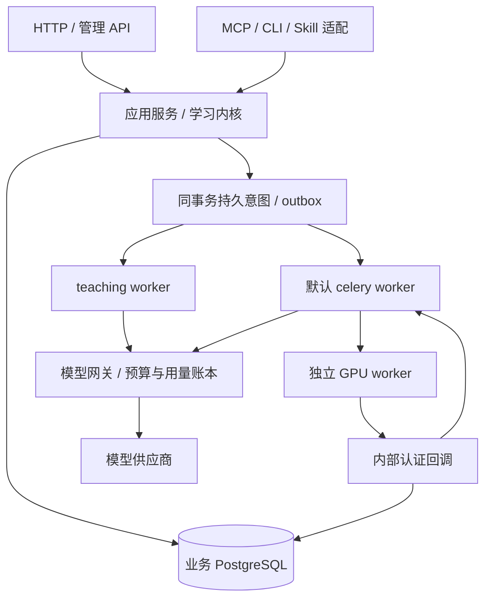

# 后端目标框架与边界

## 0. V2 目标依据与范围

2026-11-05 对齐：后端以 V2 产品能力为终态，存量修复服务于该终态。产品原稿《SeeWord 产品与技术一体化方案 V2.0》已在本机核对，来源见[原稿评审](../../docs/v2-plan-review-2026-10-31.md)开头；[技术设计](../../docs/v2-technical-design-2026-10-31.md)提供教学事务、内容版本和运行机制，[方向对齐](../../docs/v2-direction-alignment-2026-11-02.md)更新三层路线、独立网关与个人记忆。它们的旧阶段状态、测试数字和候选实现不作为当前完成证据。

用户后续要求优先：V2.0–V2.2 均纳入最终验收，四宿主分别验证，两种推理模式共用学习记录；既有工程实施限后端。后续研究新增 [Agent 交互目标与实施计划](agent-plan.md)，用于确定后端消息、组件和动作语义，不重建原型、独立前端工程或视觉设计稿；本轮仅更新文档，业务实施仍暂停。历史文档中“首版只做阅读”“一个宿主”“记忆后置”仅作阶段切片，不能删减最终目标。独立网关取代早期进程内网关倾向；具体候选代码可替换，V2 能力边界保留。

| 目标编号 | V2 必须形成的后端能力 | 规则与验收位置 |
| --- | --- | --- |
| V201 | 可信材料内核：来源/许可、稳定身份、不可变 revision、证据和解析发布/撤回；正式考试使用冻结题面并与辅助教学分开 | content/assessment/teaching；CTX02–03、CTX08，AC04–05 |
| V202 | 同一任务保存初答、草稿、提示、复答、揭晓和帮助来源，服务端判分；网页/外部读写共享业务服务和恢复状态 | teaching；CTX01–03，AC03–05、AC14 |
| V203 | 平台老师：独立于学习任务的持久聊天、跨任务辅导、动态学习组件与受控动作、可恢复 run/SSE、停止/重试与版本隔离；支持阅读、判断、听力和视频/词汇教学 | tutor_runtime 与材料适配；[Agent 计划](agent-plan.md)、CTX02–04，AC06、AC14 |
| V204 | 个人记忆：来源、自述/证据/推断区分、确认、纠正、编辑、删除、过期和受控检索；接入教学及导出/注销 | memory/account_lifecycle；CTX06，AC07、AC11 |
| V205 | 视频语境与词汇复习：一个词关联多个真实 occurrence，保存字幕/时间定位；逐次复习日志、调度版本、到期任务和跨入口回写 | video/vocabulary；AC15；调度迁移边界见下文 |
| V206 | BYOA：外部自行推理与平台托管分别授权/计量；HTTP/MCP/CLI/Skill 复用同一内核，Codex/Claude/DSH/WorkBuddy 逐个闭环 | connections；CTX01、CTX05，AC08–09、AC14 |
| V207 | 可收费运营：权益/额度、真实到账与对账、预算、内容核验和版本发布后台 API、调用审计、账号生命周期、监控与回退 | entitlement/billing/operations；AC08、AC10–13 |

复习算法：V2 原稿包含 FSRS 目标；旧开发计划的自研影子与当前 S6 是已识别的分歧，不能将保留 S6 宣布为满足 V2。实施时先完成 occurrence、逐次日志和可回放的版本接口，再核验 FSRS 候选、许可、映射与迁移评估，记录最终决策后切换；这一轮不切生产算法，也不复制实现或降低门禁。若拟改掉原稿目标，必须明确记录范围决策。

V2 的产品出口是可信学习与跨入口连续性，具体实施顺序统一见[实施包](execution.md)。完成存量拆分、模型选型或协议连通中的任一项，均不能单独算上述目标完成。

## 1. 整体结构

采用**模块化单体 + 独立 GPU worker + 独立模型网关**。继续使用 FastAPI、SQLAlchemy async、PostgreSQL、Redis、Celery。重构的目标是减少职责混杂与重复实现，不是增加微服务数量或套一层通用 Agent 框架。

这是目标能力边界，不是对未提交 V2 代码的保留承诺。试做可以舍弃；选型与实现是否采用，以 [审查结论](review.md) 和后续真实验证为准。已实施切片见[实施记录](implementation.md)，尚未建设新网关或新领域目录。



图中默认 worker→网关是统一迁移后的目标；历史调用是否已接入，必须按现状清单验证。网关可以自带独立存储/限流设施，不把这些设施当作业务事实源。

按用户最新要求，站内优先对齐 ChatGPT 的对话体验，以现有 Python 对话服务、按需学习工具和组件动作实现；不将 Deep Agents/Pi、自主规划或四个独立 Engine 作为当前前提。简化后的调用关系及原图职责对照见 [AI 学习助手逻辑架构](agent-plan.md#21-目标架构与模块映射)，外部 Agent 接入目标保持。

## 2. 模块与数据归属

| 领域 | 拥有的事实与写入 | 对外应用能力 |
| --- | --- | --- |
| identity | User、会话、账号状态、授权主体 | 解析身份、校验账号有效性 |
| entitlement | 会员有效期与功能权益 | 统一准入；试用、白名单、商业授权分别明确 |
| content | 材料身份、revision、来源/许可、发布撤回 | 按 site/model/external 投影允许内容 |
| video | Video/Subtitle、处理状态、字幕与播放来源 | 入库、转录回调、重试、媒体定位 |
| vocabulary | 生词/词集、多语境 occurrence、逐次复习日志与调度版本 | 查词、收词、筛词、到期任务、记录和回放复习 |
| assessment | 整卷/听力快照、答案、确定性判分 | 建会话、存草稿、正式提交、历史结果 |
| teaching | 教学 session/item/attempt/exposure/operation | 明确作答、分层提示、揭晓、反馈与恢复 |
| tutor_runtime | 聊天消息与任务关联、组件定义/引用、run/step/event、租约、取消与运行版本 | 创建/执行/查询/取消、对话与组件恢复、事件续读；领域进度仍由对应领域拥有 |
| memory | 个人记忆、来源、确认/过期/删除和检索记录 | 本人 CRUD、授权检索、纠错与失效 |
| connections | 连接、凭据、scope、协议适配记录 | 授权、轮换、撤销、调用身份转换 |
| library | 用户收藏、笔记、订阅与历史引用 | 个人资料查询/写入，不复制材料和成绩 |
| billing | 订单/收款事实、发放记录、对账 | 校验到账、幂等发放、退款/异常处理 |
| operations | 反馈、公告、通知、系统设置与人工操作审计 | 编排后台操作，调用对应业务域服务 |
| analytics | 学习事件投影、档案和运营聚合 | 可重建读模型与业务指标 |
| account_lifecycle | 导出、注销、跨域删除意图与回执 | 编排生命周期，不复制各域原始数据 |

模型网关拥有 provider key、路由、上游重试、预算与 usage/cost；业务库只存调用关联与生命周期收据。内容系统不拥有用户成绩，运行时不拥有标准答案，统计不反写学习事实，外部入口不拥有第二套教学规则。

## 3. 目录与依赖标准

上表是逻辑职责，不要求创建十五个一级业务包。短期保留现有 `api/services/models/schemas/tasks`，先修正反向依赖和事务边界。只有一个切片的职责、公共服务接口及消费者稳定后才迁目录；目录树是渐进终态，不是本轮任务清单。

```text
backend/app/
  main.py                     # 装配与生命周期
  api/                        # HTTP/内部回调适配，保持现有 URL
  integrations/               # MCP 等外部协议适配
  domains/<上述领域>/         # 随切片逐步归拢，不提前创建空目录
    service.py                # 用例编排与事务内写入
    schemas.py                # 领域输入/输出；明确与 wire DTO 的映射
    models.py                 # 该域拥有的 SQLAlchemy 实体
    rules.py                  # 需要独立测试的纯规则；没有需要就不建
  core/                       # 数据库、配置、安全、错误、日志等基础能力
  tasks/                      # 队列入口、重试/巡检和调度装配
```

- 依赖方向：适配层→应用服务→本域规则/模型与基础设施。协议、供应商 SDK 和任务消费者不能反向被纯判分规则依赖。
- 跨域写入调用拥有者的应用服务，不直接跨域修改 ORM 对象。跨域读取可使用明确的读模型，不能扩散任意 join 到所有路由。
- 不强制每表一个 repository、不先引入通用工作流引擎、不把 `utils` 变成业务规则仓库。按业务原因拆分大文件，避免只把同一个大服务换目录。
- 迁移期间旧 import 路径保留兼容 re-export；模型仍由 `app/models/__init__.py` 保证 metadata 注册。只有迁移所有消费者后才能移除兼容层。
- 物理搬迁不改变表名、任务名或公共 API；这些变化需要独立契约与迁移理由。
- 保留已退役功能的兼容边界；内容入库/处理仍由管理员或 catalog 触发，不新增未经授权的用户投稿路径。AI 调用继续遵守现有 service 层入口和 TID251 门禁。
- 记忆先使用业务 PostgreSQL 的结构化字段、来源和索引，不把新的向量/图数据库作为重构前置。

## 4. 事务和队列

一次用户写操作由一个事务拥有者负责最终提交。工作区教学 service 使用同一 `AsyncSession` 并 flush，HTTP/MCP 入口负责 commit，可作为候选约定；现有支付、考试、词汇的 commit 位置各不相同，不能宣称全项目已统一。先逐用例登记事务拥有者，不在下层辅助函数偷偷 commit。

学习事实与可丢失埋点分别选择写入口：`learning_event_service.record_event` 用于需要同业务写入原子提交的事实，失败由事务拥有者处理；`emit_event` 是原有生产者的 savepoint 容错入口。两者共享事件和投影实现，不建立第二套总线。实际迁移到哪条入口只登记在实施记录，不能从函数存在推断所有学习流程都已具备必达性。

教学写入在同一事务里完成：账号/scope/状态校验→按统一顺序锁资源→检查幂等→检查 expected_revision→写 attempt/exposure/operation→写 outbox→推进版本。幂等重放必须先识别，不能因请求旧 revision 而把成功重试误判为失败。

数据库提交和消息派发之间保留持久意图。视频沿用已提交的 pipeline outbox；教学重做时可借鉴试做的 queued run 与 sweep，是否采用另行验收，不并存两套互相竞争的派发账本。消费者重复执行不得重复判分、重复发事件或重复收费。通知推送须发生在提交之后，需可靠送达的通知另用同事务持久意图。

目标三类队列：默认 `celery`、独立 `teaching`、独立 GPU 转录队列；HEAD 已有默认和 GPU，teaching 属于试做。保留旧 GPU 任务名与认证回调；禁止把转录依赖带回云端 API。SSE 只订阅持久事件，不在连接里执行模型任务。

## 5. 两种外部推理模式

外部自行推理：SeeWord 提供授权内容、证据、提示、学习工具与持久进度；宿主自己调用模型。平台托管：同一学习内核增加受控模型调用，使用网关预算和站内用量规则。

两者共用身份、内容 revision、教学状态和记录；区分 mode、来源与费用。外部作答标为辅助转述、独立性未知，不覆盖正式成绩。由这套可信内容和持续学习事实形成产品积累，而不是依赖某个宿主的聊天历史。

## 6. 商业与运维底线

商业准入与私测开关分开；不能为开放付费而直接取消账号校验、披露限制或治理门。正式收费需要实际收款和可持续成本证据，本次不冻结新定价。

监测 API 错误、run/队列积压、租约超时、幂等冲突、outbox 重复、网关预算阻断与未知用量、收款异常、删除未确认意图。保留现有错误 envelope、request-id、健康检查与脱敏，配置/凭据不写进文档。
